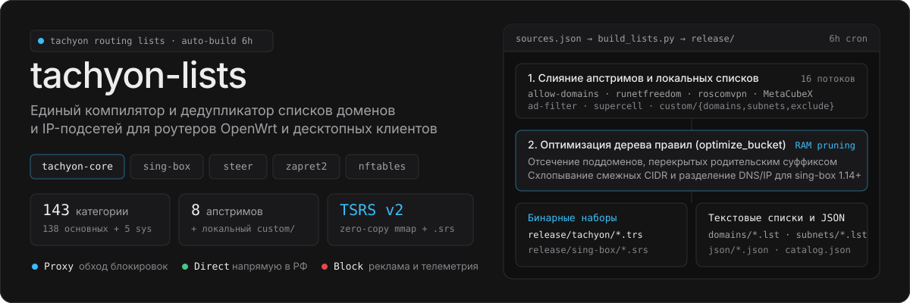
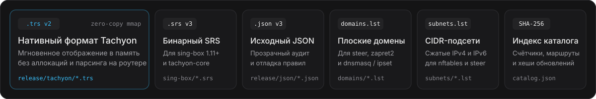
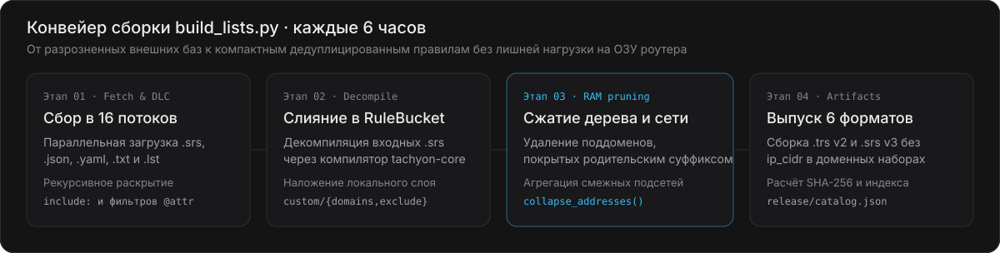
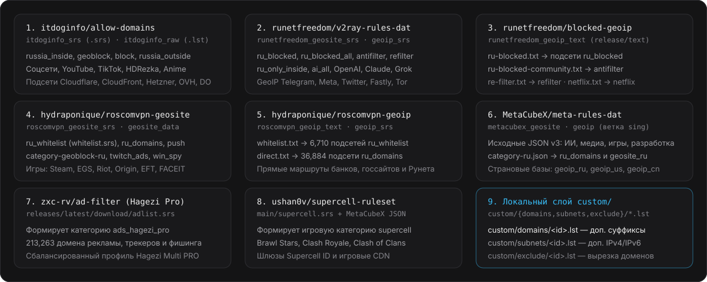
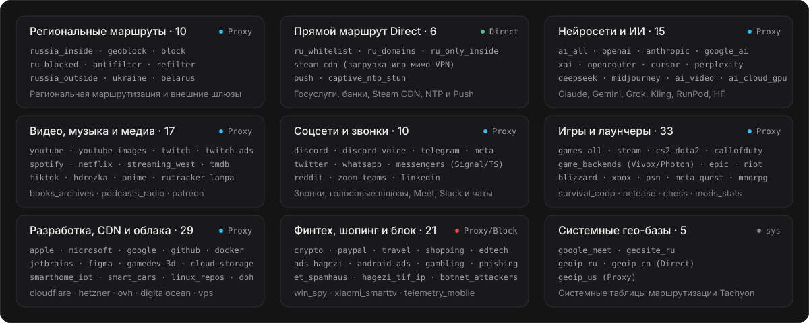

<p align="center">
  
</p>

<p align="center">
  <a href="https://github.com/Dushnilin/tachyon-lists/actions/workflows/build.yml"></a>
  <a href="https://github.com/Dushnilin/tachyon-lists/releases/tag/latest"></a>
  <a href="./release/catalog.json"></a>
  <a href="./sources.json"></a>
</p>

---

<p align="center">
  
</p>

<p align="center">
  
</p>

| Целевая система | Артефакт | Шаблон прямой ссылки (`raw` / `releases`) |
|:---|:---|:---|
| **`tachyon-core` (Zero-Copy mmap)** | `release/tachyon/<id>.trs` | `https://raw.githubusercontent.com/Dushnilin/tachyon-lists/main/release/tachyon/<id>.trs`<br>`https://github.com/Dushnilin/tachyon-lists/releases/download/latest/<id>.trs` |
| **`sing-box` / `tachyon-core`** | `release/sing-box/<id>.srs` | `https://raw.githubusercontent.com/Dushnilin/tachyon-lists/main/release/sing-box/<id>.srs`<br>`https://github.com/Dushnilin/tachyon-lists/releases/download/latest/<id>.srs` |
| **Исходник `sing-box` v3** | `release/json/<id>.json` | `https://raw.githubusercontent.com/Dushnilin/tachyon-lists/main/release/json/<id>.json` |
| **`steer` / `zapret2` / `dnsmasq`** | `release/domains/<id>.lst` | `https://raw.githubusercontent.com/Dushnilin/tachyon-lists/main/release/domains/<id>.lst` |
| **`nftables` / `steer` / `ipset`** | `release/subnets/<id>.lst` | `https://raw.githubusercontent.com/Dushnilin/tachyon-lists/main/release/subnets/<id>.lst` (также `subnets/ipv4/<id>.lst` и `ipv6/<id>.lst`) |
| **Индекс и `SHA-256` хеши** | [`release/catalog.json`](release/catalog.json) | `https://github.com/Dushnilin/tachyon-lists/releases/download/latest/catalog.json` |

<details>
<summary><b>Пример подключения в <code>sing-box</code> (1.11+ / 1.14+) и команды локальной сборки (<code>build_lists.py</code>)</b></summary>

<br>

Все доменные категории (`kind: "domains"`) гарантированно **не содержат `ip_cidr`** внутри `.srs`, поэтому совместимы с `dns.rules` в `sing-box 1.14+` без ошибки `rule-set with IP CIDR rules requires match_response`:

```json
{
  "route": {
    "rule_set": [
      {
        "tag": "ru_whitelist",
        "type": "remote",
        "format": "binary",
        "url": "https://raw.githubusercontent.com/Dushnilin/tachyon-lists/main/release/sing-box/ru_whitelist.srs",
        "download_detour": "direct",
        "update_interval": "6h"
      },
      {
        "tag": "ai_all",
        "type": "remote",
        "format": "binary",
        "url": "https://raw.githubusercontent.com/Dushnilin/tachyon-lists/main/release/sing-box/ai_all.srs",
        "download_detour": "proxy",
        "update_interval": "6h"
      },
      {
        "tag": "ads_hagezi_pro",
        "type": "remote",
        "format": "binary",
        "url": "https://raw.githubusercontent.com/Dushnilin/tachyon-lists/main/release/sing-box/ads_hagezi_pro.srs",
        "download_detour": "proxy",
        "update_interval": "12h"
      }
    ],
    "rules": [
      { "rule_set": ["ads_hagezi_pro"], "action": "reject" },
      { "rule_set": ["ru_whitelist"], "outbound": "direct" },
      { "rule_set": ["ai_all"], "outbound": "proxy" }
    ]
  }
}
```

**Локальная сборка и кастомизация (`custom/`):**

```bash
python3 build_lists.py                                             # Полная сборка всех 146 категорий
python3 build_lists.py --only ru_whitelist geoblock ai_all         # Выборочная пересборка
```

- `custom/domains/<id>.lst` — добавить свои домены (`domain_suffix`) в категорию `<id>`.
- `custom/subnets/<id>.lst` — добавить свои IPv4/IPv6 CIDR в категорию `<id>`.
- `custom/exclude/<id>.lst` — принудительно вырезать домены или IP/CIDR-подсети из категории `<id>` до компиляции.

</details>

---

<p align="center">
  
</p>

<p align="center">
  
</p>

---

<p align="center">
  
</p>

<p align="center">
  
</p>

<p align="center">
  <sub>Прямые ссылки на апстрим-репозитории из <a href="./sources.json"><code>sources.json</code></a>:
  <a href="https://github.com/itdoginfo/allow-domains"><b>itdoginfo/allow-domains</b></a> ·
  <a href="https://github.com/runetfreedom/russia-v2ray-rules-dat"><b>runetfreedom/russia-v2ray-rules-dat</b></a> ·
  <a href="https://github.com/runetfreedom/russia-blocked-geoip"><b>runetfreedom/russia-blocked-geoip</b></a> ·
  <a href="https://github.com/hydraponique/roscomvpn-geosite"><b>hydraponique/roscomvpn-geosite</b></a> ·
  <a href="https://github.com/hydraponique/roscomvpn-geoip"><b>hydraponique/roscomvpn-geoip</b></a> ·
  <a href="https://github.com/MetaCubeX/meta-rules-dat"><b>MetaCubeX/meta-rules-dat</b></a> ·
  <a href="https://github.com/zxc-rv/ad-filter"><b>zxc-rv/ad-filter</b></a> ·
  <a href="https://github.com/ushan0v/sing-box-supercell-ruleset"><b>ushan0v/sing-box-supercell-ruleset</b></a></sub>
</p>

<details>
<summary><b>Пофайловая матрица источников для всех категорий (<code>sources.json</code> → входные файлы и <code>fallback_srs</code>)</b></summary>

<br>

| ID | Группа | `kind` | Входные источники (`sources` в `sources.json` + `custom/`) | Резервный `fallback_srs` |
|:---|:---:|:---:|:---|:---|
| `russia_inside` | `regional` | `domains` | `itdoginfo_srs/russia_inside.srs` + `roscomvpn_geosite_srs/category-geoblock-ru.srs` + `runetfreedom_geosite_srs/geosite-refilter.srs` + `geosite-ru-blocked.srs` + `custom/domains/russia_inside.lst` | `itdoginfo` → `russia_inside.srs` |
| `geoblock` | `regional` | `domains` | `itdoginfo_srs/geoblock.srs` + `roscomvpn_geosite_srs/category-geoblock-ru.srs` + `custom/domains/geoblock.lst` | `itdoginfo` → `geoblock.srs` |
| `block` | `regional` | `domains` | `itdoginfo_srs/block.srs` | `itdoginfo` → `block.srs` |
| `ru_blocked` | `regional` | `domains` | `runetfreedom_geosite_srs/geosite-ru-blocked.srs` + `runetfreedom_geoip_text/ru-blocked.txt` | `runetfreedom` → `geosite-ru-blocked.srs` |
| `ru_blocked_all` | `regional` | `domains` | `runetfreedom_geosite_srs/geosite-ru-blocked-all.srs` + `runetfreedom_geoip_text/ru-blocked-community.txt` | `runetfreedom` → `geosite-ru-blocked-all.srs` |
| `antifilter` | `regional` | `domains` | `runetfreedom_geosite_srs/geosite-antifilter-download-community.srs` + `runetfreedom_geoip_text/ru-blocked-community.txt` | `runetfreedom` → `geosite-antifilter-download-community.srs` |
| `refilter` | `regional` | `domains` | `runetfreedom_geosite_srs/geosite-refilter.srs` + `runetfreedom_geoip_text/re-filter.txt` | `runetfreedom` → `geosite-refilter.srs` |
| `russia_outside` | `regional` | `domains` | `itdoginfo_srs/russia_outside.srs` + `runetfreedom_geosite_srs/geosite-ru-available-only-inside.srs` | `itdoginfo` → `russia_outside.srs` |
| `ukraine_inside` | `regional` | `domains` | `itdoginfo_srs/ukraine_inside.srs` + `itdoginfo_srs/russia_outside.srs` + `roscomvpn_geosite_srs/whitelist.srs` + `runetfreedom_geosite_srs/geosite-ru-available-only-inside.srs` + `custom/domains/ukraine_inside.lst` | `itdoginfo` → `ukraine_inside.srs` |
| `ru_whitelist` | `direct` | `domains` | `roscomvpn_geosite_srs/whitelist.srs` + `roscomvpn_geoip_text/whitelist.txt` | `roscomvpn` → `whitelist.srs` |
| `ru_domains` | `direct` | `domains` | `roscomvpn_geosite_srs/category-ru.srs` + `runetfreedom_geosite_srs/geosite-category-ru.srs` + `metacubex_geosite/category-ru.json` + `roscomvpn_geoip_text/direct.txt` | `roscomvpn` → `category-ru.srs` |
| `ru_only_inside` | `direct` | `domains` | `runetfreedom_geosite_srs/geosite-ru-available-only-inside.srs` | `runetfreedom` → `geosite-ru-available-only-inside.srs` |
| `push` | `direct` | `domains` | `roscomvpn_geosite_srs/push.srs` | `roscomvpn` → `push.srs` |
| `ai_all` | `ai` | `domains` | `runetfreedom_geosite_srs/geosite-category-ai-!cn.srs` + `itdoginfo_srs/google_ai.srs` + `roscomvpn_geosite_srs/google-deepmind.srs` + `runetfreedom_geosite_srs/geosite-google-gemini.srs` + `geosite-deepseek.srs` + `metacubex_geosite/category-ai-!cn.json` + `deepseek.json` + `custom/domains/ai_all.lst` | `runetfreedom` → `geosite-category-ai-!cn.srs` |
| `openai` | `ai` | `domains` | `runetfreedom_geosite_srs/geosite-openai.srs` + `metacubex_geosite/openai.json` | `runetfreedom` → `geosite-openai.srs` |
| `anthropic` | `ai` | `domains` | `runetfreedom_geosite_srs/geosite-anthropic.srs` + `metacubex_geosite/anthropic.json` + `custom/domains/anthropic.lst` | `runetfreedom` → `geosite-anthropic.srs` |
| `google_ai` | `ai` | `domains` | `itdoginfo_srs/google_ai.srs` + `roscomvpn_geosite_srs/google-deepmind.srs` + `runetfreedom_geosite_srs/geosite-google-gemini.srs` + `metacubex_geosite/google-gemini.json` + `custom/domains/google_ai.lst` | `itdoginfo` → `google_ai.srs` |
| `xai` | `ai` | `domains` | `runetfreedom_geosite_srs/geosite-xai.srs` + `metacubex_geosite/xai.json` + `custom/domains/xai.lst` | `runetfreedom` → `geosite-xai.srs` |
| `openrouter` | `ai` | `domains` | `runetfreedom_geosite_srs/geosite-poe.srs` + `geosite-groq.srs` + `geosite-cerebras.srs` + `metacubex_geosite/{poe,groq,cerebras}.json` + `custom/domains/openrouter.lst` | `runetfreedom` → `geosite-poe.srs` |
| `cursor` | `ai` | `domains` | `runetfreedom_geosite_srs/geosite-{cursor,windsurf,jetbrains-ai,bytedance-ai-!cn}.srs` + `metacubex_geosite/{cursor,windsurf,jetbrains-ai,bytedance-ai-!cn}.json` + `custom/domains/cursor.lst` | `runetfreedom` → `geosite-cursor.srs` |
| `perplexity` | `ai` | `domains` | `runetfreedom_geosite_srs/geosite-perplexity.srs` + `metacubex_geosite/perplexity.json` + `custom/domains/perplexity.lst` | `runetfreedom` → `geosite-perplexity.srs` |
| `copilot` | `ai` | `domains` | `runetfreedom_geosite_srs/geosite-github-copilot.srs` + `metacubex_geosite/github-copilot.json` + `custom/domains/copilot.lst` | `runetfreedom` → `geosite-github-copilot.srs` |
| `deepseek` | `ai` | `domains` | `runetfreedom_geosite_srs/geosite-{deepseek,manus}.srs` + `metacubex_geosite/{deepseek,manus}.json` + `custom/domains/deepseek.lst` | `runetfreedom` → `geosite-deepseek.srs` |
| `midjourney` | `ai` | `domains` | `runetfreedom_geosite_srs/geosite-comfy.srs` + `metacubex_geosite/comfy.json` + `custom/domains/midjourney.lst` | `runetfreedom` → `geosite-comfy.srs` |
| `elevenlabs` | `ai` | `domains` | `runetfreedom_geosite_srs/geosite-elevenlabs.srs` + `metacubex_geosite/elevenlabs.json` + `custom/domains/elevenlabs.lst` | `runetfreedom` → `geosite-elevenlabs.srs` |
| `huggingface` | `ai` | `domains` | `runetfreedom_geosite_srs/geosite-huggingface.srs` + `metacubex_geosite/huggingface.json` + `custom/domains/huggingface.lst` | `runetfreedom` → `geosite-huggingface.srs` |
| `youtube` | `media` | `domains` | `itdoginfo_srs/youtube.srs` + `roscomvpn_geosite_srs/youtube.srs` + `runetfreedom_geosite_srs/geosite-youtube.srs` + `metacubex_geosite/youtube.json` + `custom/domains/youtube.lst` | `itdoginfo` → `youtube.srs` |
| `twitch` | `media` | `domains` | `roscomvpn_geosite_srs/twitch.srs` + `runetfreedom_geosite_srs/geosite-twitch.srs` + `metacubex_geosite/twitch.json` | `MetaCubeX` → `twitch.srs` |
| `twitch_ads` | `media` | `domains` | `roscomvpn_geosite_srs/twitch-ads.srs` | `roscomvpn` → `twitch-ads.srs` |
| `spotify` | `media` | `domains` | `runetfreedom_geosite_srs/geosite-spotify.srs` + `metacubex_geosite/spotify.json` | `runetfreedom` → `geosite-spotify.srs` |
| `netflix` | `media` | `domains` | `runetfreedom_geosite_srs/geosite-netflix.srs` + `metacubex_geosite/netflix.json` + `runetfreedom_geoip_text/netflix.txt` | `runetfreedom` → `geosite-netflix.srs` |
| `tiktok` | `media` | `domains` | `itdoginfo_srs/tiktok.srs` + `runetfreedom_geosite_srs/geosite-tiktok.srs` + `metacubex_geosite/tiktok.json` + `custom/domains/tiktok.lst` | `itdoginfo` → `tiktok.srs` |
| `hdrezka` | `media` | `domains` | `itdoginfo_srs/hdrezka.srs` | `itdoginfo` → `hdrezka.srs` |
| `anime` | `media` | `domains` | `itdoginfo_srs/anime.srs` | `itdoginfo` → `anime.srs` |
| `pinterest` | `media` | `domains` | `roscomvpn_geosite_srs/pinterest.srs` + `runetfreedom_geosite_srs/geosite-pinterest.srs` + `metacubex_geosite/pinterest.json` | `roscomvpn` → `pinterest.srs` |
| `soundcloud_music` | `media` | `domains` | `runetfreedom_geosite_srs/geosite-{soundcloud,deezer,tidal}.srs` + `metacubex_geosite/{soundcloud,deezer,tidal}.json` + `custom/domains/soundcloud_music.lst` | `runetfreedom` → `geosite-soundcloud.srs` |
| `rutracker_lampa` | `media` | `domains` | `runetfreedom_geosite_srs/geosite-{rutracker,z-library,libgen}.srs` + `metacubex_geosite/{rutracker,z-library,libgen}.json` + `custom/domains/rutracker_lampa.lst` | `runetfreedom` → `geosite-rutracker.srs` |
| `patreon_creators` | `media` | `domains` | `runetfreedom_geosite_srs/geosite-{patreon,medium,pixiv,deviantart}.srs` + `metacubex_geosite/{patreon,medium,pixiv,deviantart}.json` + `custom/domains/patreon_creators.lst` | `runetfreedom` → `geosite-patreon.srs` |
| `discord` | `social` | `subnets` | `itdoginfo_srs/discord.srs` + `runetfreedom_geosite_srs/geosite-discord.srs` + `itdoginfo_raw/Subnets/IPv4·IPv6/discord.lst` + `custom/domains/discord.lst` | `itdoginfo` → `discord.srs` |
| `telegram` | `social` | `mixed` | `itdoginfo_srs/telegram.srs` + `roscomvpn_geosite_srs/telegram.srs` + `runetfreedom_geosite_srs/geosite-telegram.srs` + `runetfreedom_geoip_srs/geoip-telegram.srs` + `itdoginfo_raw/Subnets/IPv4·IPv6/telegram.lst` | `itdoginfo` → `telegram.srs` |
| `meta` | `social` | `mixed` | `itdoginfo_srs/meta.srs` + `runetfreedom_geosite_srs/geosite-meta.srs` + `runetfreedom_geoip_srs/geoip-facebook.srs` + `itdoginfo_raw/Subnets/IPv4·IPv6/meta.lst` + `custom/domains/meta.lst` | `itdoginfo` → `meta.srs` |
| `twitter` | `social` | `mixed` | `itdoginfo_srs/twitter.srs` + `runetfreedom_geosite_srs/geosite-twitter.srs` + `runetfreedom_geoip_srs/geoip-twitter.srs` + `itdoginfo_raw/Subnets/IPv4·IPv6/twitter.lst` | `itdoginfo` → `twitter.srs` |
| `whatsapp` | `social` | `domains` | `runetfreedom_geosite_srs/geosite-whatsapp.srs` + `metacubex_geosite/whatsapp.json` + `custom/domains/whatsapp.lst` | `runetfreedom` → `geosite-whatsapp.srs` |
| `messengers` | `social` | `domains` | `runetfreedom_geosite_srs/geosite-{signal,viber}.srs` + `metacubex_geosite/{signal,viber}.json` + `custom/domains/messengers.lst` | `runetfreedom` → `geosite-signal.srs` |
| `reddit` | `social` | `domains` | `runetfreedom_geosite_srs/geosite-reddit.srs` + `metacubex_geosite/reddit.json` + `custom/domains/reddit.lst` | `runetfreedom` → `geosite-reddit.srs` |
| `zoom_teams` | `social` | `mixed` | `itdoginfo_srs/google_meet.srs` + `runetfreedom_geosite_srs/geosite-{zoom,slack}.srs` + `metacubex_geosite/{zoom,slack}.json` + `custom/domains/zoom_teams.lst` | `runetfreedom` → `geosite-zoom.srs` |
| `linkedin` | `social` | `domains` | `runetfreedom_geosite_srs/geosite-linkedin.srs` + `metacubex_geosite/linkedin.json` + `custom/domains/linkedin.lst` | `runetfreedom` → `geosite-linkedin.srs` |
| `games_all` | `gaming` | `domains` | `runetfreedom_geosite_srs/geosite-category-games-!cn.srs` + `geosite-category-game-platforms-download.srs` + `metacubex_geosite/category-games-!cn.json` + `roscomvpn_geosite_srs/{steam,epicgames,riot,origin,escapefromtarkov,faceit}.srs` + `ushan0v/supercell.srs` + `custom/domains/games_all.lst` | `runetfreedom` → `geosite-category-games-!cn.srs` |
| `steam` | `gaming` | `domains` | `roscomvpn_geosite_srs/steam.srs` + `runetfreedom_geosite_srs/geosite-steam.srs` + `metacubex_geosite/steam.json` | `roscomvpn` → `steam.srs` |
| `epicgames` | `gaming` | `domains` | `roscomvpn_geosite_srs/epicgames.srs` + `runetfreedom_geosite_srs/geosite-epicgames.srs` + `metacubex_geosite/epicgames.json` | `roscomvpn` → `epicgames.srs` |
| `ubisoft` | `gaming` | `domains` | `runetfreedom_geosite_srs/geosite-ubisoft.srs` + `metacubex_geosite/ubisoft.json` + `custom/domains/ubisoft.lst` | `runetfreedom` → `geosite-ubisoft.srs` |
| `warthunder` | `gaming` | `domains` | `runetfreedom_geosite_srs/geosite-gaijin.srs` + `metacubex_geosite/gaijin.json` + `custom/domains/warthunder.lst` | `runetfreedom` → `geosite-gaijin.srs` |
| `blizzard` | `gaming` | `domains` | `runetfreedom_geosite_srs/geosite-blizzard.srs` + `metacubex_geosite/{blizzard,activision-blizzard}.json` + `custom/domains/blizzard.lst` | `runetfreedom` → `geosite-blizzard.srs` |
| `callofduty` | `gaming` | `mixed` | `rock12/clash-warzone-rules/{warzone-servers,activision}.yaml` + `metacubex_geosite/activision-blizzard.json` + `runetfreedom_geosite_srs/geosite-blizzard.srs` + `custom/domains/callofduty.lst` + `custom/subnets/callofduty.lst` (`AS60229` + `AS57976`) | `MetaCubeX` → `activision-blizzard.srs` |
| `riot` | `gaming` | `domains` | `roscomvpn_geosite_srs/riot.srs` + `runetfreedom_geosite_srs/geosite-riot.srs` + `metacubex_geosite/riot.json` | `roscomvpn` → `riot.srs` |
| `origin` | `gaming` | `domains` | `roscomvpn_geosite_srs/origin.srs` + `runetfreedom_geosite_srs/geosite-{ea,origin}.srs` + `metacubex_geosite/{ea,origin}.json` | `roscomvpn` → `origin.srs` |
| `xbox` | `gaming` | `domains` | `runetfreedom_geosite_srs/geosite-{xbox,bethesda}.srs` + `metacubex_geosite/{xbox,bethesda}.json` + `custom/domains/xbox.lst` | `runetfreedom` → `geosite-xbox.srs` |
| `playstation` | `gaming` | `domains` | `runetfreedom_geosite_srs/geosite-playstation.srs` + `metacubex_geosite/playstation.json` + `custom/domains/playstation.lst` | `runetfreedom` → `geosite-playstation.srs` |
| `nintendo` | `gaming` | `domains` | `runetfreedom_geosite_srs/geosite-nintendo.srs` + `metacubex_geosite/nintendo.json` + `custom/domains/nintendo.lst` | `runetfreedom` → `geosite-nintendo.srs` |
| `gog` | `gaming` | `domains` | `runetfreedom_geosite_srs/geosite-gog.srs` + `metacubex_geosite/{gog,cdprojekt}.json` + `custom/domains/gog.lst` | `runetfreedom` → `geosite-gog.srs` |
| `wargaming` | `gaming` | `domains` | `runetfreedom_geosite_srs/geosite-wargaming.srs` + `metacubex_geosite/wargaming.json` + `custom/domains/wargaming.lst` | `runetfreedom` → `geosite-wargaming.srs` |
| `hoyoverse` | `gaming` | `domains` | `runetfreedom_geosite_srs/geosite-{hoyoverse,mihoyo,kurogames}.srs` + `metacubex_geosite/{hoyoverse,mihoyo,kurogames}.json` + `custom/domains/hoyoverse.lst` | `runetfreedom` → `geosite-hoyoverse.srs` |
| `minecraft` | `gaming` | `domains` | `runetfreedom_geosite_srs/geosite-{mojang,curseforge,modrinth}.srs` + `metacubex_geosite/{mojang,curseforge,modrinth,nexusmods}.json` + `custom/domains/minecraft.lst` | `runetfreedom` → `geosite-mojang.srs` |
| `rockstar` | `gaming` | `domains` | `runetfreedom_geosite_srs/geosite-{rockstar,take-two,2kgames}.srs` + `metacubex_geosite/{rockstar,take-two,2kgames}.json` + `custom/domains/rockstar.lst` | `runetfreedom` → `geosite-rockstar.srs` |
| `pubg` | `gaming` | `domains` | `runetfreedom_geosite_srs/geosite-{pubg,embark,bohemia,vrchat,wbgames,itchio,humblebundle}.srs` + `metacubex_geosite/{pubg,embark,bohemia,vrchat,wbgames}.json` + `custom/domains/pubg.lst` | `runetfreedom` → `geosite-pubg.srs` |
| `roblox` | `gaming` | `mixed` | `itdoginfo_srs/roblox.srs` + `runetfreedom_geosite_srs/geosite-roblox.srs` + `itdoginfo_raw/Subnets/IPv4/roblox.lst` | `itdoginfo` → `roblox.srs` |
| `supercell` | `gaming` | `domains` | `ushan0v/sing-box-supercell-ruleset/main/supercell.srs` + `metacubex_geosite/supercell.json` | `ushan0v` → `supercell.srs` |
| `escapefromtarkov` | `gaming` | `domains` | `roscomvpn_geosite_srs/escapefromtarkov.srs` + `runetfreedom_geosite_srs/geosite-escapefromtarkov.srs` + `metacubex_geosite/escapefromtarkov.json` + `custom/domains/escapefromtarkov.lst` | `roscomvpn` → `escapefromtarkov.srs` |
| `faceit` | `gaming` | `domains` | `roscomvpn_geosite_srs/faceit.srs` + `runetfreedom_geosite_srs/geosite-faceit.srs` + `metacubex_geosite/faceit.json` + `custom/domains/faceit.lst` | `roscomvpn` → `faceit.srs` |
| `apple` | `tech` | `domains` | `roscomvpn_geosite_srs/apple.srs` + `runetfreedom_geosite_srs/geosite-apple.srs` + `metacubex_geosite/apple.json` | `roscomvpn` → `apple.srs` |
| `microsoft` | `tech` | `domains` | `roscomvpn_geosite_srs/microsoft.srs` + `runetfreedom_geosite_srs/geosite-microsoft.srs` + `metacubex_geosite/microsoft.json` | `roscomvpn` → `microsoft.srs` |
| `google_play` | `tech` | `domains` | `itdoginfo_srs/google_play.srs` + `roscomvpn_geosite_srs/google-play.srs` + `runetfreedom_geosite_srs/geosite-google-play.srs` + `metacubex_geosite/google-play.json` | `itdoginfo` → `google_play.srs` |
| `github` | `tech` | `domains` | `roscomvpn_geosite_srs/github.srs` + `runetfreedom_geosite_srs/geosite-github.srs` + `metacubex_geosite/github.json` | `MetaCubeX` → `github.srs` |
| `docker` | `tech` | `domains` | `runetfreedom_geosite_srs/geosite-docker.srs` + `metacubex_geosite/docker.json` | `runetfreedom` → `geosite-docker.srs` |
| `hodca` | `tech` | `domains` | `itdoginfo_srs/hodca.srs` | `itdoginfo` → `hodca.srs` |
| `jetbrains` | `tech` | `domains` | `runetfreedom_geosite_srs/geosite-jetbrains.srs` + `metacubex_geosite/jetbrains.json` + `custom/domains/jetbrains.lst` | `runetfreedom` → `geosite-jetbrains.srs` |
| `gitlab_notion` | `tech` | `domains` | `runetfreedom_geosite_srs/geosite-{gitlab,atlassian,notion}.srs` + `metacubex_geosite/{gitlab,atlassian,notion}.json` + `custom/domains/gitlab_notion.lst` | `runetfreedom` → `geosite-notion.srs` |
| `figma_adobe` | `tech` | `domains` | `runetfreedom_geosite_srs/geosite-{figma,adobe,canva}.srs` + `metacubex_geosite/{figma,adobe,canva}.json` + `custom/domains/figma_adobe.lst` | `runetfreedom` → `geosite-figma.srs` |
| `pkg_registries` | `tech` | `domains` | `runetfreedom_geosite_srs/geosite-{hashicorp,python}.srs` + `metacubex_geosite/{hashicorp,python}.json` + `custom/domains/pkg_registries.lst` | `runetfreedom` → `geosite-hashicorp.srs` |
| `cloudflare` | `infra` | `subnets` | `itdoginfo_srs/cloudflare.srs` + `runetfreedom_geoip_srs/geoip-cloudflare.srs` + `itdoginfo_raw/Subnets/IPv4·IPv6/cloudflare.lst` | `itdoginfo` → `cloudflare.srs` |
| `cloudfront` | `infra` | `subnets` | `itdoginfo_srs/cloudfront.srs` + `runetfreedom_geoip_srs/geoip-cloudfront.srs` + `itdoginfo_raw/Subnets/IPv4·IPv6/cloudfront.lst` | `itdoginfo` → `cloudfront.srs` |
| `fastly` | `infra` | `domains` | `runetfreedom_geosite_srs/geosite-fastly.srs` + `metacubex_geosite/fastly.json` + `runetfreedom_geoip_srs/geoip-fastly.srs` | `runetfreedom` → `geosite-fastly.srs` |
| `hetzner` | `infra` | `subnets` | `itdoginfo_srs/hetzner.srs` + `itdoginfo_raw/Subnets/IPv4·IPv6/hetzner.lst` | `itdoginfo` → `hetzner.srs` |
| `ovh` | `infra` | `subnets` | `itdoginfo_srs/ovh.srs` + `itdoginfo_raw/Subnets/IPv4·IPv6/ovh.lst` | `itdoginfo` → `ovh.srs` |
| `digitalocean` | `infra` | `subnets` | `itdoginfo_srs/digitalocean.srs` + `itdoginfo_raw/Subnets/IPv4·IPv6/digitalocean.lst` | `itdoginfo` → `digitalocean.srs` |
| `speedtest` | `infra` | `domains` | `runetfreedom_geosite_srs/geosite-{ookla-speedtest,speedtest}.srs` + `metacubex_geosite/{ookla-speedtest,speedtest}.json` + `custom/domains/speedtest.lst` | `runetfreedom` → `geosite-ookla-speedtest.srs` |
| `crypto` | `other` | `domains` | `runetfreedom_geosite_srs/geosite-{category-cryptocurrency,binance,bybit,okx}.srs` + `metacubex_geosite/{category-cryptocurrency,binance,bybit,okx}.json` + `custom/domains/crypto.lst` | `runetfreedom` → `geosite-category-cryptocurrency.srs` |
| `paypal_fintech` | `other` | `domains` | `runetfreedom_geosite_srs/geosite-{paypal,wise,stripe}.srs` + `metacubex_geosite/{paypal,wise,stripe}.json` + `custom/domains/paypal_fintech.lst` | `runetfreedom` → `geosite-paypal.srs` |
| `news` | `other` | `domains` | `itdoginfo_srs/news.srs` | `itdoginfo` → `news.srs` |
| `torrent` | `other` | `domains` | `roscomvpn_geosite_srs/torrent.srs` | `roscomvpn` → `torrent.srs` |
| `tor` | `other` | `domains` | `runetfreedom_geosite_srs/geosite-tor.srs` + `metacubex_geosite/tor.json` + `runetfreedom_geoip_srs/geoip-tor.srs` | `runetfreedom` → `geosite-tor.srs` |
| `porn` | `other` | `domains` | `itdoginfo_srs/porn.srs` + `runetfreedom_geosite_srs/geosite-category-porn.srs` | `itdoginfo` → `porn.srs` |
| `ads_hagezi_pro` | `block` | `domains` | `zxc-rv/ad-filter/releases/latest/download/adlist.srs` | `zxc-rv/ad-filter` → `adlist.srs` |
| `win_spy` | `block` | `domains` | `roscomvpn_geosite_srs/win-spy.srs` + `metacubex_geosite/win-spy.json` | `roscomvpn` → `win-spy.srs` |
| `xiaomi_smarttv_ads` | `block` | `domains` | `runetfreedom_geosite_srs/geosite-{xiaomi@ads,samsung@ads}.srs` + `metacubex_geosite/{xiaomi@ads,samsung@ads,apple@ads}.json` + `custom/domains/xiaomi_smarttv_ads.lst` | `runetfreedom` → `geosite-xiaomi@ads.srs` |
| `et_spamhaus_block` | `block` | `subnets` | `emergingthreats/{emerging-Block-IPs,compromised-ips}.txt` + `feodotracker/ipblocklist.txt` + `spamhaus/{drop,dropv6}.txt` + `firehol_ipsets/{spamhaus_edrop,dshield}.netset` | `tachyon-lists` → `et_spamhaus_block.srs` |
| `hagezi_tif_ip_block` | `block` | `subnets` | `hagezi_ips/tif.txt` + `firehol_ipsets/firehol_webclient.netset` | `tachyon-lists` → `hagezi_tif_ip_block.srs` |
| `botnet_attackers_ip_block` | `block` | `subnets` | `stamparm/ipsum/levels/3.txt` + `cinsscore/ci-badguys.txt` + `binarydefense/banlist.txt` | `tachyon-lists` → `botnet_attackers_ip_block.srs` |
| `google_meet` | `internal` | `mixed` | `itdoginfo_srs/google_meet.srs` | `itdoginfo` → `google_meet.srs` |
| `geosite_ru` | `internal` | `domains` | `roscomvpn_geosite_srs/category-ru.srs` + `metacubex_geosite/category-ru.json` | `MetaCubeX` → `category-ru.srs` |
| `geoip_ru` | `internal` | `subnets` | `metacubex_geoip/ru.json` | `MetaCubeX` → `geoip/ru.srs` |
| `geoip_us` | `internal` | `subnets` | `metacubex_geoip/us.json` | `MetaCubeX` → `geoip/us.srs` |
| `geoip_cn` | `internal` | `subnets` | `metacubex_geoip/cn.json` | `MetaCubeX` → `geoip/cn.srs` |

</details>

---

<p align="center">
  
</p>

<p align="center">
  
</p>

<details>
<summary><b>Полная таблица 141 основного списка (описания, счётчики доменов/подсетей и прямые ссылки — автообновление 6ч)</b></summary>

<br>

<!-- CATALOG_TABLE_START -->
| ID | Категория и описание | Режим | Домены | Подсети (IPv4/IPv6) | Форматы |
|:---|:---|:---:|---:|---:|:---|
| `russia_inside` | **Россия (внутри) — сводный набор регионально ограниченных в РФ ресурсов**<br><sub>[Маршрут: В Прокси / VPN или Desync] Главный сводный список селективной маршрутизации внутри России: объединяет региональные базы доменов, списки Re:filter, Antifilter и популярные зарубежные сервисы, ограничившие доступ для российских IP.</sub> | `Proxy` | `73,286` | `0` | [`.trs`](release/tachyon/russia_inside.trs) · [`.srs`](release/sing-box/russia_inside.srs) · [`.json`](release/json/russia_inside.json) · [`.lst`](release/domains/russia_inside.lst) |
| `geoblock` | **Геоблок — зарубежные сервисы, закрывшие доступ с российских IP**<br><sub>[Маршрут: Только в Прокси / VPN — геоблок по IP] Единая база из 150+ иностранных платформ, SaaS, банков и облаков, возвращающих ошибку 403 / Unavailable in your region из РФ: PayPal, Wise, Revolut, Notion, Canva, Trello, Jira, Atlassian, Zoom, Intel, Dell, Broadcom, VMware, Coursera, Udemy, JetBrains, GitLab, Adobe, Autodesk, Grammarly, Medium, Docker, DigiCert и др.</sub> | `Proxy` | `968` | `0` | [`.trs`](release/tachyon/geoblock.trs) · [`.srs`](release/sing-box/geoblock.srs) · [`.json`](release/json/geoblock.json) · [`.lst`](release/domains/geoblock.lst) |
| `block` | **Базовый региональный список (block) — домены с прямыми сетевыми ограничениями**<br><sub>[Маршрут: В Прокси / VPN или Desync] Сайты и внешние веб-ресурсы из базовой региональной выгрузки, недоступные при прямом подключении через локальных провайдеров.</sub> | `Proxy` | `331` | `0` | [`.trs`](release/tachyon/block.trs) · [`.srs`](release/sing-box/block.srs) · [`.json`](release/json/block.json) · [`.lst`](release/domains/block.lst) |
| `ru_blocked` | **Региональный список RU (очищенный) — актуальные домены с ограниченным доступом**<br><sub>[Маршрут: В Прокси / VPN или Desync] Очищенный и дедуплицированный список реально действующих доменов с региональными ограничениями в РФ (без неактивных и устаревших записей).</sub> | `Proxy` | `73,607` | `88,587` | [`.trs`](release/tachyon/ru_blocked.trs) · [`.srs`](release/sing-box/ru_blocked.srs) · [`.json`](release/json/ru_blocked.json) · [`.lst`](release/domains/ru_blocked.lst) · [`subnets`](release/subnets/ru_blocked.lst) |
| `ru_blocked_all` | **Региональный список RU (полный) — все домены, поддомены и зеркала**<br><sub>[Маршрут: В Прокси / VPN или Desync] Полная нефильтрованная выгрузка всех доменов, поддоменов и зеркал из региональных списков маршрутизации РФ.</sub> | `Proxy` | `1,601,463` | `933` | [`.trs`](release/tachyon/ru_blocked_all.trs) · [`.srs`](release/sing-box/ru_blocked_all.srs) · [`.json`](release/json/ru_blocked_all.json) · [`.lst`](release/domains/ru_blocked_all.lst) · [`subnets`](release/subnets/ru_blocked_all.lst) |
| `antifilter` | **Antifilter Community — сводный список маршрутизации сообщества**<br><sub>[Маршрут: В Прокси / VPN или Desync] Курируемый сообществом Antifilter.download список доменов и подсетей зарубежных сервисов для селективной маршрутизации.</sub> | `Proxy` | `421` | `933` | [`.trs`](release/tachyon/antifilter.trs) · [`.srs`](release/sing-box/antifilter.srs) · [`.json`](release/json/antifilter.json) · [`.lst`](release/domains/antifilter.lst) · [`subnets`](release/subnets/antifilter.lst) |
| `refilter` | **Re:filter — выверенный список региональных маршрутов и геоблока без лишних доменов**<br><sub>[Маршрут: В Прокси / VPN] Тщательно модерируемый проект Re:filter: включает проверенные домены зарубежных ресурсов и сервисов с геоблоком без избыточных правил.</sub> | `Proxy` | `73,528` | `25,394` | [`.trs`](release/tachyon/refilter.trs) · [`.srs`](release/sing-box/refilter.srs) · [`.json`](release/json/refilter.json) · [`.lst`](release/domains/refilter.lst) · [`subnets`](release/subnets/refilter.lst) |
| `russia_outside` | **Россия (снаружи) — сервисы РФ для доступа из-за рубежа**<br><sub>[Маршрут: В Прокси с IP РФ (из-за рубежа) или Direct (в РФ)] Российские банки, Госуслуги, маркетплейсы (Ozon, Wildberries), онлайн-кинотеатры (Кинопоиск, Иви, Wink, Okko) и госсайты, не открывающиеся с зарубежных IP-адресов.</sub> | `Proxy` | `176` | `0` | [`.trs`](release/tachyon/russia_outside.trs) · [`.srs`](release/sing-box/russia_outside.srs) · [`.json`](release/json/russia_outside.json) · [`.lst`](release/domains/russia_outside.lst) |
| `ukraine_inside` | **Украина (внутри) — российские сервисы, соцсети, банки и ресурсы с региональными ограничениями**<br><sub>[Маршрут: В Прокси / VPN] Российские сайты, экосистемы (Яндекс, VK, Одноклассники, Mail.ru, Дзен, Кинопоиск, Rutube), банки (Сбер, Т-Банк, ВТБ, Альфа), маркетплейсы (Ozon, Wildberries, Авито), Госуслуги, СМИ и CDN с региональными ограничениями маршрутизации.</sub> | `Proxy` | `1,858` | `0` | [`.trs`](release/tachyon/ukraine_inside.trs) · [`.srs`](release/sing-box/ukraine_inside.srs) · [`.json`](release/json/ukraine_inside.json) · [`.lst`](release/domains/ukraine_inside.lst) |
| `belarus_inside` | **Беларусь (внутри) — региональный набор сайтов, медиа и зарубежных платформ**<br><sub>[Маршрут: В Прокси / VPN или Desync] Сводный список интернет-ресурсов, новостных порталов и зарубежных платформ с региональными ограничениями доступа в РБ (включая закрытые по геоблоку LinkedIn, ChatGPT, Claude, Airbnb, Upwork, Coursera).</sub> | `Proxy` | `81` | `0` | [`.trs`](release/tachyon/belarus_inside.trs) · [`.srs`](release/sing-box/belarus_inside.srs) · [`.json`](release/json/belarus_inside.json) · [`.lst`](release/domains/belarus_inside.lst) |
| `ru_whitelist` | **Белый список РФ (Direct) — Госуслуги, банки, маркетплейсы, капчи и госсайты**<br><sub>[Маршрут: Напрямую (Direct)] Критически важные российские сервисы, которые нельзя пускать через VPN: Госуслуги, ФНС (nalog.ru), Честный ЗНАК, Мос.ру, Сбербанк, Т-Банк, Альфа-Банк, ВТБ, Ozon, Wildberries, Авито, Яндекс, VK, РЖД, корневые сертификаты и проверочные домены.</sub> | `Direct` | `456` | `6,710` | [`.trs`](release/tachyon/ru_whitelist.trs) · [`.srs`](release/sing-box/ru_whitelist.srs) · [`.json`](release/json/ru_whitelist.json) · [`.lst`](release/domains/ru_whitelist.lst) · [`subnets`](release/subnets/ru_whitelist.lst) |
| `ru_domains` | **Рунет и СНГ (Direct) — доменные зоны .ru, .рф, .su, .by, .kz и компании РФ**<br><sub>[Маршрут: Напрямую (Direct)] Все национальные доменные зоны России и СНГ (.ru, .рф, .su, .рус, .москва, .дети, .татар, .by, .бел, .kz, .қаз), а также международные домены российских компаний (Яндекс, VK, Mail.ru, Kaspersky, 1С, 2ГИС, Rutube).</sub> | `Direct` | `895` | `37,158` | [`.trs`](release/tachyon/ru_domains.trs) · [`.srs`](release/sing-box/ru_domains.srs) · [`.json`](release/json/ru_domains.json) · [`.lst`](release/domains/ru_domains.lst) · [`subnets`](release/subnets/ru_domains.lst) |
| `ru_only_inside` | **Только из РФ (Direct) — госпорталы, банки и сервисы, блокирующие VPN IP**<br><sub>[Маршрут: Строго Напрямую (Direct)] Российские государственные порталы, банки, суды, ЕМИАС, региональные сервисы ЖКХ и операторы связи, которые жёстко блокируют вход с любых зарубежных и серверных IP-адресов.</sub> | `Direct` | `170` | `0` | [`.trs`](release/tachyon/ru_only_inside.trs) · [`.srs`](release/sing-box/ru_only_inside.srs) · [`.json`](release/json/ru_only_inside.json) · [`.lst`](release/domains/ru_only_inside.lst) |
| `push` | **Push-уведомления (Direct) — Apple APNs, Google FCM, Huawei, Xiaomi, Samsung**<br><sub>[Маршрут: Напрямую (Direct)] Серверы доставки мобильных и системных push-уведомлений: Apple APNs (push.apple.com), Google FCM (mtalk.google.com, fcm.googleapis.com), Huawei Push, Xiaomi MiPush, Samsung Push и Windows WNS.</sub> | `Direct` | `17` | `0` | [`.trs`](release/tachyon/push.trs) · [`.srs`](release/sing-box/push.srs) · [`.json`](release/json/push.json) · [`.lst`](release/domains/push.lst) |
| `steam_cdn` | **Steam CDN и загрузка игр (Direct) — скачивание игр и патчей напрямую мимо VPN**<br><sub>[Маршрут: Напрямую (Direct) — ставить выше правила Steam] Контент-серверы скачивания игр и обновлений Steam (steamcontent.com, steampipe.akamaized.net, dl.steam.ksyna.com, steamserver.net) и других игровых лаунчеров. Поставьте этот список в Direct выше основного списка Steam (Proxy): магазин, смена региона, инвентарь и торговая площадка будут работать через VPN, а 100-гигабайтные игры будут качаться напрямую на полной скорости вашего провайдера.</sub> | `Direct` | `100` | `0` | [`.trs`](release/tachyon/steam_cdn.trs) · [`.srs`](release/sing-box/steam_cdn.srs) · [`.json`](release/json/steam_cdn.json) · [`.lst`](release/domains/steam_cdn.lst) |
| `captive_ntp_stun` | **Captive Portal, NTP и STUN (Direct) — проверка интернета, точное время и NAT-проброс**<br><sub>[Маршрут: Напрямую (Direct)] Системные домены проверки наличия интернета на iOS, Android, Windows и macOS (captive.apple.com, connectivitycheck.gstatic.com, msftconnecttest.com), серверы синхронизации точного времени NTP (pool.ntp.org, time.cloudflare.com — критично для запуска VLESS/Reality и WireGuard на роутерах без RTC) и публичные STUN-серверы.</sub> | `Direct` | `496` | `0` | [`.trs`](release/tachyon/captive_ntp_stun.trs) · [`.srs`](release/sing-box/captive_ntp_stun.srs) · [`.json`](release/json/captive_ntp_stun.json) · [`.lst`](release/domains/captive_ntp_stun.lst) |
| `ai_all` | **Нейросети и ИИ (все) — OpenAI, Claude, Gemini, Grok, OpenRouter, OpenCode, Cursor, Perplexity, DeepSeek**<br><sub>[Маршрут: Только в Прокси / VPN — геоблок по IP] Единый полный список всех зарубежных ИИ-сервисов и инструментов разработки: OpenAI (ChatGPT, Sora), Anthropic (Claude, Claude Code), Google (Gemini, AI Studio, NotebookLM, Antigravity), xAI (Grok), OpenRouter, OpenCode, Cursor, Windsurf, Codeium, Perplexity, GitHub/MS Copilot, JetBrains AI, DeepSeek, Midjourney, Civitai, ElevenLabs, Suno, Udio, Runway, Kling, Hugging Face, Poe, Groq и Mistral.</sub> | `Proxy` | `354` | `0` | [`.trs`](release/tachyon/ai_all.trs) · [`.srs`](release/sing-box/ai_all.srs) · [`.json`](release/json/ai_all.json) · [`.lst`](release/domains/ai_all.lst) |
| `openai` | **OpenAI — ChatGPT, Sora, GPT API, o1/o3 и CDN-ресурсы**<br><sub>[Маршрут: Только в Прокси / VPN — геоблок по IP] Все домены и поддомены OpenAI: chatgpt.com, chat.openai.com, sora.com, platform.openai.com, api.openai.com, oaistatic.com, oaiusercontent.com и шлюзы авторизации.</sub> | `Proxy` | `24` | `0` | [`.trs`](release/tachyon/openai.trs) · [`.srs`](release/sing-box/openai.srs) · [`.json`](release/json/openai.json) · [`.lst`](release/domains/openai.lst) |
| `anthropic` | **Anthropic — Claude AI, Claude Code, Console и API**<br><sub>[Маршрут: Только в Прокси / VPN — геоблок по IP] Домены нейросети Claude и инструментов разработки Anthropic: claude.ai, claude.com, anthropic.com, console.anthropic.com, api.anthropic.com, claudeusercontent.com, claudemcpclient.com и CDN.</sub> | `Proxy` | `21` | `0` | [`.trs`](release/tachyon/anthropic.trs) · [`.srs`](release/sing-box/anthropic.srs) · [`.json`](release/json/anthropic.json) · [`.lst`](release/domains/anthropic.lst) |
| `google_ai` | **Google AI — Gemini, AI Studio, NotebookLM, Antigravity, Jules, DeepMind и Vertex AI**<br><sub>[Маршрут: Только в Прокси / VPN — геоблок по IP] Все домены ИИ-экосистемы Google: gemini.google.com, aistudio.google.com, notebooklm.google.com, antigravity.google, jules.google, stitch.withgoogle.com, labs.google, deepmind.google и generativelanguage.googleapis.com.</sub> | `Proxy` | `58` | `0` | [`.trs`](release/tachyon/google_ai.trs) · [`.srs`](release/sing-box/google_ai.srs) · [`.json`](release/json/google_ai.json) · [`.lst`](release/domains/google_ai.lst) |
| `xai` | **xAI — нейросеть Grok (grok.com, x.ai и API)**<br><sub>[Маршрут: Только в Прокси / VPN — геоблок по IP] Домены искусственного интеллекта xAI Илона Маска: grok.com, x.ai, console.x.ai, api.x.ai, grokusercontent.com и медиа-CDN Grok.</sub> | `Proxy` | `6` | `0` | [`.trs`](release/tachyon/xai.trs) · [`.srs`](release/sing-box/xai.srs) · [`.json`](release/json/xai.json) · [`.lst`](release/domains/xai.lst) |
| `openrouter` | **OpenRouter, Poe, Groq и Mistral — единые LLM API-шлюзы и быстрый облачный инференс**<br><sub>[Маршрут: Только в Прокси / VPN — геоблок по IP] Агрегаторы нейросетей и провайдеры облачного инференса: OpenRouter (openrouter.ai), Poe (poe.com), Groq (groq.com), Mistral AI (mistral.ai), Together AI, Fireworks AI, DeepInfra, Cerebras, Replicate, Fal.ai, Chutes, Cohere и LMSYS Arena.</sub> | `Proxy` | `31` | `0` | [`.trs`](release/tachyon/openrouter.trs) · [`.srs`](release/sing-box/openrouter.srs) · [`.json`](release/json/openrouter.json) · [`.lst`](release/domains/openrouter.lst) |
| `cursor` | **Cursor, OpenCode, Windsurf и AI-кодинг — ИИ-редакторы, терминальные агенты и генераторы**<br><sub>[Маршрут: Только в Прокси / VPN — геоблок по IP] Инструменты ИИ-разработки и кодинг-агенты: Cursor (cursor.com, cursorapi.com), OpenCode (opencode.ai, models.dev), Windsurf / Codeium (windsurf.com, codeium.com), JetBrains AI (grazie.ai, jetbrains.ai), Trae, Cline, Roo Code, Kilo Code, Aider, Lovable, Bolt.new, v0.dev, Devin, Replit, CodeRabbit и Context7.</sub> | `Proxy` | `68` | `0` | [`.trs`](release/tachyon/cursor.trs) · [`.srs`](release/sing-box/cursor.srs) · [`.json`](release/json/cursor.json) · [`.lst`](release/domains/cursor.lst) |
| `perplexity` | **Perplexity AI — поисковая нейросеть, Deep Research, You.com и Genspark**<br><sub>[Маршрут: Только в Прокси / VPN — геоблок по IP] Поисковые и исследовательские ИИ-системы: Perplexity (perplexity.ai, pplx.ai), You.com, Genspark, Consensus, Elicit и Scite.</sub> | `Proxy` | `11` | `0` | [`.trs`](release/tachyon/perplexity.trs) · [`.srs`](release/sing-box/perplexity.srs) · [`.json`](release/json/perplexity.json) · [`.lst`](release/domains/perplexity.lst) |
| `copilot` | **Microsoft & GitHub Copilot — GitHub Copilot, Copilot Chat, Workspace и Designer**<br><sub>[Маршрут: Только в Прокси / VPN — геоблок по IP] Все домены автодополнения кода GitHub Copilot (githubcopilot.com, copilot-proxy.githubusercontent.com) и ассистента Microsoft Copilot в Windows, Edge и Office 365 (copilot.microsoft.com, sydney.bing.com).</sub> | `Proxy` | `15` | `0` | [`.trs`](release/tachyon/copilot.trs) · [`.srs`](release/sing-box/copilot.srs) · [`.json`](release/json/copilot.json) · [`.lst`](release/domains/copilot.lst) |
| `deepseek` | **DeepSeek, Kimi, Qwen и Manus — нейросети DeepSeek-R1/V3, Kimi, Qwen Chat и Manus**<br><sub>[Маршрут: В Прокси / VPN] Домены DeepSeek (deepseek.com, chat.deepseek.com, api.deepseek.com), Moonshot Kimi (kimi.ai), Alibaba Qwen Chat (chat.qwen.ai), MiniMax, Z.ai, Manus (manus.im) и Dify.</sub> | `Proxy` | `12` | `0` | [`.trs`](release/tachyon/deepseek.trs) · [`.srs`](release/sing-box/deepseek.srs) · [`.json`](release/json/deepseek.json) · [`.lst`](release/domains/deepseek.lst) |
| `midjourney` | **Midjourney, Flux и Civitai — генерация изображений, LoRA-модели, Leonardo, Krea и 3D**<br><sub>[Маршрут: Только в Прокси / VPN — геоблок по IP] Платформы генерации графики, дизайна и 3D: Midjourney (midjourney.com), Civitai (civitai.com), Black Forest Labs / Flux (bfl.ai), Leonardo.ai, Ideogram, Krea, Recraft, Magnific, Stability AI, ComfyUI Registry, OpenArt, Tripo3D и Meshy.</sub> | `Proxy` | `42` | `0` | [`.trs`](release/tachyon/midjourney.trs) · [`.srs`](release/sing-box/midjourney.srs) · [`.json`](release/json/midjourney.json) · [`.lst`](release/domains/midjourney.lst) |
| `elevenlabs` | **ElevenLabs, Suno, Udio и Runway — синтез речи, генерация музыки и ИИ-видео**<br><sub>[Маршрут: Только в Прокси / VPN — геоблок по IP] Сервисы генерации звука, клонирования голоса, музыки и видео: ElevenLabs (elevenlabs.io), Suno (suno.com), Udio (udio.com), Runway (runwayml.com), Kling AI (klingai.com), Luma Dream Machine, Pika, Hailuo Video, HeyGen, Synthesia, Vidu и PixVerse.</sub> | `Proxy` | `46` | `0` | [`.trs`](release/tachyon/elevenlabs.trs) · [`.srs`](release/sing-box/elevenlabs.srs) · [`.json`](release/json/elevenlabs.json) · [`.lst`](release/domains/elevenlabs.lst) |
| `huggingface` | **Hugging Face, Ollama и Character.AI — открытые LLM-модели, локальный запуск и ролевые чаты**<br><sub>[Маршрут: В Прокси / VPN] Репозитории моделей и датасетов Hugging Face (huggingface.co, hf.co), каталоги локальных LLM (ollama.com, lmstudio.ai, openwebui.com), а также платформы ролевых ИИ-персонажей (Character.AI, JanitorAI, Chub, NovelAI) и ML-инфраструктура (Weights & Biases, Kaggle, LangChain).</sub> | `Proxy` | `49` | `0` | [`.trs`](release/tachyon/huggingface.trs) · [`.srs`](release/sing-box/huggingface.srs) · [`.json`](release/json/huggingface.json) · [`.lst`](release/domains/huggingface.lst) |
| `ai_video` | **Генерация ИИ-видео и аватаров — Kling AI, Hailuo (MiniMax), Luma, Pika, HeyGen и Vidu**<br><sub>[Маршрут: Только в Прокси / VPN — геоблок по IP] Ведущие нейросети генерации видео, анимации, говорящих аватаров и VFX: Kling AI (klingai.com), Hailuo AI / MiniMax (hailuoai.video), Luma Dream Machine (lumalabs.ai), Pika Art (pika.art), HeyGen (heygen.com), Synthesia, Vidu, PixVerse, Higgsfield AI, Hedra, Topaz Labs и Magnific AI.</sub> | `Proxy` | `37` | `0` | [`.trs`](release/tachyon/ai_video.trs) · [`.srs`](release/sing-box/ai_video.srs) · [`.json`](release/json/ai_video.json) · [`.lst`](release/domains/ai_video.lst) |
| `ai_cloud_gpu` | **Облачные GPU и ИИ-инференс — RunPod, Vast.ai, Replicate, Fal.ai, Together AI и Modal**<br><sub>[Маршрут: В Прокси / VPN] Платформы почасовой аренды GPU (A100/H100/RTX 4090) под Stable Diffusion / Flux / LLM и бессерверного API-инференса: RunPod (runpod.io), Vast.ai (vast.ai), Replicate (replicate.com), Fal.ai (fal.ai, fal.run), Together AI, Fireworks AI, Modal, Lambda Labs, Baseten, DeepInfra и Chutes AI.</sub> | `Proxy` | `34` | `0` | [`.trs`](release/tachyon/ai_cloud_gpu.trs) · [`.srs`](release/sing-box/ai_cloud_gpu.srs) · [`.json`](release/json/ai_cloud_gpu.json) · [`.lst`](release/domains/ai_cloud_gpu.lst) |
| `youtube` | **YouTube — видеосервис, YouTube Music, Studio и кэш-серверы (googlevideo / ytimg)**<br><sub>[Маршрут: В Desync / Zapret или Прокси / VPN] Полный набор доменов YouTube: youtube.com, youtu.be, googlevideo.com (видеопотоки GGC), ytimg.com (превью), ggpht.com (аватарки каналов), youtubei.googleapis.com и YouTube Music.</sub> | `Proxy` | `182` | `0` | [`.trs`](release/tachyon/youtube.trs) · [`.srs`](release/sing-box/youtube.srs) · [`.json`](release/json/youtube.json) · [`.lst`](release/domains/youtube.lst) |
| `twitch` | **Twitch — стриминговая платформа, видеопотоки (ttvnw.net) и чат**<br><sub>[Маршрут: В Прокси / VPN или Desync] Все домены платформы Twitch (twitch.tv, ttvnw.net, jtvnw.net, live-video.net). Для снятия лимита 720p и отключения рекламы без проксирования самого видеопотока используйте список «Twitch (без рекламы и 1080p+)».</sub> | `Proxy` | `43` | `0` | [`.trs`](release/tachyon/twitch.trs) · [`.srs`](release/sing-box/twitch.srs) · [`.json`](release/json/twitch.json) · [`.lst`](release/domains/twitch.lst) |
| `twitch_ads` | **Twitch (без рекламы и 1080p+) — серверы манифестов качества видео и рекламы**<br><sub>[Маршрут: Только в Прокси / VPN] Узкий список серверов выбора качества потока и рекламных вставок Twitch (usher.ttvnw.net, gql.twitch.tv, edge.ads.twitch.tv). Направьте его в Прокси (оставив остальной Twitch напрямую): видеопоток пойдёт напрямую без нагрузки на VPN, но пропадёт реклама и вернётся качество 1080p60 / 1440p.</sub> | `Proxy` | `5` | `0` | [`.trs`](release/tachyon/twitch_ads.trs) · [`.srs`](release/sing-box/twitch_ads.srs) · [`.json`](release/json/twitch_ads.json) · [`.lst`](release/domains/twitch_ads.lst) |
| `spotify` | **Spotify — музыкальный стриминг, аудио-CDN и клиентские API**<br><sub>[Маршрут: Только в Прокси / VPN — геоблок по IP] Все домены Spotify: spotify.com, scdn.co, spotifycdn.com, audio-ak-spotify-com.akamaized.net, psavn.com и серверы авторизации приложений.</sub> | `Proxy` | `25` | `0` | [`.trs`](release/tachyon/spotify.trs) · [`.srs`](release/sing-box/spotify.srs) · [`.json`](release/json/spotify.json) · [`.lst`](release/domains/spotify.lst) |
| `netflix` | **Netflix — онлайн-кинотеатр, видеопотоки (nflxvideo.net) и статика**<br><sub>[Маршрут: Только в Прокси / VPN — геоблок по IP] Домены видеосервиса Netflix: netflix.com, nflxvideo.net, nflximg.net, nflxso.net, nflxext.com и проверка скорости fast.com.</sub> | `Proxy` | `24` | `122` | [`.trs`](release/tachyon/netflix.trs) · [`.srs`](release/sing-box/netflix.srs) · [`.json`](release/json/netflix.json) · [`.lst`](release/domains/netflix.lst) · [`subnets`](release/subnets/netflix.lst) |
| `tiktok` | **TikTok — приложение, веб-версия и медиа-CDN ByteDance**<br><sub>[Маршрут: Только в Прокси / VPN — региональный блок РФ] Домены TikTok и ByteDance (tiktok.com, tiktokv.com, tiktokcdn.com, byteoversea.com, musical.ly) для просмотра новых видео и стримов без региональных ограничений в РФ.</sub> | `Proxy` | `53` | `0` | [`.trs`](release/tachyon/tiktok.trs) · [`.srs`](release/sing-box/tiktok.srs) · [`.json`](release/json/tiktok.json) · [`.lst`](release/domains/tiktok.lst) |
| `hdrezka` | **HDRezka — онлайн-кинотеатр, видео-балансеры (Voidboost) и актуальные зеркала**<br><sub>[Маршрут: В Прокси / VPN или Desync] Домены, зеркала и CDN видеопотоков онлайн-кинотеатра HDRezka (rezka.ag, hdrezka.ag, voidboost.cc, stream.voidboost.cc и связанные балансеры).</sub> | `Proxy` | `17` | `0` | [`.trs`](release/tachyon/hdrezka.trs) · [`.srs`](release/sing-box/hdrezka.srs) · [`.json`](release/json/hdrezka.json) · [`.lst`](release/domains/hdrezka.lst) |
| `anime` | **Аниме — Shikimori, AnimeGO, Jut.su, Kodik, Anilibria, Crunchyroll**<br><sub>[Маршрут: В Прокси / VPN или Desync] Популярные аниме-порталы, базы данных и видеоплееры: Shikimori, AnimeGO, Jut.su, YummyAnime, Anilibria, Kodik, Sibnet, Crunchyroll и MyAnimeList.</sub> | `Proxy` | `42` | `0` | [`.trs`](release/tachyon/anime.trs) · [`.srs`](release/sing-box/anime.srs) · [`.json`](release/json/anime.json) · [`.lst`](release/domains/anime.lst) |
| `pinterest` | **Pinterest — фотохостинг, пины и серверы изображений (pinimg.com)**<br><sub>[Маршрут: В Прокси / VPN или Desync] Домены визуальной соцсети Pinterest: pinterest.com, pin.it и CDN картинок i.pinimg.com / s.pinimg.com (обеспечивает стабильную загрузку медиаконтента).</sub> | `Proxy` | `52` | `0` | [`.trs`](release/tachyon/pinterest.trs) · [`.srs`](release/sing-box/pinterest.srs) · [`.json`](release/json/pinterest.json) · [`.lst`](release/domains/pinterest.lst) |
| `soundcloud_music` | **SoundCloud, Deezer, Tidal и Genius — музыкальные стриминги, тексты песен и Hi-Fi аудио**<br><sub>[Маршрут: В Прокси / VPN] Музыкальные сервисы и энциклопедии с региональными ограничениями или геоблоком: SoundCloud (soundcloud.com, sndcdn.com), Deezer (deezer.com, dzcdn.net), Tidal (tidal.com), Qobuz, Bandcamp, Genius (genius.com), Last.fm, Mixcloud, TuneIn и Discogs.</sub> | `Proxy` | `30` | `0` | [`.trs`](release/tachyon/soundcloud_music.trs) · [`.srs`](release/sing-box/soundcloud_music.srs) · [`.json`](release/json/soundcloud_music.json) · [`.lst`](release/domains/soundcloud_music.lst) |
| `rutracker_lampa` | **RuTracker, Lampa, KinoPub и Flibusta — трекеры, онлайн-кинотеатры для ТВ и библиотеки**<br><sub>[Маршрут: В Прокси / VPN или Desync] Народный набор для дома и Android TV: зеркала RuTracker, Rutor, NNM-Club, Kinozal, LostFilm, KinoPub, балансеры и плагины Lampa (Filmix, Cub, BWA, Zetflix), а также книжные и научные библиотеки (Flibusta, Coollib, Z-Library, Anna's Archive, LibGen, Sci-Hub).</sub> | `Proxy` | `123` | `0` | [`.trs`](release/tachyon/rutracker_lampa.trs) · [`.srs`](release/sing-box/rutracker_lampa.srs) · [`.json`](release/json/rutracker_lampa.json) · [`.lst`](release/domains/rutracker_lampa.lst) |
| `patreon_creators` | **Patreon, Medium, Substack, DeviantArt и Pixiv — платформы авторов, блогов и иллюстраторов**<br><sub>[Маршрут: В Прокси / VPN] Платформы поддержки авторов, блогов и цифрового арта с региональными ограничениями или геоблоком: Patreon (patreon.com), Medium (medium.com), Substack, DeviantArt, ArtStation, Pixiv (pixiv.net, pximg.net), Gumroad, Ko-fi, AO3, Ficbook, Goodreads и Letterboxd.</sub> | `Proxy` | `50` | `0` | [`.trs`](release/tachyon/patreon_creators.trs) · [`.srs`](release/sing-box/patreon_creators.srs) · [`.json`](release/json/patreon_creators.json) · [`.lst`](release/domains/patreon_creators.lst) |
| `youtube_images` | **YouTube (только превью, аватарки и интерфейс — без видеопотока googlevideo)**<br><sub>[Маршрут: В Прокси / VPN — при раздельной маршрутизации видеопотока] Серверы обложек роликов (i.ytimg.com, i9.ytimg.com), аватарок каналов (yt3.ggpht.com, yt4.ggpht.com) и веб-интерфейса YouTube без тяжёлых видеосерверов googlevideo.com. Позволяет направить загрузку статики и миниатюр через отдельный прокси-туннель.</sub> | `Proxy` | `11` | `0` | [`.trs`](release/tachyon/youtube_images.trs) · [`.srs`](release/sing-box/youtube_images.srs) · [`.json`](release/json/youtube_images.json) · [`.lst`](release/domains/youtube_images.lst) |
| `tmdb_metadata` | **Постеры и базы фильмов для Lampa, Plex, Kodi и Jellyfin — TMDB, TheTVDB, IMDb и Last.fm**<br><sub>[Маршрут: В Прокси / VPN или Desync] Базы метаданных, обложек, актёров и описаний фильмов и музыки: The Movie Database (themoviedb.org, image.tmdb.org, api.themoviedb.org — для загрузки постеров в Lampa, Plex, Kodi, Jellyfin и Infuse), TheTVDB, IMDb, Trakt.tv, Fanart.tv, OpenSubtitles, Last.fm, MusicBrainz и Discogs.</sub> | `Proxy` | `43` | `0` | [`.trs`](release/tachyon/tmdb_metadata.trs) · [`.srs`](release/sing-box/tmdb_metadata.srs) · [`.json`](release/json/tmdb_metadata.json) · [`.lst`](release/domains/tmdb_metadata.lst) |
| `streaming_west` | **Зарубежные онлайн-кинотеатры — Disney+, Max (HBO), Amazon Prime Video, Hulu, Paramount+ и Plex**<br><sub>[Маршрут: Только в Прокси / VPN — геоблок по IP] Западные стриминговые сервисы и медиасерверы: Disney+ (disneyplus.com, bamgrid.com), Max / HBO (max.com, hbomax.com), Amazon Prime Video (primevideo.com, aiv-cdn.net), Hulu, Paramount+, Peacock, MUBI и облако домашнего медиасервера Plex (plex.tv, plex.direct).</sub> | `Proxy` | `335` | `0` | [`.trs`](release/tachyon/streaming_west.trs) · [`.srs`](release/sing-box/streaming_west.srs) · [`.json`](release/json/streaming_west.json) · [`.lst`](release/domains/streaming_west.lst) |
| `books_archives` | **Архивы интернета и научные библиотеки — Wayback Machine, Sci-Hub, LibGen, Anna's Archive и Z-Library**<br><sub>[Маршрут: В Прокси / VPN или Desync] Архив интернета (archive.org / Wayback Machine), архивы веб-страниц (archive.is, archive.ph, ghostarchive.org), крупнейшие библиотеки книг и научных статей: Anna's Archive, Z-Library (z-lib.gs, singlelogin.re), Library Genesis (libgen.is), Sci-Hub, Project Gutenberg, ResearchGate, Academia.edu и AO3 (archiveofourown.org).</sub> | `Proxy` | `121` | `0` | [`.trs`](release/tachyon/books_archives.trs) · [`.srs`](release/sing-box/books_archives.srs) · [`.json`](release/json/books_archives.json) · [`.lst`](release/domains/books_archives.lst) |
| `podcasts_radio` | **Подкасты, онлайн-радио и аудиокниги — хостинги Apple/Spotify подкастов, TuneIn, DI.FM и Audible**<br><sub>[Маршрут: В Прокси / VPN] Зарубежные CDN-хостинги подкастов (megaphone.fm, art19.com, simplecast.com, acast.com, omny.fm, buzzsprout.com, libsyn.com, podbean.com — используются для загрузки выпусков в приложении «Подкасты» на iPhone), плееры Pocket Casts и Overcast, аудиокниги Audible, Storytel, Bookmate и интернет-радио TuneIn Radio, DI.FM и Radio Garden.</sub> | `Proxy` | `57` | `0` | [`.trs`](release/tachyon/podcasts_radio.trs) · [`.srs`](release/sing-box/podcasts_radio.srs) · [`.json`](release/json/podcasts_radio.json) · [`.lst`](release/domains/podcasts_radio.lst) |
| `discord` | **Discord — мессенджер, чаты, CDN вложений и голосовые шлюзы**<br><sub>[Маршрут: В Прокси / VPN или Desync] Все домены и подсети Discord: discord.com, discord.gg, discordapp.com, discordapp.net, discord.media и голосовые серверы.</sub> | `Proxy` | `29` | `9` | [`.trs`](release/tachyon/discord.trs) · [`.srs`](release/sing-box/discord.srs) · [`.json`](release/json/discord.json) · [`.lst`](release/domains/discord.lst) · [`subnets`](release/subnets/discord.lst) |
| `telegram` | **Telegram — мессенджер, веб-клиенты, Telegraph и все датацентры (DC1–DC5)**<br><sub>[Маршрут: В Прокси / VPN] Домены (telegram.org, t.me, web.telegram.org, telegra.ph, telesco.pe) и официальные IPv4/IPv6-подсети всех датацентров Telegram для работы звонков, кружочков и быстрой загрузки медиа.</sub> | `Proxy` | `27` | `14` | [`.trs`](release/tachyon/telegram.trs) · [`.srs`](release/sing-box/telegram.srs) · [`.json`](release/json/telegram.json) · [`.lst`](release/domains/telegram.lst) · [`subnets`](release/subnets/telegram.lst) |
| `meta` | **Meta — Instagram, Facebook, Threads, Messenger и медиа-серверы (fbcdn)**<br><sub>[Маршрут: В Прокси / VPN] Все домены и IP-подсети компании Meta: instagram.com, cdninstagram.com, facebook.com, fbcdn.net, threads.net и messenger.com (без WhatsApp).</sub> | `Proxy` | `555` | `122` | [`.trs`](release/tachyon/meta.trs) · [`.srs`](release/sing-box/meta.srs) · [`.json`](release/json/meta.json) · [`.lst`](release/domains/meta.lst) · [`subnets`](release/subnets/meta.lst) |
| `twitter` | **X (Twitter) — соцсеть, короткие ссылки t.co и медиа-CDN (twimg.com)**<br><sub>[Маршрут: В Прокси / VPN или Desync] Домены и IP-подсети соцсети X / Twitter: x.com, twitter.com, t.co, twimg.com, abs.twimg.com, pbs.twimg.com и video.twimg.com.</sub> | `Proxy` | `24` | `20` | [`.trs`](release/tachyon/twitter.trs) · [`.srs`](release/sing-box/twitter.srs) · [`.json`](release/json/twitter.json) · [`.lst`](release/domains/twitter.lst) · [`subnets`](release/subnets/twitter.lst) |
| `whatsapp` | **WhatsApp — мессенджер, аудио/видеозвонки, веб-клиент и медиа-серверы (отдельно от Meta)**<br><sub>[Маршрут: В Прокси / VPN или Direct] Все домены WhatsApp (whatsapp.com, whatsapp.net, wa.me) отдельно от Instagram и Facebook: позволяет точечно маршрутизировать звонки и сообщения WhatsApp без проксирования тяжёлого видео-трафика Instagram.</sub> | `Proxy` | `12` | `0` | [`.trs`](release/tachyon/whatsapp.trs) · [`.srs`](release/sing-box/whatsapp.srs) · [`.json`](release/json/whatsapp.json) · [`.lst`](release/domains/whatsapp.lst) |
| `messengers` | **Signal, Viber, TeamSpeak и Matrix — мессенджеры и голосовые чаты**<br><sub>[Маршрут: В Прокси / VPN] Альтернативные мессенджеры и голосовые серверы для командной связи: Signal (signal.org, whispersystems.org), Viber (viber.com), TeamSpeak 3/5 (teamspeak.com, myteamspeak.com), Guilded, Element / Matrix, Threema, Session, SimpleX и Wire.</sub> | `Proxy` | `29` | `0` | [`.trs`](release/tachyon/messengers.trs) · [`.srs`](release/sing-box/messengers.srs) · [`.json`](release/json/messengers.json) · [`.lst`](release/domains/messengers.lst) |
| `reddit` | **Reddit — форум, приложение, видеоплеер (v.redd.it) и изображения (i.redd.it)**<br><sub>[Маршрут: В Прокси / VPN или Desync] Все домены и медиа-CDN платформы Reddit: reddit.com, redd.it, v.redd.it, i.redd.it, redditmedia.com и redditstatic.com (устраняет зависание видео и картинок).</sub> | `Proxy` | `12` | `0` | [`.trs`](release/tachyon/reddit.trs) · [`.srs`](release/sing-box/reddit.srs) · [`.json`](release/json/reddit.json) · [`.lst`](release/domains/reddit.lst) |
| `zoom_teams` | **Zoom, Google Meet, MS Teams, Webex и Slack — рабочие видеоконференции и корпоративные чаты**<br><sub>[Маршрут: Напрямую (Direct) для минимальной задержки или в Прокси при корпоративном геоблоке] Платформы удалённой работы и видеозвонков: Zoom (zoom.us), Google Meet (meet.google.com + STUN/TURN подсети), Microsoft Teams, Cisco Webex, Slack (slack.com), Loom, Gather, Whereby и Jitsi.</sub> | `Proxy` | `37` | `3` | [`.trs`](release/tachyon/zoom_teams.trs) · [`.srs`](release/sing-box/zoom_teams.srs) · [`.json`](release/json/zoom_teams.json) · [`.lst`](release/domains/zoom_teams.lst) · [`subnets`](release/subnets/zoom_teams.lst) |
| `linkedin` | **LinkedIn, Glassdoor и Indeed — деловая соцсеть и международный поиск работы в IT**<br><sub>[Маршрут: В Прокси / VPN] Профессиональная соцсеть LinkedIn (linkedin.com, licdn.com, lnkd.in, slideshare.net), а также международные карьерные порталы Glassdoor, Indeed, Wellfound (AngelList) и Levels.fyi.</sub> | `Proxy` | `22` | `0` | [`.trs`](release/tachyon/linkedin.trs) · [`.srs`](release/sing-box/linkedin.srs) · [`.json`](release/json/linkedin.json) · [`.lst`](release/domains/linkedin.lst) |
| `discord_voice` | **Discord Voice — только голосовые серверы и звонки WebRTC / UDP (отдельно от чата)**<br><sub>[Маршрут: В низкопинговый игровой Прокси / VPN с поддержкой UDP или Desync] Узкий список голосовых и видео-шлюзов Discord (*.discord.media и UDP-подсети голосовых серверов Discord). Позволяет направить голосовые каналы и стриминг экрана через самый быстрый узел с минимальным пингом отдельно от основного чата и картинок Discord.</sub> | `Proxy` | `1` | `9` | [`.trs`](release/tachyon/discord_voice.trs) · [`.srs`](release/sing-box/discord_voice.srs) · [`.json`](release/json/discord_voice.json) · [`.lst`](release/domains/discord_voice.lst) · [`subnets`](release/subnets/discord_voice.lst) |
| `games_all` | **Игры и игровые платформы (все) — Steam, Epic, Ubisoft, War Thunder, Battle.net, EA, Riot, Xbox, PSN**<br><sub>[Маршрут: В Прокси / VPN или Direct] Единый сводный список всех популярных игровых лаунчеров, магазинов, античитов (BattlEye, EasyAntiCheat) и серверов: Steam, Epic Games, Ubisoft Connect, War Thunder / Gaijin, Battle.net / Blizzard, EA App / Origin, Riot Games, Xbox Live, PlayStation Network, Nintendo, GOG, Wargaming, HoYoverse, Minecraft, Rockstar, Roblox, Supercell, Escape from Tarkov, FACEIT и PUBG.</sub> | `Proxy` | `1,355` | `136` | [`.trs`](release/tachyon/games_all.trs) · [`.srs`](release/sing-box/games_all.srs) · [`.json`](release/json/games_all.json) · [`.lst`](release/domains/games_all.lst) · [`subnets`](release/subnets/games_all.lst) |
| `steam` | **Steam — магазин, сообщество, инвентарь, чат и CDN загрузок Valve**<br><sub>[Маршрут: Напрямую (Direct) или в Прокси для смены региона магазина] Все домены экосистемы Valve и Steam: store.steampowered.com, steamcommunity.com, steamstatic.com, steamusercontent.com, steamcontent.com и steamserver.net.</sub> | `Proxy` | `60` | `0` | [`.trs`](release/tachyon/steam.trs) · [`.srs`](release/sing-box/steam.srs) · [`.json`](release/json/steam.json) · [`.lst`](release/domains/steam.lst) |
| `epicgames` | **Epic Games — EGS, Fortnite, Unreal Engine, Rocket League и EasyAntiCheat**<br><sub>[Маршрут: В Прокси / VPN (для раздач/покупок) или Direct] Домены Epic Games Store, Fortnite, Rocket League, Fall Guys, движка Unreal Engine, Fab/Quixel и античита EasyAntiCheat (epicgames.com, unrealengine.com, fortnite.com, easy.ac).</sub> | `Proxy` | `34` | `13` | [`.trs`](release/tachyon/epicgames.trs) · [`.srs`](release/sing-box/epicgames.srs) · [`.json`](release/json/epicgames.json) · [`.lst`](release/domains/epicgames.lst) · [`subnets`](release/subnets/epicgames.lst) |
| `ubisoft` | **Ubisoft Connect (Uplay) — Rainbow Six Siege, Assassin's Creed, Far Cry, The Division и For Honor**<br><sub>[Маршрут: В Прокси / VPN] Домены лаунчера Ubisoft Connect (Uplay), серверов авторизации, облачных сохранений, CDN обновлений и античитов (ubisoft.com, ubi.com, ubisoftconnect.com, uplay.com, rainbowsix.com, ubistatic-a.akamaihd.net, battleye.com).</sub> | `Proxy` | `58` | `0` | [`.trs`](release/tachyon/ubisoft.trs) · [`.srs`](release/sing-box/ubisoft.srs) · [`.json`](release/json/ubisoft.json) · [`.lst`](release/domains/ubisoft.lst) |
| `warthunder` | **War Thunder и Gaijin — War Thunder, Enlisted, Crossout, CRSED, Star Conflict и Gaijin.Net**<br><sub>[Маршрут: В Прокси / VPN или Direct] Домены игр и лаунчера Gaijin Entertainment: War Thunder (warthunder.com, wtmobile.com), Enlisted (enlisted.net), Crossout (crossout.net), CRSED, Star Conflict, Modern Warships, магазин Gaijin.Net и мастер-серверы обновлений.</sub> | `Proxy` | `16` | `0` | [`.trs`](release/tachyon/warthunder.trs) · [`.srs`](release/sing-box/warthunder.srs) · [`.json`](release/json/warthunder.json) · [`.lst`](release/domains/warthunder.lst) |
| `blizzard` | **Battle.net (Activision Blizzard) — World of Warcraft, Overwatch 2, Diablo IV, Call of Duty и Hearthstone**<br><sub>[Маршрут: В Прокси / VPN] Домены лаунчера Battle.net, магазина и серверов Activision Blizzard: battle.net, blizzard.com, activision.com, callofduty.com, worldofwarcraft.com, playoverwatch.com, diablo4.com, playhearthstone.com и CDN загрузок.</sub> | `Proxy` | `70` | `0` | [`.trs`](release/tachyon/blizzard.trs) · [`.srs`](release/sing-box/blizzard.srs) · [`.json`](release/json/blizzard.json) · [`.lst`](release/domains/blizzard.lst) |
| `callofduty` | **Call of Duty и Demonware — Warzone, Black Ops 6, Modern Warfare II/III, CoD HQ и микропатчи**<br><sub>[Маршрут: В Прокси / VPN (устраняет ошибки HUENEME-NEGEV / TRAVIS-RILEA и вечный цикл «Обновление завершено. Требуется перезапуск»)] Полный список доменов и 805 IP-подсетей матчей Call of Duty для Steam, Battle.net, Xbox Game Pass и PlayStation: шлюзы матчмейкинга и лобби Demonware (demonware.net + AS60229), CDN микропатчей и шейдеров Beenox (d2cyf1jgpkmugk.cloudfront.net, fastdl/content.callofduty.com, cod-live-updates.activision.com, blzstatic.com) и игровые серверы Warzone.</sub> | `Proxy` | `77` | `812` | [`.trs`](release/tachyon/callofduty.trs) · [`.srs`](release/sing-box/callofduty.srs) · [`.json`](release/json/callofduty.json) · [`.lst`](release/domains/callofduty.lst) · [`subnets`](release/subnets/callofduty.lst) |
| `riot` | **Riot Games — Valorant, League of Legends, TFT, Riot Client и Vanguard**<br><sub>[Маршрут: В Прокси / VPN или Direct] Сервисы авторизации, обновлений и матчей Riot Games: riotgames.com, leagueoflegends.com, playvalorant.com, pvp.net и riotcdn.net.</sub> | `Proxy` | `54` | `0` | [`.trs`](release/tachyon/riot.trs) · [`.srs`](release/sing-box/riot.srs) · [`.json`](release/json/riot.json) · [`.lst`](release/domains/riot.lst) |
| `origin` | **EA / Origin — EA App, Apex Legends, Battlefield, EA Sports FC и The Sims**<br><sub>[Маршрут: В Прокси / VPN] Домены Electronic Arts: ea.com, origin.com, tnt-ea.com, apexlegends.com и серверы авторизации, античита и загрузки игр EA App.</sub> | `Proxy` | `171` | `13` | [`.trs`](release/tachyon/origin.trs) · [`.srs`](release/sing-box/origin.srs) · [`.json`](release/json/origin.json) · [`.lst`](release/domains/origin.lst) · [`subnets`](release/subnets/origin.lst) |
| `xbox` | **Xbox Live и Game Pass — консоли Xbox, PC Game Pass, Cloud Gaming, Forza, Halo и Bethesda**<br><sub>[Маршрут: В Прокси / VPN] Экосистема Xbox и игровых студий Microsoft / Bethesda: xbox.com, xboxlive.com, gamepass.com, xboxservices.com, forzamotorsport.net, halowaypoint.com, seaofthieves.com, flightsimulator.com, bethesda.net, doom.com и elderscrolls.com.</sub> | `Proxy` | `68` | `0` | [`.trs`](release/tachyon/xbox.trs) · [`.srs`](release/sing-box/xbox.srs) · [`.json`](release/json/xbox.json) · [`.lst`](release/domains/xbox.lst) |
| `playstation` | **PlayStation Network (PSN) — PS5/PS4, PS Store, PS Plus, тусовки и обновления игр**<br><sub>[Маршрут: В Прокси / VPN] Сетевые сервисы Sony PlayStation: playstation.com, playstation.net, playstationnetwork.com, sonyentertainmentnetwork.com, CDN загрузок dl.playstation.net, а также Bungie / Helldivers 2.</sub> | `Proxy` | `16` | `0` | [`.trs`](release/tachyon/playstation.trs) · [`.srs`](release/sing-box/playstation.srs) · [`.json`](release/json/playstation.json) · [`.lst`](release/domains/playstation.lst) |
| `nintendo` | **Nintendo Switch — Nintendo eShop, Switch Online, аккаунты и обновления игр**<br><sub>[Маршрут: В Прокси / VPN] Все домены консолей Nintendo Switch, магазина eShop, подписки Nintendo Switch Online и игр Pokémon / Zelda / Mario / Splatoon (nintendo.com, nintendo.net, nintendowifi.net, pokemon.com).</sub> | `Proxy` | `131` | `0` | [`.trs`](release/tachyon/nintendo.trs) · [`.srs`](release/sing-box/nintendo.srs) · [`.json`](release/json/nintendo.json) · [`.lst`](release/domains/nintendo.lst) |
| `gog` | **GOG и CD Projekt RED — лаунчер GOG Galaxy, Cyberpunk 2077, Ведьмак 3 и Gwent**<br><sub>[Маршрут: В Прокси / VPN] Домены магазина без DRM GOG.com, клиента GOG Galaxy и студий CD Projekt RED (gog.com, gogalaxy.com, gog-statics.com, cdprojektred.com, cyberpunk.net, thewitcher.com).</sub> | `Proxy` | `14` | `0` | [`.trs`](release/tachyon/gog.trs) · [`.srs`](release/sing-box/gog.srs) · [`.json`](release/json/gog.json) · [`.lst`](release/domains/gog.lst) |
| `wargaming` | **Wargaming — World of Tanks (EU/Global), World of Warships, WoT Blitz и WGC**<br><sub>[Маршрут: В Прокси / VPN] Европейские и глобальные серверы Wargaming.net, лаунчер Wargaming Game Center, World of Tanks, World of Warships и WoT Blitz (wargaming.net, worldoftanks.eu, worldofwarships.eu, wotblitz.com, wgcdn.co).</sub> | `Proxy` | `16` | `0` | [`.trs`](release/tachyon/wargaming.trs) · [`.srs`](release/sing-box/wargaming.srs) · [`.json`](release/json/wargaming.json) · [`.lst`](release/domains/wargaming.lst) |
| `hoyoverse` | **HoYoverse и Kuro Games — Genshin Impact, Honkai: Star Rail, Zenless Zone Zero, Wuthering Waves**<br><sub>[Маршрут: В Прокси / VPN или Direct] Домены лаунчера HoYoPlay, HoYoLAB и популярных гача-игр: Genshin Impact, Honkai: Star Rail, Zenless Zone Zero, Honkai Impact 3rd, Wuthering Waves (Kuro Games), Arknights, Azur Lane и NIKKE.</sub> | `Proxy` | `45` | `0` | [`.trs`](release/tachyon/hoyoverse.trs) · [`.srs`](release/sing-box/hoyoverse.srs) · [`.json`](release/json/hoyoverse.json) · [`.lst`](release/domains/hoyoverse.lst) |
| `minecraft` | **Minecraft и моддинг — Mojang, CurseForge, Modrinth, NexusMods, PrismLauncher, Fabric и Forge**<br><sub>[Маршрут: В Прокси / VPN] Официальные серверы авторизации и скинов Minecraft / Mojang (minecraft.net, mojang.com, minecraftservices.com), а также главные платформы модов, плагинов и кастомных лаунчеров: CurseForge (forgecdn.net), Modrinth, NexusMods, PrismLauncher, Lunar/Badlion, Fabric, Forge, NeoForge и PaperMC.</sub> | `Proxy` | `45` | `0` | [`.trs`](release/tachyon/minecraft.trs) · [`.srs`](release/sing-box/minecraft.srs) · [`.json`](release/json/minecraft.json) · [`.lst`](release/domains/minecraft.lst) |
| `rockstar` | **Rockstar Games и 2K (Take-Two) — GTA V / Online, Red Dead Redemption 2, Social Club, FiveM и 2K**<br><sub>[Маршрут: В Прокси / VPN] Домены Rockstar Games Launcher, Social Club, GTA Online, Red Dead Online, серверов ролевых проектов FiveM / RedM (cfx.re), а также 2K Games (Civilization, NBA 2K, Borderlands, Mafia).</sub> | `Proxy` | `24` | `0` | [`.trs`](release/tachyon/rockstar.trs) · [`.srs`](release/sing-box/rockstar.srs) · [`.json`](release/json/rockstar.json) · [`.lst`](release/domains/rockstar.lst) |
| `pubg` | **PUBG, THE FINALS, DayZ, VRChat, PoE, Warframe и античиты (BattlEye / EasyAntiCheat)**<br><sub>[Маршрут: В Прокси / VPN] Популярные сетевые игры и античит-системы: PUBG / Krafton, THE FINALS и ARC Raiders (Embark), DayZ и Arma (Bohemia), VRChat, Dead by Daylight, Path of Exile, Warframe, Guild Wars 2, Albion Online, Rust, Squad, Warner Bros. Games (Mortal Kombat), osu! и античиты BattlEye / EasyAntiCheat.</sub> | `Proxy` | `84` | `20` | [`.trs`](release/tachyon/pubg.trs) · [`.srs`](release/sing-box/pubg.srs) · [`.json`](release/json/pubg.json) · [`.lst`](release/domains/pubg.lst) · [`subnets`](release/subnets/pubg.lst) |
| `roblox` | **Roblox — игровая платформа, лаунчер, Roblox Studio и игровые серверы**<br><sub>[Маршрут: В Прокси / VPN или Desync] Все домены и игровые IP-подсети Roblox: roblox.com, rbxcdn.com, rbx.com, robloxlabs.com и голосовой чат.</sub> | `Proxy` | `52` | `2` | [`.trs`](release/tachyon/roblox.trs) · [`.srs`](release/sing-box/roblox.srs) · [`.json`](release/json/roblox.json) · [`.lst`](release/domains/roblox.lst) · [`subnets`](release/subnets/roblox.lst) |
| `supercell` | **Supercell — Brawl Stars, Clash Royale, Clash of Clans, Squad Busters**<br><sub>[Маршрут: Только в Прокси / VPN — геоблок по IP] Игровые серверы, домены авторизации Supercell ID и CDN обновлений для всех мобильных игр Supercell (блокируют вход с российских и белорусских IP).</sub> | `Proxy` | `24` | `0` | [`.trs`](release/tachyon/supercell.trs) · [`.srs`](release/sing-box/supercell.srs) · [`.json`](release/json/supercell.json) · [`.lst`](release/domains/supercell.lst) |
| `escapefromtarkov` | **Escape from Tarkov — лаунчер, сайт, API профилей и серверы Battlestate Games**<br><sub>[Маршрут: В Прокси / VPN или Direct] Домены игры Escape from Tarkov и EFT: Arena (escapefromtarkov.com, tarkov.com, battlestategames.com и CDN обновлений).</sub> | `Proxy` | `6` | `0` | [`.trs`](release/tachyon/escapefromtarkov.trs) · [`.srs`](release/sing-box/escapefromtarkov.srs) · [`.json`](release/json/escapefromtarkov.json) · [`.lst`](release/domains/escapefromtarkov.lst) |
| `faceit` | **FACEIT — киберспортивная платформа CS2, античит и матчмейкинг**<br><sub>[Маршрут: В Прокси / VPN или Desync] Домены платформы FACEIT (faceit.com, faceit-cdn.net) для открытия лобби, статистики и работы клиента без бесконечной загрузки.</sub> | `Proxy` | `9` | `0` | [`.trs`](release/tachyon/faceit.trs) · [`.srs`](release/sing-box/faceit.srs) · [`.json`](release/json/faceit.json) · [`.lst`](release/domains/faceit.lst) |
| `game_backends` | **Сетевые движки игр и голосовой чат — Photon Engine, Vivox Voice, Azure PlayFab и EOS**<br><sub>[Маршрут: В Прокси / VPN (с UDP) или Desync] Сетевая инфраструктура сотен мультиплеерных игр и внутриигрового голосового чата: войс-движок Vivox (vivox.com, unity3d.com — чинит голосовой чат в Valorant, PUBG, LoL, Fortnite, Overwatch 2, Rainbow Six), облако кооп-игр Photon Engine (photonengine.com, exitgames.com + UDP-подсети — чинит Phasmophobia, R.E.P.O., Content Warning, Lethal Company, VRChat, Among Us), Azure PlayFab (playfabapi.com — Helldivers 2, Sea of Thieves, Minecraft) и Epic Online Services (epicgames.dev).</sub> | `Proxy` | `22` | `5` | [`.trs`](release/tachyon/game_backends.trs) · [`.srs`](release/sing-box/game_backends.srs) · [`.json`](release/json/game_backends.json) · [`.lst`](release/domains/game_backends.lst) · [`subnets`](release/subnets/game_backends.lst) |
| `cs2_dota2` | **Valve Matchmaking — CS2, Dota 2, Deadlock и Team Fortress 2 (серверы матчей и SDR)**<br><sub>[Маршрут: В игровой Прокси с минимальным пингом или Direct] Только соревновательные серверы матчей Valve, релеи Steam Datagram Relay (steamdatagram.com, valve.net и подсети AS32590 Valve Corporation) и игровой координатор (CS2, Dota 2, Deadlock, TF2) — без тяжёлого магазина и скачивания игр Steam.</sub> | `Proxy` | `8` | `32` | [`.trs`](release/tachyon/cs2_dota2.trs) · [`.srs`](release/sing-box/cs2_dota2.srs) · [`.json`](release/json/cs2_dota2.json) · [`.lst`](release/domains/cs2_dota2.lst) · [`subnets`](release/subnets/cs2_dota2.lst) |
| `survival_coop` | **Dead by Daylight, Rust, Hunt: Showdown, Helldivers 2, Palworld и кооп-выживачи**<br><sub>[Маршрут: В Прокси / VPN или Desync] Серверы входа, инвентаря и матчмейкинга популярных мультиплеерных экшенов и кооп-игр, размещённых на инфраструктуре Amazon AWS / GameLift и Hetzner: Dead by Daylight (bhvrdbd.com), Rust (facepunch.com, playrust.com), Hunt: Showdown 1896 (huntshowdown.com, crytek.com), Helldivers 2, Palworld, ARK, Valheim, Satisfactory, Deep Rock Galactic, Dune: Awakening и Sea of Thieves.</sub> | `Proxy` | `50` | `0` | [`.trs`](release/tachyon/survival_coop.trs) · [`.srs`](release/sing-box/survival_coop.srs) · [`.json`](release/json/survival_coop.json) · [`.lst`](release/domains/survival_coop.lst) |
| `mmorpg` | **MMORPG — Path of Exile 1 & 2, Guild Wars 2, Final Fantasy XIV, ESO, Albion Online и Black Desert**<br><sub>[Маршрут: В Прокси / VPN] Серверы авторизации, патчеры и торговые площадки ведущих MMORPG: Path of Exile 1 и PoE 2 (pathofexile.com, poecdn.com, grindinggear.com), Guild Wars 2 (guildwars2.com, arena.net, ncsoft.com), Final Fantasy XIV (finalfantasyxiv.com, sqex.com), The Elder Scrolls Online (elderscrollsonline.com), Albion Online (albiononline.com), Black Desert, EVE Online, Star Citizen, Lost Ark и RuneScape.</sub> | `Proxy` | `40` | `0` | [`.trs`](release/tachyon/mmorpg.trs) · [`.srs`](release/sing-box/mmorpg.srs) · [`.json`](release/json/mmorpg.json) · [`.lst`](release/domains/mmorpg.lst) |
| `netease_tencent_games` | **Marvel Rivals, Delta Force, Once Human, Arena Breakout и Naraka (NetEase и Level Infinite)**<br><sub>[Маршрут: В Прокси / VPN] Игровые бэкенды, лаунчеры, античиты и CDN-серверы глобальных хитов от NetEase Games и Tencent Level Infinite: Marvel Rivals (marvelrivals.com), Delta Force (playdeltaforce.com), Once Human (oncehuman.game), Arena Breakout: Infinite, Naraka: Bladepoint, FragPunk, PUBG Mobile, NIKKE и Strinova (netease.com, easebar.com, loadingbay.com, intlgame.com, proximabeta.com).</sub> | `Proxy` | `147` | `0` | [`.trs`](release/tachyon/netease_tencent_games.trs) · [`.srs`](release/sing-box/netease_tencent_games.srs) · [`.json`](release/json/netease_tencent_games.json) · [`.lst`](release/domains/netease_tencent_games.lst) |
| `japanese_publishers` | **Capcom, Bandai Namco, FromSoftware, SEGA, Square Enix и Konami — Elden Ring, Monster Hunter, RE**<br><sub>[Маршрут: В Прокси / VPN] Онлайн-сервисы и серверы коопа/матчмейкинга японских игровых издателей: FromSoftware и Bandai Namco (Elden Ring, Elden Ring Nightreign, Dark Souls, Armored Core VI — fromsoftware-game.jp, bandainamcoent.com), Capcom (Monster Hunter Wilds / World, Resident Evil, Capcom ID — capcom.com), SEGA и Atlus (Sonic, Like a Dragon, Persona — sega.com), Square Enix и Konami (eFootball, Yu-Gi-Oh!, Metal Gear).</sub> | `Proxy` | `50` | `0` | [`.trs`](release/tachyon/japanese_publishers.trs) · [`.srs`](release/sing-box/japanese_publishers.srs) · [`.json`](release/json/japanese_publishers.json) · [`.lst`](release/domains/japanese_publishers.lst) |
| `fighting_racing` | **Файтинги и симрейсинг — Mortal Kombat 1 (WB Games), Tekken 8, Street Fighter 6, iRacing и Assetto Corsa**<br><sub>[Маршрут: Только в Прокси / VPN — WB Games блокирует РФ по IP] Серверы онлайна и профилей файтингов и гоночных симуляторов: Mortal Kombat 1 / 11 и игры Warner Bros. Games (wbgames.com, wbplay.com, agoragames.com — закрыты для российских IP), Tekken 8, Street Fighter 6 (buckler.capcom.com), Guilty Gear Strive, а также симрейсинг iRacing (iracing.com), Assetto Corsa / LFM (lowfuelmotorsport.com), Le Mans Ultimate, RaceRoom, Fanatec, Moza Racing и Simagic.</sub> | `Proxy` | `39` | `0` | [`.trs`](release/tachyon/fighting_racing.trs) · [`.srs`](release/sing-box/fighting_racing.srs) · [`.json`](release/json/fighting_racing.json) · [`.lst`](release/domains/fighting_racing.lst) |
| `strategy_sim` | **Стратегии и авиасимуляторы — Paradox (HOI4, Stellaris, Cities: Skylines), Civilization и MS Flight Simulator**<br><sub>[Маршрут: В Прокси / VPN] Лаунчеры, моды и мультиплеер глобальных стратегий и симуляторов: Paradox Interactive (Hearts of Iron IV, Stellaris, Europa Universalis IV, Crusader Kings III, Cities: Skylines — paradoxinteractive.com, paradoxplaza.com), Sid Meier's Civilization (2K), Age of Empires, Total War, Euro Truck Simulator 2 (TruckersMP), а также серверы фотограмметрии, погоды и навигации Microsoft Flight Simulator 2020/2024, X-Plane, Navigraph и VATSIM.</sub> | `Proxy` | `110` | `0` | [`.trs`](release/tachyon/strategy_sim.trs) · [`.srs`](release/sing-box/strategy_sim.srs) · [`.json`](release/json/strategy_sim.json) · [`.lst`](release/domains/strategy_sim.lst) |
| `meta_quest` | **Meta Quest (Oculus) и Pico VR — активация VR-шлемов, обновление прошивок и магазин игр**<br><sub>[Маршрут: Только в Прокси / VPN — обязательно для работы Meta Quest в РФ] Выделенный список доменов VR-экосистемы Meta Quest 2 / 3 / 3S / Pro (oculus.com, oculuscdn.com, meta.com, graph.oculus.com, securecdn.oculus.com), Pico VR (picoxr.com) и SideQuest. Позволяет активировать шлем, обновлять прошивку Horizon OS и скачивать игры на полной скорости, не проксируя весь остальной трафик Instagram/Facebook.</sub> | `Proxy` | `27` | `0` | [`.trs`](release/tachyon/meta_quest.trs) · [`.srs`](release/sing-box/meta_quest.srs) · [`.json`](release/json/meta_quest.json) · [`.lst`](release/domains/meta_quest.lst) |
| `chess_boardgames` | **Шахматы, настолки и викторины — Chess.com, Lichess, GeoGuessr, D&D Beyond, Roll20 и BoardGameArena**<br><sub>[Маршрут: В Прокси / VPN или Desync] Крупнейший шахматный портал Chess.com (chess.com, chesscomfiles.com), Lichess (lichess.org), географическая игра GeoGuessr (geoguessr.com), виртуальные столы для настольных и ролевых игр D&D Beyond (dndbeyond.com, wizards.com), Roll20 (roll20.net), Foundry VTT, BoardGameArena и Tabletopia.</sub> | `Proxy` | `32` | `0` | [`.trs`](release/tachyon/chess_boardgames.trs) · [`.srs`](release/sing-box/chess_boardgames.srs) · [`.json`](release/json/chess_boardgames.json) · [`.lst`](release/domains/chess_boardgames.lst) |
| `gaming_mods_stats` | **Менеджеры модов, оверлеи и стат-трекеры — Thunderstore, Overwolf, WeMod, Tracker.gg, OP.GG и HLTV**<br><sub>[Маршрут: В Прокси / VPN] Платформы моддинга, игровых оверлеев, трейнеров и киберспортивной статистики за CDN Cloudflare и с региональными ограничениями: Thunderstore Mod Manager / r2modman (thunderstore.io, gcdn.thunderstore.io), Overwolf (overwolf.com), WeMod, ModDB, GameBanana, SteamDB, Tracker.gg, OP.GG, U.GG, Mobalytics, Dotabuff, OpenDota, Stratz, Leetify, Maxroll, Wowhead, Poe.ninja и HLTV.org.</sub> | `Proxy` | `72` | `0` | [`.trs`](release/tachyon/gaming_mods_stats.trs) · [`.srs`](release/sing-box/gaming_mods_stats.srs) · [`.json`](release/json/gaming_mods_stats.json) · [`.lst`](release/domains/gaming_mods_stats.lst) |
| `apple` | **Apple — App Store, iCloud, обновления iOS/macOS, Apple Music, TV+ и Intelligence**<br><sub>[Маршрут: Напрямую (Direct) или в Прокси для Apple Intelligence] Все домены экосистемы Apple: apple.com, icloud.com, mzstatic.com, aaplimg.com, cdn-apple.com, itunes.apple.com и серверы Apple Intelligence / Siri.</sub> | `Proxy` | `1,590` | `0` | [`.trs`](release/tachyon/apple.trs) · [`.srs`](release/sing-box/apple.srs) · [`.json`](release/json/apple.json) · [`.lst`](release/domains/apple.lst) |
| `microsoft` | **Microsoft — Windows Update, Office 365, OneDrive, Xbox Live, Teams и Azure**<br><sub>[Маршрут: В Прокси / VPN (для Copilot, Xbox и ISO Windows) или Direct] Все сервисы Microsoft: microsoft.com, live.com, office.com, sharepoint.com, onedrive.com, xbox.com, microsoftonline.com, visualstudio.com и серверы обновлений Windows.</sub> | `Proxy` | `646` | `0` | [`.trs`](release/tachyon/microsoft.trs) · [`.srs`](release/sing-box/microsoft.srs) · [`.json`](release/json/microsoft.json) · [`.lst`](release/domains/microsoft.lst) |
| `google_play` | **Google Play — магазин приложений Android, обновления и APK-серверы (gvt1/gvt2)**<br><sub>[Маршрут: В Прокси / VPN (для платных приложений и смены региона) или Direct] Домены магазина Google Play и скачивания приложений Android: play.google.com, play.googleapis.com, android.clients.google.com, gvt1.com, gvt2.com и xn--ngstr-lra8j.com.</sub> | `Proxy` | `32` | `0` | [`.trs`](release/tachyon/google_play.trs) · [`.srs`](release/sing-box/google_play.srs) · [`.json`](release/json/google_play.json) · [`.lst`](release/domains/google_play.lst) |
| `github` | **GitHub — репозитории, GitHub Actions, Packages, Pages, Raw и Gist**<br><sub>[Маршрут: В Прокси / VPN (для Copilot и стабильной загрузки релизов) или Direct] Все домены GitHub: github.com, githubusercontent.com, githubassets.com, ghcr.io, github.io, gist.github.com и api.github.com.</sub> | `Proxy` | `60` | `0` | [`.trs`](release/tachyon/github.trs) · [`.srs`](release/sing-box/github.srs) · [`.json`](release/json/github.json) · [`.lst`](release/domains/github.lst) |
| `docker` | **Docker — Docker Hub, реестр образов (registry-1.docker.io) и пакеты**<br><sub>[Маршрут: Только в Прокси / VPN — геоблок по IP] Домены Docker, закрывшие скачивание контейнеров с российских IP: docker.com, hub.docker.com, docker.io, registry-1.docker.io, production.cloudflare.docker.com и download.docker.com.</sub> | `Proxy` | `6` | `0` | [`.trs`](release/tachyon/docker.trs) · [`.srs`](release/sing-box/docker.srs) · [`.json`](release/json/docker.json) · [`.lst`](release/domains/docker.lst) |
| `hodca` | **Центры сертификации (CA) — проверка SSL/TLS (OCSP / CRL): DigiCert, Sectigo, Let's Encrypt**<br><sub>[Маршрут: В Прокси / VPN] Серверы проверки отзыва SSL-сертификатов (OCSP и CRL) мировых удостоверяющих центров: DigiCert, Sectigo, Comodo, GlobalSign, Entrust, Let's Encrypt и Amazon Trust (устраняет зависания при открытии HTTPS-сайтов из-за геоблока OCSP).</sub> | `Proxy` | `249` | `0` | [`.trs`](release/tachyon/hodca.trs) · [`.srs`](release/sing-box/hodca.srs) · [`.json`](release/json/hodca.json) · [`.lst`](release/domains/hodca.lst) |
| `jetbrains` | **JetBrains, Android Studio и Gradle — IDE (IntelliJ, PyCharm, WebStorm, RustRover), плагины и SDK**<br><sub>[Маршрут: Только в Прокси / VPN — геоблок по IP] Все домены экосистемы JetBrains (jetbrains.com, marketplace.jetbrains.com, download.jetbrains.com, account.jetbrains.com, kotlinlang.org), загрузки Android Studio / SDK (dl.google.com, developer.android.com), Gradle и Maven Central.</sub> | `Proxy` | `34` | `0` | [`.trs`](release/tachyon/jetbrains.trs) · [`.srs`](release/sing-box/jetbrains.srs) · [`.json`](release/json/jetbrains.json) · [`.lst`](release/domains/jetbrains.lst) |
| `gitlab_notion` | **GitLab, Atlassian (Jira, Confluence, Trello), Notion, Miro и Linear — таск-трекеры и DevOps**<br><sub>[Маршрут: Только в Прокси / VPN — геоблок по IP] Рабочие пространства, репозитории и сервисы мониторинга, закрывшие доступ из РФ: GitLab (gitlab.com), Atlassian (Jira, Confluence, Bitbucket, Trello), Notion (notion.so), Miro, Linear, Asana, ClickUp, Monday, Airtable, Postman, Sentry, Datadog и Grafana Cloud.</sub> | `Proxy` | `52` | `0` | [`.trs`](release/tachyon/gitlab_notion.trs) · [`.srs`](release/sing-box/gitlab_notion.srs) · [`.json`](release/json/gitlab_notion.json) · [`.lst`](release/domains/gitlab_notion.lst) |
| `figma_adobe` | **Figma, Canva, Adobe Creative Cloud, Framer и Webflow — дизайн, вёрстка, 3D и фотостоки**<br><sub>[Маршрут: Только в Прокси / VPN — геоблок по IP] Платформы UI/UX-дизайна, графики и стоков: Figma (figma.com), Canva (canva.com), Adobe Creative Cloud & Firefly AI (adobe.com, adobe.io, behance.net), Framer, Webflow, Dribbble, Freepik, Flaticon, Envato, Shutterstock, Unsplash и Autodesk.</sub> | `Proxy` | `179` | `0` | [`.trs`](release/tachyon/figma_adobe.trs) · [`.srs`](release/sing-box/figma_adobe.srs) · [`.json`](release/json/figma_adobe.json) · [`.lst`](release/domains/figma_adobe.lst) |
| `pkg_registries` | **Пакетные менеджеры и реестры — HashiCorp (Terraform), npm, PyPI, Crates.io, Go, Brew, OpenWrt**<br><sub>[Маршрут: В Прокси / VPN] Репозитории пакетов, библиотек и Linux-дистрибутивов: HashiCorp (Terraform, Vagrant, Vault — жёсткий геоблок РФ), npm, Yarn, pnpm, Bun, Deno, jsDelivr, PyPI, Anaconda, PyTorch, Rust Crates.io, Go Proxy, NuGet, Packagist, Homebrew, GHCR, Quay.io, Kubernetes (k8s.io), Arch, Alpine, Debian/Ubuntu и OpenWrt.</sub> | `Proxy` | `65` | `0` | [`.trs`](release/tachyon/pkg_registries.trs) · [`.srs`](release/sing-box/pkg_registries.srs) · [`.json`](release/json/pkg_registries.json) · [`.lst`](release/domains/pkg_registries.lst) |
| `google_services` | **Сервисы Google (Почта, Диск, Документы, Карты, Переводчик, Календарь — без YouTube и Gemini)**<br><sub>[Маршрут: Напрямую (Direct) или В Прокси / VPN по выбору] Основная экосистема поиска и офисных сервисов Google (google.com, gmail.com, drive.google.com, docs.google.com, maps.google.com, translate.google.com, gstatic.com, googleapis.com, googleusercontent.com), из которой исключены домены YouTube (youtube.com, googlevideo.com) и нейросетей Google AI (gemini.google.com, aistudio.google.com).</sub> | `Direct` | `838` | `0` | [`.trs`](release/tachyon/google_services.trs) · [`.srs`](release/sing-box/google_services.srs) · [`.json`](release/json/google_services.json) · [`.lst`](release/domains/google_services.lst) |
| `captcha_auth` | **Капчи и единый вход (SSO) — Cloudflare Turnstile, Google reCAPTCHA, hCaptcha, Arkose Labs и Auth0**<br><sub>[Маршрут: В Прокси / VPN или Direct (в зависимости от сайта)] Виджеты проверки на робота и провайдеры единой авторизации (SSO / OAuth / Passkeys): Cloudflare Turnstile (challenges.cloudflare.com), hCaptcha (hcaptcha.com), Google reCAPTCHA (recaptcha.net), Arkose Labs / FunCaptcha (arkoselabs.com, funcaptcha.com — капча в Steam, Roblox, EA, GitHub, OpenAI), GeeTest, DataDome, Auth0, Okta и Clerk.</sub> | `Proxy` | `25` | `0` | [`.trs`](release/tachyon/captcha_auth.trs) · [`.srs`](release/sing-box/captcha_auth.srs) · [`.json`](release/json/captcha_auth.json) · [`.lst`](release/domains/captcha_auth.lst) |
| `cloud_gaming_remote` | **Облачный гейминг и удалённый рабочий стол — GeForce NOW, Boosteroid, Parsec, TeamViewer, AnyDesk и RustDesk**<br><sub>[Маршрут: В Прокси / VPN] Сервисы облачного гейминга и удалённого управления ПК: NVIDIA GeForce NOW (geforcenow.com, nvidiagrid.net — проверяет зарубежный IP только при входе и старте игры, после чего видеопоток идёт напрямую), Boosteroid, Parsec (parsec.app), Shadow, а также TeamViewer, AnyDesk (anydesk.com), RustDesk, NoMachine, Tailscale и ZeroTier.</sub> | `Proxy` | `97` | `0` | [`.trs`](release/tachyon/cloud_gaming_remote.trs) · [`.srs`](release/sing-box/cloud_gaming_remote.srs) · [`.json`](release/json/cloud_gaming_remote.json) · [`.lst`](release/domains/cloud_gaming_remote.lst) |
| `cloud_storage` | **Облачные хранилища и файлообменники — MEGA, Dropbox, WeTransfer, Pixeldrain, GoFile, Catbox и MediaFire**<br><sub>[Маршрут: В Прокси / VPN или Desync] Зарубежные облачные диски и популярные файлообменники, где публикуют прошивки, моды и рабочие архивы: MEGA (mega.nz, mega.co.nz, mega.io), Dropbox (dropbox.com), WeTransfer (wetransfer.com, we.tl), Pixeldrain (pixeldrain.com), GoFile (gofile.io), Catbox (catbox.moe), MediaFire, Box.com, pCloud, Sync.com и TeraBox.</sub> | `Proxy` | `99` | `0` | [`.trs`](release/tachyon/cloud_storage.trs) · [`.srs`](release/sing-box/cloud_storage.srs) · [`.json`](release/json/cloud_storage.json) · [`.lst`](release/domains/cloud_storage.lst) |
| `gamedev_3d` | **3D-графика, CAD и геймдев — Unity Hub, Autodesk, Blender, Chaos (V-Ray/Corona), Maxon, ArtStation и Fab**<br><sub>[Маршрут: Только в Прокси / VPN — геоблок по IP] Профессиональный софт для 3D-моделирования, рендера, CAD и разработки игр: Unity Engine, Unity Hub и Asset Store (unity.com, unity3d.com — закрыты для RU IP), Autodesk (AutoCAD, 3ds Max, Maya, Revit, Fusion 360 — autodesk.com), Chaos Group (V-Ray, Corona, Enscape), Maxon (Cinema 4D, Redshift, ZBrush), Blender, Godot, SideFX Houdini, Quixel Megascans / Fab.com, Sketchfab, ArtStation, Poly Haven и Printables.</sub> | `Proxy` | `609` | `0` | [`.trs`](release/tachyon/gamedev_3d.trs) · [`.srs`](release/sing-box/gamedev_3d.srs) · [`.json`](release/json/gamedev_3d.json) · [`.lst`](release/domains/gamedev_3d.lst) |
| `security_passwords` | **Менеджеры паролей, защищённая почта и антивирусы — Bitwarden, 1Password, Proton, VirusTotal и Malwarebytes**<br><sub>[Маршрут: В Прокси / VPN] Менеджеры паролей и ключей: Bitwarden (bitwarden.com, bitwarden.eu), 1Password (1password.com), NordPass, Dashlane, Keeper, Enpass; защищённая экосистема Proton (Proton Mail, Proton Pass, Proton Drive — proton.me, protonmail.com), Tuta (tuta.com); облачный сканер VirusTotal и обновления баз зарубежных антивирусов (Malwarebytes, Avast, AVG, ESET NOD32, Bitdefender, Norton, Avira).</sub> | `Proxy` | `138` | `0` | [`.trs`](release/tachyon/security_passwords.trs) · [`.srs`](release/sing-box/security_passwords.srs) · [`.json`](release/json/security_passwords.json) · [`.lst`](release/domains/security_passwords.lst) |
| `smarthome_iot` | **Умный дом и 3D-печать — Home Assistant, HACS, Bambu Lab, Tuya (Smart Life), Aqara и Roborock**<br><sub>[Маршрут: В Прокси / VPN] Облачные сервисы и репозитории умного дома и 3D-принтеров: облако 3D-печати Bambu Lab / MakerWorld (bambulab.com, bblmw.com, makerworld.com — отправка заданий из Bambu Studio и видеопоток камеры через AWS), Creality Cloud, Prusa; экосистема Home Assistant и Nabu Casa (home-assistant.io, nabu.casa, esphome.io, zigbee2mqtt.io); глобальные облака Tuya / Smart Life, eWeLink (Sonoff), Aqara, Roborock, Dreame и Philips Hue.</sub> | `Proxy` | `54` | `0` | [`.trs`](release/tachyon/smarthome_iot.trs) · [`.srs`](release/sing-box/smarthome_iot.srs) · [`.json`](release/json/smarthome_iot.json) · [`.lst`](release/domains/smarthome_iot.lst) |
| `smarttv_apps` | **Smart TV: Samsung Tizen и LG webOS — разблокировка Smart Hub, смена региона и магазины приложений ТВ**<br><sub>[Маршрут: Только в Прокси / VPN (на нужный регион при настройке/активации ТВ)] Серверы проверки геолокации, активации Smart Hub и каталогов приложений телевизоров Samsung Smart TV (Tizen OS: samsungcloudsolution.com, samsungotn.net, samsungqbe.com, samsungosp.com) и LG Smart TV (webOS / LG Content Store: lgappstv.com, lgtvsdp.com, lgtvcommon.com). Незаменимо для разблокировки «серых» телевизоров параллельного импорта.</sub> | `Proxy` | `51` | `0` | [`.trs`](release/tachyon/smarttv_apps.trs) · [`.srs`](release/sing-box/smarttv_apps.srs) · [`.json`](release/json/smarttv_apps.json) · [`.lst`](release/domains/smarttv_apps.lst) |
| `smart_cars` | **Умные автомобили и электрокары — LiXiang (Li Auto), Zeekr, BYD, Voyah, Geely, Xiaomi Auto, Tesla и BMW**<br><sub>[Маршрут: Напрямую (Direct) или в китайский/целевой прокси] Серверы телематики, OTA-обновлений, мастер-аккаунтов и штатной навигации современных автомобилей: китайские электрокары и гибриды LiXiang / Li Auto (lixiang.com, chj.com), Zeekr (zeekrlife.com, zeekr.com), BYD, Voyah, Geely, Changan, Xiaomi SU7, NIO, XPeng, а также приложения и облака Tesla (tesla.com), BMW (MyBMW / ConnectedDrive) и Mercedes me. Позволяет на роутере в авто не пускать китайскую телематику в европейский VPN во избежание гео-блокировки экранов.</sub> | `Direct` | `823` | `0` | [`.trs`](release/tachyon/smart_cars.trs) · [`.srs`](release/sing-box/smart_cars.srs) · [`.json`](release/json/smart_cars.json) · [`.lst`](release/domains/smart_cars.lst) |
| `linux_repos` | **Репозитории и пакеты Linux — Flathub, Snapcraft, Ubuntu PPA (Launchpad), Arch AUR, Proxmox, RedHat и Fedora**<br><sub>[Маршрут: В Прокси / VPN] Пакетные репозитории, магазины приложений Linux и серверные дистрибутивы с региональными ограничениями доступа (Red Hat, Fedora, Canonical Launchpad, Flathub): Flathub / Flatpak (flathub.org), Snapcraft (snapcraft.io), Ubuntu / Launchpad PPA (launchpad.net), Arch Linux & AUR (archlinux.org), Proxmox VE (proxmox.com), Red Hat (redhat.com), Fedora, Debian, Alpine, Kali и NixOS.</sub> | `Proxy` | `50` | `0` | [`.trs`](release/tachyon/linux_repos.trs) · [`.srs`](release/sing-box/linux_repos.srs) · [`.json`](release/json/linux_repos.json) · [`.lst`](release/domains/linux_repos.lst) |
| `cloudflare` | **Cloudflare — IPv4/IPv6-подсети глобальной сети CDN и защиты от DDoS**<br><sub>[Маршрут: В Прокси / VPN или Desync] Официальные IPv4/IPv6-подсети CDN Cloudflare для маршрутизации ресурсов, использующих TLS ECH (Encrypted Client Hello) и проксирование Cloudflare.</sub> | `Proxy` | `4` | `813` | [`.trs`](release/tachyon/cloudflare.trs) · [`.srs`](release/sing-box/cloudflare.srs) · [`.json`](release/json/cloudflare.json) · [`.lst`](release/domains/cloudflare.lst) · [`subnets`](release/subnets/cloudflare.lst) |
| `cloudfront` | **Amazon CloudFront — IP-подсети глобальной CDN-сети AWS**<br><sub>[Маршрут: В Прокси / VPN] Диапазоны IP-адресов CDN Amazon CloudFront, на которых работают тысячи зарубежных веб-приложений, игровых сервисов и API.</sub> | `Proxy` | `1` | `248` | [`.trs`](release/tachyon/cloudfront.trs) · [`.srs`](release/sing-box/cloudfront.srs) · [`.json`](release/json/cloudfront.json) · [`.lst`](release/domains/cloudfront.lst) · [`subnets`](release/subnets/cloudfront.lst) |
| `fastly` | **Fastly CDN — домены и инфраструктура сети доставки контента Fastly**<br><sub>[Маршрут: В Прокси / VPN] Домены и подсети CDN-провайдера Fastly (fastly.net, fastlylb.net, fsdn.com), используемого Reddit, GitHub, StackOverflow, PyPI и многими западными сервисами.</sub> | `Proxy` | `7` | `94` | [`.trs`](release/tachyon/fastly.trs) · [`.srs`](release/sing-box/fastly.srs) · [`.json`](release/json/fastly.json) · [`.lst`](release/domains/fastly.lst) · [`subnets`](release/subnets/fastly.lst) |
| `hetzner` | **Hetzner — IP-подсети европейских датацентров Hetzner (Германия и Финляндия)**<br><sub>[Маршрут: В Прокси / VPN] Подсети европейских датацентров хостинг-провайдера Hetzner Online (Германия и Финляндия).</sub> | `Proxy` | `1` | `87` | [`.trs`](release/tachyon/hetzner.trs) · [`.srs`](release/sing-box/hetzner.srs) · [`.json`](release/json/hetzner.json) · [`.lst`](release/domains/hetzner.lst) · [`subnets`](release/subnets/hetzner.lst) |
| `ovh` | **OVHcloud — IP-подсети европейских датацентров OVH**<br><sub>[Маршрут: В Прокси / VPN] Подсети облачного провайдера OVHcloud, на которых размещено множество игровых серверов, веб-проектов и API.</sub> | `Proxy` | `1` | `683` | [`.trs`](release/tachyon/ovh.trs) · [`.srs`](release/sing-box/ovh.srs) · [`.json`](release/json/ovh.json) · [`.lst`](release/domains/ovh.lst) · [`subnets`](release/subnets/ovh.lst) |
| `digitalocean` | **DigitalOcean — IP-подсети облачного хостинга DigitalOcean**<br><sub>[Маршрут: В Прокси / VPN] Подсети глобальной облачной инфраструктуры и датацентров DigitalOcean.</sub> | `Proxy` | `1` | `185` | [`.trs`](release/tachyon/digitalocean.trs) · [`.srs`](release/sing-box/digitalocean.srs) · [`.json`](release/json/digitalocean.json) · [`.lst`](release/domains/digitalocean.lst) · [`subnets`](release/subnets/digitalocean.lst) |
| `speedtest` | **Speedtest и проверка IP — Ookla Speedtest, Fast.com, 2ip, Whoer, BrowserLeaks и Ping.pe**<br><sub>[Маршрут: В Прокси / VPN (для теста скорости и IP туннеля) или Direct] Сервисы замера скорости интернета, проверки внешнего IP-адреса, DNS-утечек и маршрутов: Speedtest (speedtest.net, ookla.com), Fast.com, Cloudflare Speed, 2ip.ru / 2ip.io, Whoer.net, BrowserLeaks, IPLeak, IPinfo, Check-Host и Ping.pe.</sub> | `Proxy` | `53` | `0` | [`.trs`](release/tachyon/speedtest.trs) · [`.srs`](release/sing-box/speedtest.srs) · [`.json`](release/json/speedtest.json) · [`.lst`](release/domains/speedtest.lst) |
| `doh_dot_dns` | **Публичные шифрованные DNS (DoH / DoT) — Cloudflare 1.1.1.1, Google 8.8.8.8, Quad9, AdGuard и NextDNS**<br><sub>[Маршрут: В Прокси / VPN (для туннелирования DoH) или Блокировать (Block — для принудительного использования локального DNS роутера)] Полная база публичных серверов DNS-over-HTTPS (DoH) и DNS-over-TLS (DoT), включая домены и IP-адреса резолверов Cloudflare (1.1.1.1, cloudflare-dns.com), Google (8.8.8.8, dns.google), Quad9 (9.9.9.9, dns.quad9.net), AdGuard DNS, NextDNS, OpenDNS, Control D и Mullvad DNS.</sub> | `Proxy` | `3,554` | `38` | [`.trs`](release/tachyon/doh_dot_dns.trs) · [`.srs`](release/sing-box/doh_dot_dns.srs) · [`.json`](release/json/doh_dot_dns.json) · [`.lst`](release/domains/doh_dot_dns.lst) · [`subnets`](release/subnets/doh_dot_dns.lst) |
| `vps_clouds` | **Облачные хостинги (VPS) — IP-подсети Oracle Cloud, Vultr, Linode (Akamai), Scaleway и GCore**<br><sub>[Маршрут: В Прокси / VPN] Сводные IPv4/IPv6-подсети популярных зарубежных облачных провайдеров и VPS-хостингов: Oracle Cloud (AS31898), Vultr / Constant (AS20473), Linode / Akamai Connected Cloud (AS63949), Scaleway / Online.net (AS12876) и GCore Labs (AS199524) в дополнение к спискам Hetzner, OVH и DigitalOcean.</sub> | `Proxy` | `0` | `3,696` | [`.trs`](release/tachyon/vps_clouds.trs) · [`.srs`](release/sing-box/vps_clouds.srs) · [`.json`](release/json/vps_clouds.json) · [`subnets`](release/subnets/vps_clouds.lst) |
| `crypto` | **Криптовалюты и Web3 — Bybit, Binance, OKX, Bitget, BingX, TradingView, CoinMarketCap и TON**<br><sub>[Маршрут: В Прокси / VPN (на статичный зарубежный IP) или Direct] Все ведущие криптобиржи, DEX, графики, аналитика и кошельки: Binance, Bybit, OKX, Bitget, BingX, KuCoin, Gate.io, HTX, MEXC, Kraken, Coinbase, Uniswap, Jupiter, Polymarket, TradingView, CoinMarketCap, CoinGecko, DeFiLlama, DexScreener, MetaMask, Phantom, Tonkeeper и RPC-ноды (Infura, Alchemy).</sub> | `Proxy` | `297` | `0` | [`.trs`](release/tachyon/crypto.trs) · [`.srs`](release/sing-box/crypto.srs) · [`.json`](release/json/crypto.json) · [`.lst`](release/domains/crypto.lst) |
| `paypal_fintech` | **PayPal, Wise, Revolut и Stripe — международные платёжные системы, необанки и инвестиции**<br><sub>[Маршрут: Только в Прокси / VPN — геоблок по IP] Зарубежные финансовые сервисы, платёжные шлюзы и брокеры, блокирующие вход с российских IP: PayPal (paypal.com), Wise (wise.com), Revolut (revolut.com), Stripe (stripe.com), Payoneer, Skrill, Neteller, N26, Monzo, Interactive Brokers, Investing.com и Bloomberg.</sub> | `Proxy` | `301` | `0` | [`.trs`](release/tachyon/paypal_fintech.trs) · [`.srs`](release/sing-box/paypal_fintech.srs) · [`.json`](release/json/paypal_fintech.json) · [`.lst`](release/domains/paypal_fintech.lst) |
| `news` | **СМИ и новости — зарубежные и независимые информационные издания и медиа**<br><sub>[Маршрут: В Прокси / VPN или Desync] Зарубежные и международные новостные агентства, издания и аналитические порталы.</sub> | `Proxy` | `184` | `0` | [`.trs`](release/tachyon/news.trs) · [`.srs`](release/sing-box/news.srs) · [`.json`](release/json/news.json) · [`.lst`](release/domains/news.lst) |
| `torrent` | **Торренты и трекеры — RuTracker, Rutor, NNM-Club, Kinozal, LostFilm, Nyaa**<br><sub>[Маршрут: В Desync / Zapret или Прокси] Торрент-трекеры, индексаторы и публичные анонсеры: RuTracker, Rutor, NNM-Club, Kinozal, Rustorka, Tapochek, LostFilm, The Pirate Bay, 1337x, YTS и Nyaa.</sub> | `Proxy` | `418` | `0` | [`.trs`](release/tachyon/torrent.trs) · [`.srs`](release/sing-box/torrent.srs) · [`.json`](release/json/torrent.json) · [`.lst`](release/domains/torrent.lst) |
| `tor` | **Tor и анонимайзеры — проект Tor, мосты, I2P, Freenet и Psiphon**<br><sub>[Маршрут: В Прокси / VPN] Домены и узлы Tor Project (torproject.org), каталогов мостов, оверлейных сетей I2P, Tails и Whonix.</sub> | `Proxy` | `3` | `668` | [`.trs`](release/tachyon/tor.trs) · [`.srs`](release/sing-box/tor.srs) · [`.json`](release/json/tor.json) · [`.lst`](release/domains/tor.lst) · [`subnets`](release/subnets/tor.lst) |
| `porn` | **Сайты 18+ (Adult) — Pornhub, XVideos, xHamster, OnlyFans, Fansly, Chaturbate**<br><sub>[Маршрут: В Прокси / VPN или Desync] Крупнейшие сайты категории 18+, видео-CDN и платформы подписок с региональными ограничениями доступа.</sub> | `Proxy` | `6,534` | `0` | [`.trs`](release/tachyon/porn.trs) · [`.srs`](release/sing-box/porn.srs) · [`.json`](release/json/porn.json) · [`.lst`](release/domains/porn.lst) |
| `travel_booking` | **Путешествия, отели и авиабилеты — Booking.com, Airbnb, TripAdvisor, Skyscanner, Agoda и Flightradar24**<br><sub>[Маршрут: Только в Прокси / VPN — геоблок по IP] Международные системы бронирования отелей, жилья и поиска авиабилетов: Booking.com (booking.com, bstatic.com — не показывает объекты размещения при входе с российских IP), Airbnb (airbnb.com, muscache.com — блокирует доступ из РФ и РБ), Agoda, Hostelworld, Expedia, Hotels.com, Trip.com, Skyscanner, Kayak, Momondo, TripAdvisor, а также радар полётов Flightradar24 и MarineTraffic.</sub> | `Proxy` | `121` | `0` | [`.trs`](release/tachyon/travel_booking.trs) · [`.srs`](release/sing-box/travel_booking.srs) · [`.json`](release/json/travel_booking.json) · [`.lst`](release/domains/travel_booking.lst) |
| `shopping_global` | **Зарубежный шопинг и маркетплейсы — iHerb, Amazon, eBay, Poizon (Dewu), StockX, Farfetch, ASOS и IKEA**<br><sub>[Маршрут: Только в Прокси / VPN — региональные ограничения и геоблок] Иностранные интернет-магазины и маркетплейсы: iHerb (iherb.com), Amazon (amazon.com), eBay (ebay.com), маркетплейс Poizon / Dewu (dewu.com, poizon.com), StockX, GOAT, Chrono24, Farfetch, ASOS, Yoox, Net-a-Porter, Nike, Adidas, Uniqlo, Zara и IKEA.</sub> | `Proxy` | `983` | `0` | [`.trs`](release/tachyon/shopping_global.trs) · [`.srs`](release/sing-box/shopping_global.srs) · [`.json`](release/json/shopping_global.json) · [`.lst`](release/domains/shopping_global.lst) |
| `edtech_learning` | **Обучение, курсы и IT-платформы — Coursera, Udemy, Quizlet, Duolingo, LeetCode, Kaggle и edX**<br><sub>[Маршрут: В Прокси / VPN] Образовательные платформы, языковые сервисы и тренажёры для программистов: Coursera (coursera.org), Udemy (udemy.com), edX, Udacity, Khan Academy, карточки для запоминания слов Quizlet (quizlet.com), Duolingo (duolingo.com), Babbel, Busuu, AnkiWeb, а также алгоритмические и Data Science платформы LeetCode (leetcode.com), Kaggle (kaggle.com), HackerRank, Codewars и freeCodeCamp.</sub> | `Proxy` | `59` | `0` | [`.trs`](release/tachyon/edtech_learning.trs) · [`.srs`](release/sing-box/edtech_learning.srs) · [`.json`](release/json/edtech_learning.json) · [`.lst`](release/domains/edtech_learning.lst) |
| `freelance_remote` | **Фриланс и удалённая работа за рубежом — Upwork, Fiverr, Freelancer, Toptal, Deel и Payoneer**<br><sub>[Маршрут: Только в Прокси / VPN — строгий геоблок по IP] Международные биржи фриланса, контрактов и глобального найма (требуют постоянный не-российский IP): Upwork (upwork.com), Fiverr (fiverr.com), Freelancer.com, Toptal, PeoplePerHour, Guru, 99designs, Behance, Dribbble, а также платформы оформления контрактов и выплат удалённым сотрудникам Deel (deel.com), Remote.com, Oyster HR и Payoneer.</sub> | `Proxy` | `35` | `0` | [`.trs`](release/tachyon/freelance_remote.trs) · [`.srs`](release/sing-box/freelance_remote.srs) · [`.json`](release/json/freelance_remote.json) · [`.lst`](release/domains/freelance_remote.lst) |
| `sports_fitness` | **Спорт, велотрекеры и фитнес — Strava, Garmin Connect, Zwift, Komoot, Flashscore, F1 TV и UFC**<br><sub>[Маршрут: Только в Прокси / VPN] Спортивные трекеры, умные часы, велостанки и результаты матчей: Strava (strava.com), Garmin Connect (garmin.com, connect.garmin.com), виртуальный велотренажёр Zwift (zwift.com), велонавигатор Komoot, Wahoo, Whoop, MyFitnessPal, результаты матчей Flashscore (flashscore.com), Sofascore, Transfermarkt, F1 TV, UFC Fight Pass, NBA и NHL.</sub> | `Proxy` | `53` | `0` | [`.trs`](release/tachyon/sports_fitness.trs) · [`.srs`](release/sing-box/sports_fitness.srs) · [`.json`](release/json/sports_fitness.json) · [`.lst`](release/domains/sports_fitness.lst) |
| `ads_hagezi_pro` | **Реклама и трекеры (Hagezi Pro) — блокировка рекламы, аналитики и фишинга**<br><sub>[Маршрут: Блокировать (Block)] Сбалансированный список блокировки рекламных сетей, счётчиков аналитики, мобильных баннеров и фишинга (Hagezi Multi PRO).</sub> | `Block` | `223,201` | `0` | [`.trs`](release/tachyon/ads_hagezi_pro.trs) · [`.srs`](release/sing-box/ads_hagezi_pro.srs) · [`.json`](release/json/ads_hagezi_pro.json) · [`.lst`](release/domains/ads_hagezi_pro.lst) |
| `android_ads_block` | **Реклама в играх и приложениях Android (Block) — AdMob, Unity Ads, AppLovin, IronSource, Яндекс и MyTarget**<br><sub>[Маршрут: Блокировать (Block)] Вырезает полноэкранную видеорекламу между уровнями в мобильных играх и баннеры внутри бесплатных приложений на Android (AdAway Official + AdGuard Mobile Ads + все главные рекламные SDK: Google AdMob, Unity Ads, AppLovin MAX, IronSource LevelPlay, Vungle/Liftoff, Mintegral, Chartboost, Pangle, InMobi, AdColony, Tapjoy, Bigo Ads, BidMachine, Яндекс Реклама / Mobile Ads SDK и VK MyTarget).</sub> | `Block` | `5,059` | `0` | [`.trs`](release/tachyon/android_ads_block.trs) · [`.srs`](release/sing-box/android_ads_block.srs) · [`.json`](release/json/android_ads_block.json) · [`.lst`](release/domains/android_ads_block.lst) |
| `win_spy` | **Телеметрия Windows (Block) — домены слежки, диагностики и рекламы Microsoft**<br><sub>[Маршрут: Блокировать (Block)] Серверы сбора телеметрии, отчётов об ошибках и рекламных идентификаторов Windows 10/11 (vortex.data.microsoft.com, telecommand.telemetry.microsoft.com, settings-win.data.microsoft.com).</sub> | `Block` | `328` | `0` | [`.trs`](release/tachyon/win_spy.trs) · [`.srs`](release/sing-box/win_spy.srs) · [`.json`](release/json/win_spy.json) · [`.lst`](release/domains/win_spy.lst) |
| `xiaomi_smarttv_ads` | **Реклама Xiaomi HyperOS/MIUI и Smart TV (Block) — баннеры в телефонах Xiaomi и ТВ Samsung / LG**<br><sub>[Маршрут: Блокировать (Block)] Вырезает встроенную системную рекламу и телеметрию в прошивках Xiaomi / Poco / Redmi (MIUI и HyperOS: api.ad.xiaomi.com, tracking.miui.com, mistat.xiaomi.com), а также рекламные баннеры и ACR-слежку на телевизорах Samsung Smart TV (Tizen) и LG webOS.</sub> | `Block` | `57` | `0` | [`.trs`](release/tachyon/xiaomi_smarttv_ads.trs) · [`.srs`](release/sing-box/xiaomi_smarttv_ads.srs) · [`.json`](release/json/xiaomi_smarttv_ads.json) · [`.lst`](release/domains/xiaomi_smarttv_ads.lst) |
| `gambling_block` | **Казино, букмекеры и слоты (Block) — блокировка 1xBet, Stake, Melbet, Vulkan, Pin-Up и азартных игр**<br><sub>[Маршрут: Блокировать (Block)] Полная база онлайн-казино, нелегальных букмекеров, крипто-рулеток, слотов и их тысяч зеркал (Hagezi Gambling Medium + СНГ-казино: 1xBet, Melbet, Mostbet, Pin-Up, Vulkan, Vavada, Joycasino, Azino777, Stake, 1win, DragonMoney, Up-X и др.), агрессивно всплывающих на пиратских киносайтах.</sub> | `Block` | `90,564` | `0` | [`.trs`](release/tachyon/gambling_block.trs) · [`.srs`](release/sing-box/gambling_block.srs) · [`.json`](release/json/gambling_block.json) · [`.lst`](release/domains/gambling_block.lst) |
| `phishing_malware_block` | **Фишинг, скам, крипто-дрейнеры и вредоносные сайты (Block) — защита без поломки кэшбэка**<br><sub>[Маршрут: Блокировать (Block)] Специализированный список блокировки фишинговых копий Steam / Telegram / Госуслуг / банков, телефонных мошенников, крипто-дрейнеров, ботнетов и вредоносных доменов (Hagezi Threat Intelligence Feeds Mini + Fake/Scam). Идеален для тех, кто не хочет включать полный AdBlock, чтобы не ломать реферальные ссылки и кэшбэк-сервисы, но хочет защитить домашнюю сеть от скама и вирусов.</sub> | `Block` | `185,866` | `0` | [`.trs`](release/tachyon/phishing_malware_block.trs) · [`.srs`](release/sing-box/phishing_malware_block.srs) · [`.json`](release/json/phishing_malware_block.json) · [`.lst`](release/domains/phishing_malware_block.lst) |
| `telemetry_mobile_block` | **Телеметрия Apple, Android, Huawei/Realme и мобильных SDK (Block) — AppsFlyer, Adjust, Branch и стучалки ОС**<br><sub>[Маршрут: Блокировать (Block)] Блокировка встроенной системной телеметрии смартфонов Apple iOS/macOS, Huawei EMUI/HarmonyOS, Realme/OPPO ColorOS, Vivo OriginOS, Amazon FireOS, а также самых навязчивых рекламных и трекинговых мобильных SDK внутри приложений (AppsFlyer, Adjust, Branch.io, Kochava, Singular, AppLovin, Unity Ads, IronSource, Vungle, Mintegral).</sub> | `Block` | `1,615` | `0` | [`.trs`](release/tachyon/telemetry_mobile_block.trs) · [`.srs`](release/sing-box/telemetry_mobile_block.srs) · [`.json`](release/json/telemetry_mobile_block.json) · [`.lst`](release/domains/telemetry_mobile_block.lst) |
| `et_spamhaus_block` | **Emerging Threats, Spamhaus DROP и Feodo C2 (Block) — базовая IP-защита от ботнетов и угона подсетей**<br><sub>[Маршрут: Блокировать (Block)] Базовый исходящий IP-фильтр сетевых угроз без ложных срабатываний (аналог профилей threat, etcompromised, spamhaus, feodo и dshield в banIP): управляющие C2-серверы ботнетов Abuse.ch Feodo Tracker, скомпрометированные узлы Emerging Threats (ET Block & Compromised), похищенные подсети Spamhaus DROP / eDROP и активные сканеры SANS DShield.</sub> | `Block` | `0` | `2,384` | [`.trs`](release/tachyon/et_spamhaus_block.trs) · [`.srs`](release/sing-box/et_spamhaus_block.srs) · [`.json`](release/json/et_spamhaus_block.json) · [`subnets`](release/subnets/et_spamhaus_block.lst) |
| `hagezi_tif_ip_block` | **HaGeZi Threat Intelligence IP и FireHOL Webclient (Block) — IP-адреса вредоносного ПО, C2 и фишинга**<br><sub>[Маршрут: Блокировать (Block)] Расширенный исходящий список опасных IP-адресов и подсетей (аналог профилей hagezi и webclient в banIP): серверы распространения вредоносного ПО, крипто-дрейнеров, троянов, командные узлы C2 и вредоносные веб-узлы по данным HaGeZi Threat Intelligence IP Feed и FireHOL Webclient. Блокирует прямое подключение по IP даже при обращениях мимо системного DNS.</sub> | `Block` | `0` | `31,028` | [`.trs`](release/tachyon/hagezi_tif_ip_block.trs) · [`.srs`](release/sing-box/hagezi_tif_ip_block.srs) · [`.json`](release/json/hagezi_tif_ip_block.json) · [`subnets`](release/subnets/hagezi_tif_ip_block.lst) |
| `botnet_attackers_ip_block` | **IPsum, CINS Army и Binary Defense (Block) — активные ботнеты, сканеры уязвимостей и брутфорс-узлы**<br><sub>[Маршрут: Блокировать (Block)] Сводный список IP-адресов с подтверждённой вредоносной активностью по данным десятков независимых сенсоров и ханипотов (аналог профилей ipsum, cinsscore и binarydefense в banIP): IPsum (Level 3+), CINS Army (Sentinel IPS) и Binary Defense ATIF.</sub> | `Block` | `0` | `20,823` | [`.trs`](release/tachyon/botnet_attackers_ip_block.trs) · [`.srs`](release/sing-box/botnet_attackers_ip_block.srs) · [`.json`](release/json/botnet_attackers_ip_block.json) · [`subnets`](release/subnets/botnet_attackers_ip_block.lst) |
<!-- CATALOG_TABLE_END -->

</details>

<details>
<summary><b>Системные и гео-базы ядра (5 категорий — <code>group: internal</code>)</b></summary>

<br>

| ID | Категория и назначение | Режим | Источники (`sources.json`) | Форматы |
|:---|:---|:---:|:---|:---|
| `google_meet` | **Google Meet** — видеоконференции и медиа-серверы | `Proxy` | `itdoginfo_srs/google_meet.srs` | [`.trs`](release/tachyon/google_meet.trs) · [`.srs`](release/sing-box/google_meet.srs) · [`.json`](release/json/google_meet.json) · [`.lst`](release/domains/google_meet.lst) · [`subnets`](release/subnets/google_meet.lst) |
| `geosite_ru` | **GeoSite RU** — все домены российского сегмента | `Direct` | `roscomvpn_geosite_srs/category-ru.srs` + `metacubex_geosite/category-ru.json` | [`.trs`](release/tachyon/geosite_ru.trs) · [`.srs`](release/sing-box/geosite_ru.srs) · [`.json`](release/json/geosite_ru.json) · [`.lst`](release/domains/geosite_ru.lst) |
| `geoip_ru` | **GeoIP RU** — IPv4/IPv6 подсети Российской Федерации | `Direct` | `metacubex_geoip/ru.json` | [`.trs`](release/tachyon/geoip_ru.trs) · [`.srs`](release/sing-box/geoip_ru.srs) · [`.json`](release/json/geoip_ru.json) · [`subnets`](release/subnets/geoip_ru.lst) |
| `geoip_us` | **GeoIP US** — IPv4/IPv6 подсети США | `Proxy` | `metacubex_geoip/us.json` | [`.trs`](release/tachyon/geoip_us.trs) · [`.srs`](release/sing-box/geoip_us.srs) · [`.json`](release/json/geoip_us.json) · [`subnets`](release/subnets/geoip_us.lst) |
| `geoip_cn` | **GeoIP CN** — IPv4/IPv6 подсети Китая | `Direct` | `metacubex_geoip/cn.json` | [`.trs`](release/tachyon/geoip_cn.trs) · [`.srs`](release/sing-box/geoip_cn.srs) · [`.json`](release/json/geoip_cn.json) · [`subnets`](release/subnets/geoip_cn.lst) |

</details>

---

## Поддержать разработку

Если Tachyon помогает в работе, вы можете поддержать развитие проекта:

- **Boosty:** [boosty.to/tachyon](https://boosty.to/tachyon)
- **Карты РФ и СБП (CloudTips):** [pay.cloudtips.ru/p/449c5ef9](https://pay.cloudtips.ru/p/449c5ef9)
- **Bitcoin (BTC):** `bc1q9ehdv7y9g948jejyflkq7xmau3tytgunxgh35h`
- **Ethereum (ETH / ERC-20):** `0x6CB7a4547eD62EF64990D5C6B5D9fdA58EB223E6`
- **TON:** `UQDPhLRjMz5KltDLACAT3YXXHDVEtIDOHky2i33ZIOtsMEoR`
- **Solana (SOL):** `3csTGaNeU9KjhCKHEKAU3XLS5UfVjEeBVhXihpsETZwh`

---

## Правовая информация и отказ от ответственности

1. **Назначение репозитория и ПО.** `tachyon-lists` является автоматизированным компилятором и дедупликатором справочных таблиц сетевых адресов (доменных суффиксов и IPv4/IPv6-подсетей), агрегируемых из открытых публичных источников для задач селективной маршрутизации сетевого трафика (Policy-Based Routing), балансировки нагрузки, фильтрации нежелательного контента (рекламы, фишинга, телеметрии) и построения защищённых корпоративных и личных каналов связи (VPN).
2. **Соблюдение законодательства.** Материалы и программные скрипты репозитория не создавались, не предназначены и не распространяются для целей нарушения законодательства Российской Федерации (включая ФЗ № 149-ФЗ «Об информации, информационных технологиях и о защите информации») или законодательства любой иной юрисдикции, а равно для неправомерного получения доступа к информационным ресурсам, доступ к которым ограничен в соответствии с законом.
3. **Использование на собственный страх и риск.** Автор и правообладатель не предоставляют никаких прокси/VPN-серверов, узлов связи, подписок или ключей доступа. Все данные и сборочные скрипты поставляются исключительно в справочно-технических целях по принципу «КАК ЕСТЬ» (`AS IS`). Любое подключение, настройка и применение таблиц маршрутизации осуществляются пользователем исключительно по собственной инициативе, на свой страх и риск и под свою полную единоличную ответственность. Правообладатель не несёт ответственности за действия пользователя, выбранные им правила маршрутизации и любые последствия их использования.
