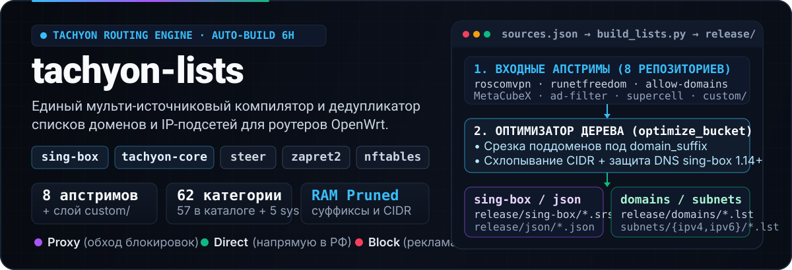
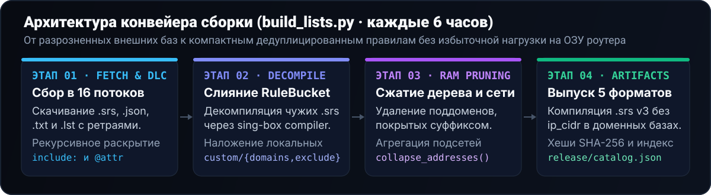
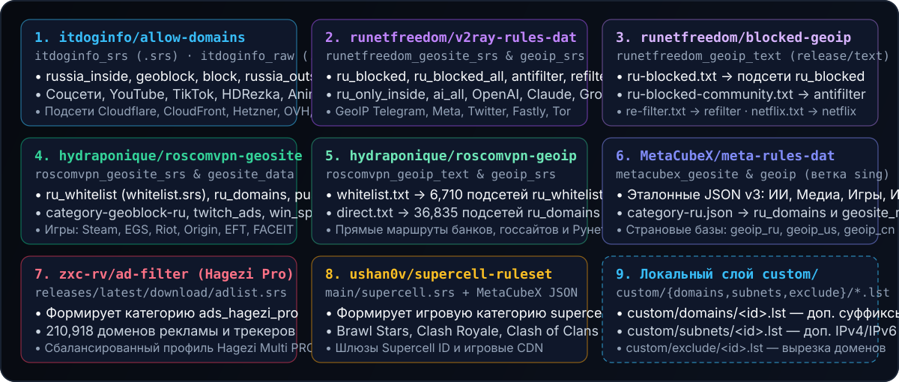

<p align="center">
  
</p>

<p align="center">
  <a href="https://github.com/Dushnilin/tachyon-lists/actions/workflows/build.yml"></a>
  <a href="https://github.com/Dushnilin/tachyon-lists/releases/tag/latest"></a>
  <a href="./release/catalog.json"></a>
  <a href="./sources.json"></a>
</p>

<p align="center">
  <b>Единый автоматизированный репозиторий курируемых списков маршрутизации, доменов и IPv4/IPv6-подсетей</b><br>
  для экосистемы <b>Tachyon</b> (<code>sing-box</code> / <code>tachyon-core</code>, <code>steer</code>, <code>zapret</code> / <code>zapret2</code>, <code>nftables</code>, <code>dnsmasq</code>).
</p>

<p align="center">
  <a href="#-быстрый-старт">Быстрый старт</a> ·
  <a href="#-как-работает-конвейер-сборки">Архитектура</a> ·
  <a href="#-откуда-берутся-источники-полная-карта-апстримов">Источники и апстримы</a> ·
  <a href="#-матрица-происхождения-всех-62-категорий">Матрица 62 списков</a> ·
  <a href="#-каталог-списков">Каталог и ссылки</a> ·
  <a href="#-локальная-сборка-и-кастомизация">Сборка и custom/</a>
</p>

---

## ⚡ Быстрый старт

Каждые **6 часов** GitHub Actions собирает, очищает от дубликатов и публикует готовые артефакты для **62 категорий** (57 основных в каталоге + 5 системных `internal`-баз) сразу в четырёх форматах:

| Целевая система | Формат | Шаблон прямой ссылки (`raw` / `releases`) |
|:---|:---|:---|
| **`sing-box` / `tachyon-core`** | Бинарный rule-set `version: 3` (`.srs`) | `https://raw.githubusercontent.com/Dushnilin/tachyon-lists/main/release/sing-box/<id>.srs`<br>`https://github.com/Dushnilin/tachyon-lists/releases/download/latest/<id>.srs` |
| **Аудит / отладка `sing-box`** | Исходный JSON rule-set `version: 3` (`.json`) | `https://raw.githubusercontent.com/Dushnilin/tachyon-lists/main/release/json/<id>.json` |
| **`steer` / `zapret2` / `dnsmasq`** | Плоский список доменов (`.lst`) | `https://raw.githubusercontent.com/Dushnilin/tachyon-lists/main/release/domains/<id>.lst` |
| **`nftables` / `steer` / `ipset`** | Агрегированные CIDR-подсети (`.lst`) | `https://raw.githubusercontent.com/Dushnilin/tachyon-lists/main/release/subnets/<id>.lst`<br>Раздельно: `.../release/subnets/ipv4/<id>.lst` и `.../ipv6/<id>.lst` |
| **Менеджеры и автообновление** | Индекс метаданных и хешей (`SHA-256`) | [`release/catalog.json`](release/catalog.json) (`https://github.com/Dushnilin/tachyon-lists/releases/download/latest/catalog.json`) |

### Пример подключения в `sing-box` (`1.11+` / `1.14+`)

Все доменные категории (`kind: "domains"`) гарантированно **не содержат `ip_cidr`** внутри `.srs`, поэтому их можно безопасно указывать одновременно и в `route.rules`, и в `dns.rules` на `sing-box 1.14+` без ошибки `rule-set with IP CIDR rules requires match_response`:

```json
{
  "route": {
    "rule_set": [
      {
        "tag": "ru_whitelist",
        "type": "remote",
        "format": "binary",
        "url": "https://raw.githubusercontent.com/Dushnilin/tachyon-lists/main/release/sing-box/ru_whitelist.srs",
        "download_detour": "direct",
        "update_interval": "6h"
      },
      {
        "tag": "ai_all",
        "type": "remote",
        "format": "binary",
        "url": "https://raw.githubusercontent.com/Dushnilin/tachyon-lists/main/release/sing-box/ai_all.srs",
        "download_detour": "proxy",
        "update_interval": "6h"
      },
      {
        "tag": "ads_hagezi_pro",
        "type": "remote",
        "format": "binary",
        "url": "https://raw.githubusercontent.com/Dushnilin/tachyon-lists/main/release/sing-box/ads_hagezi_pro.srs",
        "download_detour": "proxy",
        "update_interval": "12h"
      }
    ],
    "rules": [
      { "rule_set": ["ads_hagezi_pro"], "action": "reject" },
      { "rule_set": ["ru_whitelist"], "outbound": "direct" },
      { "rule_set": ["ai_all"], "outbound": "proxy" }
    ]
  }
}
```

---

## 🔧 Как работает конвейер сборки

<p align="center">
  
</p>

Вместо привязки роутера к разрозненным сторонним репозиториям с пересекающимися категориями, дубликатами поддоменов и несовместимыми версиями форматов, скрипт [`build_lists.py`](build_lists.py) выполняет полный цикл нормализации:

1. **Многопоточная загрузка и парсинг форматов (`16 потоков`)**:
   - Скачивает бинарные `.srs`, исходные `sing-box` JSON, текстовые списки доменов (включая синтаксис AdBlock `||domain.tld^`) и списки подсетей.
   - Рекурсивно парсит исходники `v2ray/domain-list-community` (`parse_dlc_entry`), раскрывая вложенные директивы `include:` и фильтруя правила по целевым атрибутам (например, `@ru-available-only-inside`).
2. **Декомпиляция и объединение (`RuleBucket`)**:
   - Декомпилирует внешние `.srs` через официальный бинарник `sing-box rule-set decompile` с кэшированием по `SHA-256`.
   - Сливает все правила категории из нескольких апстримов в единый `RuleBucket` (`domain`, `domain_suffix`, `domain_keyword`, `domain_regex`, `ip_cidr`) и применяет локальные правки из `custom/`.
3. **Оптимизация под роутеры с малой памятью (OpenWrt RAM Pruning)**:
   - **Срезка дочерних суффиксов**: если в наборе уже есть родительский `domain_suffix` (например, `youtube.com`), все дочерние суффиксы (`m.youtube.com`, `music.youtube.com`) и точные записи `domain` автоматически вычищаются.
   - **Схлопывание CIDR-подсетей**: пересекающиеся и смежные IPv4 и IPv6 диапазоны из разных источников агрегируются через `ipaddress.collapse_addresses`.
   - **Защита DNS-правил `sing-box 1.14+`**: для списков с `kind: "domains"` IP-префиксы сохраняются в отдельные файлы `release/subnets/<id>.lst`, но не включаются внутрь `.srs` и `.json`.
4. **Параллельная компиляция и хеширование**:
   - В 8 потоков компилирует бинарные наборы `release/sing-box/<id>.srs` (`version: 3`), формирует плоские списки для `steer`/`zapret2`/`nftables`, рассчитывает `SHA-256` и обновляет [`release/catalog.json`](release/catalog.json) и таблицу в этом README.

---

## 🌐 Откуда берутся источники (полная карта апстримов)

<p align="center">
  
</p>

Конфигурация всех источников декларативно описана в файле [`sources.json`](sources.json). Сборщик комбинирует данные из **8 внешних апстрим-проектов** (11 базовых эндпоинтов в секции `upstreams` + 2 прямых релизных URL) и локального каталога `custom/`:

### 1. Сводный реестр апстрим-репозиториев

| Ключ в `sources.json` | Апстрим-репозиторий | Базовый URL / ветка | Формат входа | Что именно берётся из источника |
|:---|:---|:---|:---:|:---|
| `itdoginfo_srs` | [**itdoginfo/allow-domains**](https://github.com/itdoginfo/allow-domains) | `releases/latest/download` | `.srs` | Сводные региональные списки (`russia_inside`, `geoblock`, `block`, `russia_outside`, `ukraine_inside`), медиа (`youtube`, `tiktok`, `hdrezka`, `anime`), соцсети (`discord`, `telegram`, `meta`, `twitter`), `roblox`, центры сертификации (`hodca`), CDN и хостинги (`cloudflare`, `cloudfront`, `hetzner`, `ovh`, `digitalocean`), `news`, `porn`, `google_meet`. |
| `itdoginfo_raw` | [**itdoginfo/allow-domains**](https://github.com/itdoginfo/allow-domains) | `refs/heads/main/Subnets/IPv4` и `IPv6` | `plain_subnets` (`.lst`) | Сырые списки IPv4 и IPv6 подсетей для `discord`, `telegram`, `meta`, `twitter`, `roblox`, `cloudflare`, `cloudfront`, `hetzner`, `ovh`, `digitalocean`. |
| `runetfreedom_geosite_srs` | [**runetfreedom/russia-v2ray-rules-dat**](https://github.com/runetfreedom/russia-v2ray-rules-dat) | `release/sing-box/rule-set-geosite` | `.srs` | Выгрузки блокировок РКН и сообщества (`geosite-ru-blocked`, `geosite-ru-blocked-all`, `geosite-antifilter-download-community`, `geosite-refilter`), госсервисы внутри РФ (`geosite-ru-available-only-inside`), Рунет (`geosite-category-ru`), ИИ (`category-ai-!cn`, `openai`, `anthropic`, `google-gemini`, `xai`), медиа, соцсети, игры, ИТ-платформы, `fastly`, `tor`, `category-porn`. |
| `runetfreedom_geoip_srs` | [**runetfreedom/russia-v2ray-rules-dat**](https://github.com/runetfreedom/russia-v2ray-rules-dat) | `release/sing-box/rule-set-geoip` | `.srs` | Бинарные базы IP-подсетей сервисов и инфраструктурных сетей: `geoip-telegram`, `geoip-facebook`, `geoip-twitter`, `geoip-cloudflare`, `geoip-cloudfront`, `geoip-fastly`, `geoip-tor`. |
| `runetfreedom_geoip_text` | [**runetfreedom/russia-blocked-geoip**](https://github.com/runetfreedom/russia-blocked-geoip) | `release/text` | `plain_subnets` (`.txt`) | Текстовые выгрузки заблокированных и проксируемых подсетей: `ru-blocked.txt`, `ru-blocked-community.txt`, `re-filter.txt`, `netflix.txt`. |
| `roscomvpn_geosite_srs` | [**hydraponique/roscomvpn-geosite**](https://github.com/hydraponique/roscomvpn-geosite) | `master/release/sing-box` | `.srs` | Курируемые списки `category-geoblock-ru`, белый список РФ (`whitelist.srs`), домены Рунета (`category-ru.srs`), `push.srs`, `google-deepmind.srs`, `twitch-ads.srs`, игровые сервисы (`steam`, `epicgames`, `riot`, `origin`, `escapefromtarkov`, `faceit`), `apple`, `microsoft`, `google-play`, `github`, `torrent.srs`, `win-spy.srs`. |
| `roscomvpn_geosite_data` | [**hydraponique/roscomvpn-geosite**](https://github.com/hydraponique/roscomvpn-geosite) | `master/data` | `dlc` (`data/*`) | Исходное дерево `domain-list-community` для прямого рекурсивного парсинга директив `include:` и атрибутов `@...` при необходимости. |
| `roscomvpn_geoip_text` | [**hydraponique/roscomvpn-geoip**](https://github.com/hydraponique/roscomvpn-geoip) | `master/release/text` | `plain_subnets` (`.txt`) | Текстовые списки IP-подсетей прямого маршрута в РФ: `whitelist.txt` (для `ru_whitelist`) и `direct.txt` (для `ru_domains`). |
| `roscomvpn_geoip_srs` | [**hydraponique/roscomvpn-geoip**](https://github.com/hydraponique/roscomvpn-geoip) | `master/release/sing-box` | `.srs` | Скомпилированные бинарные GeoIP-наборы проекта RoscomVPN. |
| `metacubex_geosite` | [**MetaCubeX/meta-rules-dat**](https://github.com/MetaCubeX/meta-rules-dat) | `sing/geo/geosite` | `singbox_json` (`.json`) | Глобальные эталонные правила экосистемы MetaCubeX (ветка `sing`): `category-ru`, `category-ai-!cn`, `openai`, `anthropic`, `google-gemini`, `xai`, `youtube`, `twitch`, `spotify`, `netflix`, `tiktok`, `pinterest`, `steam`, `epicgames`, `riot`, `supercell`, `apple`, `microsoft`, `google-play`, `github`, `docker`, `fastly`, `tor`, `win-spy`. |
| `metacubex_geoip` | [**MetaCubeX/meta-rules-dat**](https://github.com/MetaCubeX/meta-rules-dat) | `sing/geo/geoip` | `singbox_json` (`.json`) | Страновые базы IPv4/IPv6-подсетей `ru.json` (`geoip_ru`), `us.json` (`geoip_us`) и `cn.json` (`geoip_cn`). |
| *Прямой URL* | [**zxc-rv/ad-filter**](https://github.com/zxc-rv/ad-filter) | `releases/latest/download/adlist.srs` | `.srs` | Сбалансированный фильтр рекламных сетей, телеметрии, аналитики и фишинга на базе **Hagezi Multi PRO** (формирует список `ads_hagezi_pro`). |
| *Прямой URL* | [**ushan0v/sing-box-supercell-ruleset**](https://github.com/ushan0v/sing-box-supercell-ruleset) | `main/supercell.srs` | `.srs` | Специализированный набор игровых доменов, серверов авторизации Supercell ID и CDN для Brawl Stars, Clash Royale, Clash of Clans и Squad Busters (объединяется с `metacubex_geosite/supercell.json`). |
| *Локальный слой* | **`custom/`** (в этом репозитории) | `custom/{domains,subnets,exclude}/<id>.lst` | `.lst` | Локальные дополнения доменов (`custom/domains/`), подсетей (`custom/subnets/`) и принудительные исключения (`custom/exclude/`) поверх апстримов. |

---

## 🗺️ Матрица происхождения всех 62 категорий

Ниже приведена полная расшифровка того, **из каких именно апстрим-файлов собирается каждая категория** в [`sources.json`](sources.json), а также какой `fallback_srs` назначен на случай резервной загрузки.

<details>
<summary><b>1. Региональные списки и обход блокировок РКН / ТСПУ (9 категорий — <code>group: regional</code>)</b></summary>

<br>

| ID | Тип (`kind`) | Объединяемые источники (`sources`) | Резервный `fallback_srs` |
|:---|:---:|:---|:---|
| `russia_inside` | `domains` | • `itdoginfo_srs/russia_inside.srs`<br>• `roscomvpn_geosite_srs/category-geoblock-ru.srs` | `itdoginfo/allow-domains` → `russia_inside.srs` |
| `geoblock` | `domains` | • `itdoginfo_srs/geoblock.srs`<br>• `roscomvpn_geosite_srs/category-geoblock-ru.srs` | `itdoginfo/allow-domains` → `geoblock.srs` |
| `block` | `domains` | • `itdoginfo_srs/block.srs` | `itdoginfo/allow-domains` → `block.srs` |
| `ru_blocked` | `domains` (+ `subnets`) | • `runetfreedom_geosite_srs/geosite-ru-blocked.srs`<br>• `runetfreedom_geoip_text/ru-blocked.txt` | `runetfreedom` → `geosite-ru-blocked.srs` |
| `ru_blocked_all` | `domains` (+ `subnets`) | • `runetfreedom_geosite_srs/geosite-ru-blocked-all.srs`<br>• `runetfreedom_geoip_text/ru-blocked-community.txt` | `runetfreedom` → `geosite-ru-blocked-all.srs` |
| `antifilter` | `domains` (+ `subnets`) | • `runetfreedom_geosite_srs/geosite-antifilter-download-community.srs`<br>• `runetfreedom_geoip_text/ru-blocked-community.txt` | `runetfreedom` → `geosite-antifilter-download-community.srs` |
| `refilter` | `domains` (+ `subnets`) | • `runetfreedom_geosite_srs/geosite-refilter.srs`<br>• `runetfreedom_geoip_text/re-filter.txt` | `runetfreedom` → `geosite-refilter.srs` |
| `russia_outside` | `domains` | • `itdoginfo_srs/russia_outside.srs`<br>• `runetfreedom_geosite_srs/geosite-ru-available-only-inside.srs` | `itdoginfo/allow-domains` → `russia_outside.srs` |
| `ukraine_inside` | `domains` | • `itdoginfo_srs/ukraine_inside.srs` | `itdoginfo/allow-domains` → `ukraine_inside.srs` |

</details>

<details>
<summary><b>2. Прямой маршрут в РФ / Белые списки Direct (4 категории — <code>group: direct</code>)</b></summary>

<br>

| ID | Тип (`kind`) | Объединяемые источники (`sources`) | Резервный `fallback_srs` |
|:---|:---:|:---|:---|
| `ru_whitelist` | `domains` (+ `subnets`) | • `roscomvpn_geosite_srs/whitelist.srs`<br>• `roscomvpn_geoip_text/whitelist.txt` | `roscomvpn-geosite` → `whitelist.srs` |
| `ru_domains` | `domains` (+ `subnets`) | • `roscomvpn_geosite_srs/category-ru.srs`<br>• `runetfreedom_geosite_srs/geosite-category-ru.srs`<br>• `metacubex_geosite/category-ru.json`<br>• `roscomvpn_geoip_text/direct.txt` | `roscomvpn-geosite` → `category-ru.srs` |
| `ru_only_inside` | `domains` | • `runetfreedom_geosite_srs/geosite-ru-available-only-inside.srs` | `runetfreedom` → `geosite-ru-available-only-inside.srs` |
| `push` | `domains` | • `roscomvpn_geosite_srs/push.srs` | `roscomvpn-geosite` → `push.srs` |

</details>

<details>
<summary><b>3. Нейросети и ИИ-платформы (5 категорий — <code>group: ai</code>)</b></summary>

<br>

| ID | Тип (`kind`) | Объединяемые источники (`sources`) | Резервный `fallback_srs` |
|:---|:---:|:---|:---|
| `ai_all` | `domains` | • `runetfreedom_geosite_srs/geosite-category-ai-!cn.srs`<br>• `roscomvpn_geosite_srs/google-deepmind.srs`<br>• `metacubex_geosite/category-ai-!cn.json` | `runetfreedom` → `geosite-category-ai-!cn.srs` |
| `openai` | `domains` | • `runetfreedom_geosite_srs/geosite-openai.srs`<br>• `metacubex_geosite/openai.json` | `runetfreedom` → `geosite-openai.srs` |
| `anthropic` | `domains` | • `runetfreedom_geosite_srs/geosite-anthropic.srs`<br>• `metacubex_geosite/anthropic.json` | `runetfreedom` → `geosite-anthropic.srs` |
| `google_ai` | `domains` | • `itdoginfo_srs/google_ai.srs`<br>• `roscomvpn_geosite_srs/google-deepmind.srs`<br>• `runetfreedom_geosite_srs/geosite-google-gemini.srs`<br>• `metacubex_geosite/google-gemini.json` | `itdoginfo/allow-domains` → `google_ai.srs` |
| `xai` | `domains` | • `runetfreedom_geosite_srs/geosite-xai.srs`<br>• `metacubex_geosite/xai.json` | `runetfreedom` → `geosite-xai.srs` |

</details>

<details>
<summary><b>4. Видео, музыка и медиа-стриминг (9 категорий — <code>group: media</code>)</b></summary>

<br>

| ID | Тип (`kind`) | Объединяемые источники (`sources`) | Резервный `fallback_srs` |
|:---|:---:|:---|:---|
| `youtube` | `domains` | • `itdoginfo_srs/youtube.srs`<br>• `roscomvpn_geosite_srs/youtube.srs`<br>• `runetfreedom_geosite_srs/geosite-youtube.srs`<br>• `metacubex_geosite/youtube.json` | `itdoginfo/allow-domains` → `youtube.srs` |
| `twitch` | `domains` | • `roscomvpn_geosite_srs/twitch.srs`<br>• `runetfreedom_geosite_srs/geosite-twitch.srs`<br>• `metacubex_geosite/twitch.json` | `MetaCubeX` → `twitch.srs` |
| `twitch_ads` | `domains` | • `roscomvpn_geosite_srs/twitch-ads.srs` | `roscomvpn-geosite` → `twitch-ads.srs` |
| `spotify` | `domains` | • `runetfreedom_geosite_srs/geosite-spotify.srs`<br>• `metacubex_geosite/spotify.json` | `runetfreedom` → `geosite-spotify.srs` |
| `netflix` | `domains` (+ `subnets`) | • `runetfreedom_geosite_srs/geosite-netflix.srs`<br>• `metacubex_geosite/netflix.json`<br>• `runetfreedom_geoip_text/netflix.txt` | `runetfreedom` → `geosite-netflix.srs` |
| `tiktok` | `domains` | • `itdoginfo_srs/tiktok.srs`<br>• `runetfreedom_geosite_srs/geosite-tiktok.srs`<br>• `metacubex_geosite/tiktok.json` | `itdoginfo/allow-domains` → `tiktok.srs` |
| `hdrezka` | `domains` | • `itdoginfo_srs/hdrezka.srs` | `itdoginfo/allow-domains` → `hdrezka.srs` |
| `anime` | `domains` | • `itdoginfo_srs/anime.srs` | `itdoginfo/allow-domains` → `anime.srs` |
| `pinterest` | `domains` | • `roscomvpn_geosite_srs/pinterest.srs`<br>• `runetfreedom_geosite_srs/geosite-pinterest.srs`<br>• `metacubex_geosite/pinterest.json` | `roscomvpn-geosite` → `pinterest.srs` |

</details>

<details>
<summary><b>5. Мессенджеры и социальные сети (4 категории — <code>group: social</code>)</b></summary>

<br>

| ID | Тип (`kind`) | Объединяемые источники (`sources`) | Резервный `fallback_srs` |
|:---|:---:|:---|:---|
| `discord` | `subnets` | • `itdoginfo_srs/discord.srs`<br>• `runetfreedom_geosite_srs/geosite-discord.srs`<br>• `itdoginfo_raw/Subnets/IPv4/discord.lst`<br>• `itdoginfo_raw/Subnets/IPv6/discord.lst` | `itdoginfo/allow-domains` → `discord.srs` |
| `telegram` | `mixed` | • `itdoginfo_srs/telegram.srs`<br>• `roscomvpn_geosite_srs/telegram.srs`<br>• `runetfreedom_geosite_srs/geosite-telegram.srs`<br>• `runetfreedom_geoip_srs/geoip-telegram.srs`<br>• `itdoginfo_raw/Subnets/IPv4/telegram.lst`<br>• `itdoginfo_raw/Subnets/IPv6/telegram.lst` | `itdoginfo/allow-domains` → `telegram.srs` |
| `meta` | `mixed` | • `itdoginfo_srs/meta.srs`<br>• `runetfreedom_geosite_srs/geosite-meta.srs`<br>• `runetfreedom_geoip_srs/geoip-facebook.srs`<br>• `itdoginfo_raw/Subnets/IPv4/meta.lst`<br>• `itdoginfo_raw/Subnets/IPv6/meta.lst` | `itdoginfo/allow-domains` → `meta.srs` |
| `twitter` | `mixed` | • `itdoginfo_srs/twitter.srs`<br>• `runetfreedom_geosite_srs/geosite-twitter.srs`<br>• `runetfreedom_geoip_srs/geoip-twitter.srs`<br>• `itdoginfo_raw/Subnets/IPv4/twitter.lst`<br>• `itdoginfo_raw/Subnets/IPv6/twitter.lst` | `itdoginfo/allow-domains` → `twitter.srs` |

</details>

<details>
<summary><b>6. Игровые платформы и лаунчеры (8 категорий — <code>group: gaming</code>)</b></summary>

<br>

| ID | Тип (`kind`) | Объединяемые источники (`sources`) | Резервный `fallback_srs` |
|:---|:---:|:---|:---|
| `steam` | `domains` | • `roscomvpn_geosite_srs/steam.srs`<br>• `runetfreedom_geosite_srs/geosite-steam.srs`<br>• `metacubex_geosite/steam.json` | `roscomvpn-geosite` → `steam.srs` |
| `epicgames` | `domains` | • `roscomvpn_geosite_srs/epicgames.srs`<br>• `runetfreedom_geosite_srs/geosite-epicgames.srs`<br>• `metacubex_geosite/epicgames.json` | `roscomvpn-geosite` → `epicgames.srs` |
| `riot` | `domains` | • `roscomvpn_geosite_srs/riot.srs`<br>• `runetfreedom_geosite_srs/geosite-riot.srs`<br>• `metacubex_geosite/riot.json` | `roscomvpn-geosite` → `riot.srs` |
| `origin` | `domains` | • `roscomvpn_geosite_srs/origin.srs` | `roscomvpn-geosite` → `origin.srs` |
| `roblox` | `mixed` | • `itdoginfo_srs/roblox.srs`<br>• `runetfreedom_geosite_srs/geosite-roblox.srs`<br>• `itdoginfo_raw/Subnets/IPv4/roblox.lst` | `itdoginfo/allow-domains` → `roblox.srs` |
| `supercell` | `domains` | • `ushan0v/sing-box-supercell-ruleset/main/supercell.srs`<br>• `metacubex_geosite/supercell.json` | `ushan0v/sing-box-supercell-ruleset` → `supercell.srs` |
| `escapefromtarkov` | `domains` | • `roscomvpn_geosite_srs/escapefromtarkov.srs` | `roscomvpn-geosite` → `escapefromtarkov.srs` |
| `faceit` | `domains` | • `roscomvpn_geosite_srs/faceit.srs` | `roscomvpn-geosite` → `faceit.srs` |

</details>

<details>
<summary><b>7. Экосистемы, разработка, CDN и облачные хостинги (12 категорий — <code>group: tech</code> и <code>group: infra</code>)</b></summary>

<br>

| ID | Тип (`kind`) | Объединяемые источники (`sources`) | Резервный `fallback_srs` |
|:---|:---:|:---|:---|
| `apple` | `domains` | • `roscomvpn_geosite_srs/apple.srs`<br>• `runetfreedom_geosite_srs/geosite-apple.srs`<br>• `metacubex_geosite/apple.json` | `roscomvpn-geosite` → `apple.srs` |
| `microsoft` | `domains` | • `roscomvpn_geosite_srs/microsoft.srs`<br>• `runetfreedom_geosite_srs/geosite-microsoft.srs`<br>• `metacubex_geosite/microsoft.json` | `roscomvpn-geosite` → `microsoft.srs` |
| `google_play` | `domains` | • `itdoginfo_srs/google_play.srs`<br>• `roscomvpn_geosite_srs/google-play.srs`<br>• `runetfreedom_geosite_srs/geosite-google-play.srs`<br>• `metacubex_geosite/google-play.json` | `itdoginfo/allow-domains` → `google_play.srs` |
| `github` | `domains` | • `roscomvpn_geosite_srs/github.srs`<br>• `runetfreedom_geosite_srs/geosite-github.srs`<br>• `metacubex_geosite/github.json` | `MetaCubeX` → `github.srs` |
| `docker` | `domains` | • `runetfreedom_geosite_srs/geosite-docker.srs`<br>• `metacubex_geosite/docker.json` | `runetfreedom` → `geosite-docker.srs` |
| `hodca` | `domains` | • `itdoginfo_srs/hodca.srs` | `itdoginfo/allow-domains` → `hodca.srs` |
| `cloudflare` | `subnets` | • `itdoginfo_srs/cloudflare.srs`<br>• `runetfreedom_geoip_srs/geoip-cloudflare.srs`<br>• `itdoginfo_raw/Subnets/IPv4/cloudflare.lst`<br>• `itdoginfo_raw/Subnets/IPv6/cloudflare.lst` | `itdoginfo/allow-domains` → `cloudflare.srs` |
| `cloudfront` | `subnets` | • `itdoginfo_srs/cloudfront.srs`<br>• `runetfreedom_geoip_srs/geoip-cloudfront.srs`<br>• `itdoginfo_raw/Subnets/IPv4/cloudfront.lst`<br>• `itdoginfo_raw/Subnets/IPv6/cloudfront.lst` | `itdoginfo/allow-domains` → `cloudfront.srs` |
| `fastly` | `domains` (+ `subnets`) | • `runetfreedom_geosite_srs/geosite-fastly.srs`<br>• `metacubex_geosite/fastly.json`<br>• `runetfreedom_geoip_srs/geoip-fastly.srs` | `runetfreedom` → `geosite-fastly.srs` |
| `hetzner` | `subnets` | • `itdoginfo_srs/hetzner.srs`<br>• `itdoginfo_raw/Subnets/IPv4/hetzner.lst`<br>• `itdoginfo_raw/Subnets/IPv6/hetzner.lst` | `itdoginfo/allow-domains` → `hetzner.srs` |
| `ovh` | `subnets` | • `itdoginfo_srs/ovh.srs`<br>• `itdoginfo_raw/Subnets/IPv4/ovh.lst`<br>• `itdoginfo_raw/Subnets/IPv6/ovh.lst` | `itdoginfo/allow-domains` → `ovh.srs` |
| `digitalocean` | `subnets` | • `itdoginfo_srs/digitalocean.srs`<br>• `itdoginfo_raw/Subnets/IPv4/digitalocean.lst`<br>• `itdoginfo_raw/Subnets/IPv6/digitalocean.lst` | `itdoginfo/allow-domains` → `digitalocean.srs` |

</details>

<details>
<summary><b>8. СМИ, торренты, Tor, 18+, блокировка рекламы и системные базы (11 категорий — <code>other</code>, <code>block</code>, <code>internal</code>)</b></summary>

<br>

| ID | Группа | Тип (`kind`) | Объединяемые источники (`sources`) | Резервный `fallback_srs` |
|:---|:---:|:---:|:---|:---|
| `news` | `other` | `domains` | • `itdoginfo_srs/news.srs` | `itdoginfo/allow-domains` → `news.srs` |
| `torrent` | `other` | `domains` | • `roscomvpn_geosite_srs/torrent.srs` | `roscomvpn-geosite` → `torrent.srs` |
| `tor` | `other` | `domains` (+ `subnets`) | • `runetfreedom_geosite_srs/geosite-tor.srs`<br>• `metacubex_geosite/tor.json`<br>• `runetfreedom_geoip_srs/geoip-tor.srs` | `runetfreedom` → `geosite-tor.srs` |
| `porn` | `other` | `domains` | • `itdoginfo_srs/porn.srs`<br>• `runetfreedom_geosite_srs/geosite-category-porn.srs` | `itdoginfo/allow-domains` → `porn.srs` |
| `ads_hagezi_pro` | `block` | `domains` | • `zxc-rv/ad-filter/releases/latest/download/adlist.srs` | `zxc-rv/ad-filter` → `adlist.srs` |
| `win_spy` | `block` | `domains` | • `roscomvpn_geosite_srs/win-spy.srs`<br>• `metacubex_geosite/win-spy.json` | `roscomvpn-geosite` → `win-spy.srs` |
| `google_meet` | `internal` | `mixed` | • `itdoginfo_srs/google_meet.srs` | `itdoginfo/allow-domains` → `google_meet.srs` |
| `geosite_ru` | `internal` | `domains` | • `roscomvpn_geosite_srs/category-ru.srs`<br>• `metacubex_geosite/category-ru.json` | `MetaCubeX` → `category-ru.srs` |
| `geoip_ru` | `internal` | `subnets` | • `metacubex_geoip/ru.json` | `MetaCubeX` → `geoip/ru.srs` |
| `geoip_us` | `internal` | `subnets` | • `metacubex_geoip/us.json` | `MetaCubeX` → `geoip/us.srs` |
| `geoip_cn` | `internal` | `subnets` | • `metacubex_geoip/cn.json` | `MetaCubeX` → `geoip/cn.srs` |

</details>

---

## 📦 Каталог списков

> Таблица ниже автоматически пересчитывается и обновляется скриптом [`build_lists.py`](build_lists.py) при каждой сборке.

<!-- CATALOG_TABLE_START -->
| ID | Категория и описание | Режим | Домены | Подсети (IPv4/IPv6) | Форматы |
|:---|:---|:---:|---:|---:|:---|
| `russia_inside` | **Россия (внутри) — сводный реестр заблокированных и ограниченных в РФ ресурсов**<br><sub>Главный сводный список обхода блокировок внутри России: объединяет домены из реестра РКН, списки Re:filter, Antifilter и популярные зарубежные сервисы, закрывшие доступ для российских IP.</sub> | 🟣 `Proxy` | `1,607` | `0` | [`.srs`](release/sing-box/russia_inside.srs) · [`.json`](release/json/russia_inside.json) · [`.lst`](release/domains/russia_inside.lst) |
| `geoblock` | **Геоблок — зарубежные сервисы, закрывшие доступ с российских IP**<br><sub>Единая база из 150+ иностранных платформ, SaaS, банков и облаков, возвращающих ошибку 403 / Unavailable in your region из РФ: PayPal, Wise, Revolut, Notion, Canva, Trello, Jira, Atlassian, Zoom, Intel, Dell, Broadcom, VMware, Coursera, Udemy, JetBrains, GitLab, Adobe, Autodesk, Grammarly, Medium, Docker, DigiCert и др.</sub> | 🟣 `Proxy` | `931` | `0` | [`.srs`](release/sing-box/geoblock.srs) · [`.json`](release/json/geoblock.json) · [`.lst`](release/domains/geoblock.lst) |
| `block` | **Реестр РКН (прямые блокировки) — домены из выгрузки Роскомнадзора**<br><sub>Сайты и сервисы, официально внесённые в единый реестр запрещённых ресурсов Роскомнадзора и блокируемые на ТСПУ провайдеров.</sub> | 🟣 `Proxy` | `331` | `0` | [`.srs`](release/sing-box/block.srs) · [`.json`](release/json/block.json) · [`.lst`](release/domains/block.lst) |
| `ru_blocked` | **Реестр РКН и Антизапрет (очищенный) — актуальные заблокированные домены**<br><sub>Очищенный и дедуплицированный список реально действующих заблокированных в РФ доменов (объединение Антизапрета и выгрузки РКН без мёртвых и мусорных доменов).</sub> | 🟣 `Proxy` | `74,739` | `88,587` | [`.srs`](release/sing-box/ru_blocked.srs) · [`.json`](release/json/ru_blocked.json) · [`.lst`](release/domains/ru_blocked.lst) · [`subnets`](release/subnets/ru_blocked.lst) |
| `ru_blocked_all` | **Реестр РКН (полный) — все заблокированные домены, поддомены и зеркала**<br><sub>Полная нефильтрованная выгрузка всех доменов, поддоменов и зеркал из реестра блокировок РФ, включая региональные ограничения и блокировки ТСПУ.</sub> | 🟣 `Proxy` | `1,374,037` | `922` | [`.srs`](release/sing-box/ru_blocked_all.srs) · [`.json`](release/json/ru_blocked_all.json) · [`.lst`](release/domains/ru_blocked_all.lst) · [`subnets`](release/subnets/ru_blocked_all.lst) |
| `antifilter` | **Antifilter Community — народный список обхода блокировок и ТСПУ**<br><sub>Курируемый сообществом Antifilter.download список доменов и сервисов, заблокированных РКН или замедляемых оборудованием ТСПУ в России.</sub> | 🟣 `Proxy` | `420` | `922` | [`.srs`](release/sing-box/antifilter.srs) · [`.json`](release/json/antifilter.json) · [`.lst`](release/domains/antifilter.lst) · [`subnets`](release/subnets/antifilter.lst) |
| `refilter` | **Re:filter — выверенный список блокировок и геоблока без лишних доменов**<br><sub>Тщательно модерируемый проект Re:filter: включает проверенные домены заблокированных ресурсов и западных сервисов с геоблоком без избыточных правил.</sub> | 🟣 `Proxy` | `74,658` | `25,266` | [`.srs`](release/sing-box/refilter.srs) · [`.json`](release/json/refilter.json) · [`.lst`](release/domains/refilter.lst) · [`subnets`](release/subnets/refilter.lst) |
| `russia_outside` | **Россия (снаружи) — сервисы РФ для доступа из-за рубежа**<br><sub>Российские банки, Госуслуги, маркетплейсы (Ozon, Wildberries), онлайн-кинотеатры (Кинопоиск, Иви, Wink, Okko) и госсайты, не открывающиеся с зарубежных IP-адресов.</sub> | 🟣 `Proxy` | `173` | `0` | [`.srs`](release/sing-box/russia_outside.srs) · [`.json`](release/json/russia_outside.json) · [`.lst`](release/domains/russia_outside.lst) |
| `ukraine_inside` | **Украина (внутри) — ресурсы с ограниченным доступом в Украине**<br><sub>Сайты, соцсети, почтовые и медийные сервисы, доступ к которым ограничен на территории Украины.</sub> | 🟣 `Proxy` | `1,339` | `0` | [`.srs`](release/sing-box/ukraine_inside.srs) · [`.json`](release/json/ukraine_inside.json) · [`.lst`](release/domains/ukraine_inside.lst) |
| `ru_whitelist` | **Белый список РФ (Direct) — Госуслуги, банки, маркетплейсы, капчи и госсайты**<br><sub>Критически важные российские сервисы, которые нельзя пускать через VPN: Госуслуги, ФНС (nalog.ru), Честный ЗНАК, Мос.ру, Сбербанк, Т-Банк, Альфа-Банк, ВТБ, Ozon, Wildberries, Авито, Яндекс, VK, РЖД, корневые сертификаты и проверочные домены. Направляйте НАПРЯМУЮ (Direct).</sub> | 🟢 `Direct` | `456` | `6,710` | [`.srs`](release/sing-box/ru_whitelist.srs) · [`.json`](release/json/ru_whitelist.json) · [`.lst`](release/domains/ru_whitelist.lst) · [`subnets`](release/subnets/ru_whitelist.lst) |
| `ru_domains` | **Рунет и СНГ (Direct) — доменные зоны .ru, .рф, .su, .by, .kz и компании РФ**<br><sub>Все национальные доменные зоны России и СНГ (.ru, .рф, .su, .рус, .москва, .дети, .татар, .by, .бел, .kz, .қаз), а также международные домены российских компаний (Яндекс, VK, Mail.ru, Kaspersky, 1С, 2ГИС, Rutube). Направляйте НАПРЯМУЮ (Direct).</sub> | 🟢 `Direct` | `891` | `36,835` | [`.srs`](release/sing-box/ru_domains.srs) · [`.json`](release/json/ru_domains.json) · [`.lst`](release/domains/ru_domains.lst) · [`subnets`](release/subnets/ru_domains.lst) |
| `ru_only_inside` | **Только из РФ (Direct) — госпорталы, банки и сервисы, блокирующие VPN IP**<br><sub>Российские государственные порталы, банки, суды, ЕМИАС, региональные сервисы ЖКХ и операторы связи, которые жёстко блокируют вход с любых зарубежных и серверных IP-адресов. Направляйте строго НАПРЯМУЮ (Direct).</sub> | 🟢 `Direct` | `167` | `0` | [`.srs`](release/sing-box/ru_only_inside.srs) · [`.json`](release/json/ru_only_inside.json) · [`.lst`](release/domains/ru_only_inside.lst) |
| `push` | **Push-уведомления (Direct) — Apple APNs, Google FCM, Huawei, Xiaomi, Samsung**<br><sub>Серверы доставки мобильных и системных push-уведомлений: Apple APNs (push.apple.com), Google FCM (mtalk.google.com, fcm.googleapis.com), Huawei Push, Xiaomi MiPush, Samsung Push и Windows WNS. Направляйте НАПРЯМУЮ (Direct) для мгновенной доставки уведомлений и экономии заряда батареи.</sub> | 🟢 `Direct` | `17` | `0` | [`.srs`](release/sing-box/push.srs) · [`.json`](release/json/push.json) · [`.lst`](release/domains/push.lst) |
| `ai_all` | **Нейросети и ИИ (все) — OpenAI, Claude, Gemini, Grok, Perplexity, Cursor, Midjourney**<br><sub>Единый полный список всех зарубежных ИИ-сервисов, закрывших доступ из РФ: OpenAI (ChatGPT, Sora), Anthropic (Claude), Google (Gemini, AI Studio, NotebookLM), xAI (Grok), Perplexity, Microsoft Copilot, GitHub Copilot, Cursor, Windsurf, Codeium, Midjourney, ElevenLabs, Runway, Suno, Udio, Hugging Face, Replicate, Poe, OpenRouter, DeepSeek и Groq.</sub> | 🟣 `Proxy` | `216` | `0` | [`.srs`](release/sing-box/ai_all.srs) · [`.json`](release/json/ai_all.json) · [`.lst`](release/domains/ai_all.lst) |
| `openai` | **OpenAI — ChatGPT, Sora, GPT API, o1/o3 и CDN-ресурсы**<br><sub>Все домены и поддомены OpenAI: chatgpt.com, chat.openai.com, sora.com, platform.openai.com, api.openai.com, oaistatic.com, oaiusercontent.com и шлюзы авторизации.</sub> | 🟣 `Proxy` | `24` | `0` | [`.srs`](release/sing-box/openai.srs) · [`.json`](release/json/openai.json) · [`.lst`](release/domains/openai.lst) |
| `anthropic` | **Anthropic — Claude AI, Claude Code, Console и API**<br><sub>Домены нейросети Claude и инструментов разработки Anthropic: claude.ai, anthropic.com, console.anthropic.com, api.anthropic.com, claudemcpclient.com и CDN.</sub> | 🟣 `Proxy` | `19` | `0` | [`.srs`](release/sing-box/anthropic.srs) · [`.json`](release/json/anthropic.json) · [`.lst`](release/domains/anthropic.lst) |
| `google_ai` | **Google AI — Gemini, AI Studio, NotebookLM, DeepMind и Vertex AI**<br><sub>Все домены ИИ-экосистемы Google: gemini.google.com, aistudio.google.com, notebooklm.google.com, makersuite.google.com, deepmind.google, bard.google.com и generativelanguage.googleapis.com.</sub> | 🟣 `Proxy` | `54` | `0` | [`.srs`](release/sing-box/google_ai.srs) · [`.json`](release/json/google_ai.json) · [`.lst`](release/domains/google_ai.lst) |
| `xai` | **xAI — нейросеть Grok (grok.com, x.ai и API)**<br><sub>Домены искусственного интеллекта xAI Илона Маска: grok.com, x.ai, console.x.ai, api.x.ai и медиа-CDN Grok.</sub> | 🟣 `Proxy` | `4` | `0` | [`.srs`](release/sing-box/xai.srs) · [`.json`](release/json/xai.json) · [`.lst`](release/domains/xai.lst) |
| `youtube` | **YouTube — видеосервис, YouTube Music, Studio и кэш-серверы (googlevideo / ytimg)**<br><sub>Полный набор доменов YouTube: youtube.com, youtu.be, googlevideo.com (видеопотоки GGC), ytimg.com (превью), ggpht.com (аватарки каналов), youtubei.googleapis.com и YouTube Music.</sub> | 🟣 `Proxy` | `182` | `0` | [`.srs`](release/sing-box/youtube.srs) · [`.json`](release/json/youtube.json) · [`.lst`](release/domains/youtube.lst) |
| `twitch` | **Twitch — стриминговая платформа, видеопотоки (ttvnw.net) и чат**<br><sub>Все домены платформы Twitch (twitch.tv, ttvnw.net, jtvnw.net, live-video.net). Для снятия лимита 720p и отключения рекламы без проксирования самого видеопотока используйте список «Twitch (без рекламы и 1080p+)».</sub> | 🟣 `Proxy` | `43` | `0` | [`.srs`](release/sing-box/twitch.srs) · [`.json`](release/json/twitch.json) · [`.lst`](release/domains/twitch.lst) |
| `twitch_ads` | **Twitch (без рекламы и 1080p+) — серверы манифестов качества видео и рекламы**<br><sub>Узкий список серверов выбора качества потока и рекламных вставок Twitch (usher.ttvnw.net, gql.twitch.tv, edge.ads.twitch.tv). Направьте его в Прокси (оставив остальной Twitch напрямую): видеопоток пойдёт напрямую без нагрузки на VPN, но пропадёт реклама и вернётся качество 1080p60 / 1440p!</sub> | 🟣 `Proxy` | `5` | `0` | [`.srs`](release/sing-box/twitch_ads.srs) · [`.json`](release/json/twitch_ads.json) · [`.lst`](release/domains/twitch_ads.lst) |
| `spotify` | **Spotify — музыкальный стриминг, аудио-CDN и клиентские API**<br><sub>Все домены Spotify: spotify.com, scdn.co, spotifycdn.com, audio-ak-spotify-com.akamaized.net, psavn.com и серверы авторизации приложений.</sub> | 🟣 `Proxy` | `25` | `0` | [`.srs`](release/sing-box/spotify.srs) · [`.json`](release/json/spotify.json) · [`.lst`](release/domains/spotify.lst) |
| `netflix` | **Netflix — онлайн-кинотеатр, видеопотоки (nflxvideo.net) и статика**<br><sub>Домены видеосервиса Netflix: netflix.com, nflxvideo.net, nflximg.net, nflxso.net, nflxext.com и проверка скорости fast.com.</sub> | 🟣 `Proxy` | `24` | `122` | [`.srs`](release/sing-box/netflix.srs) · [`.json`](release/json/netflix.json) · [`.lst`](release/domains/netflix.lst) · [`subnets`](release/subnets/netflix.lst) |
| `tiktok` | **TikTok — приложение, веб-версия и медиа-CDN ByteDance**<br><sub>Домены TikTok и ByteDance (tiktok.com, tiktokv.com, tiktokcdn.com, byteoversea.com, musical.ly) для просмотра новых видео и стримов без региональных ограничений в РФ.</sub> | 🟣 `Proxy` | `38` | `0` | [`.srs`](release/sing-box/tiktok.srs) · [`.json`](release/json/tiktok.json) · [`.lst`](release/domains/tiktok.lst) |
| `hdrezka` | **HDRezka — онлайн-кинотеатр, видео-балансеры (Voidboost) и актуальные зеркала**<br><sub>Домены, зеркала и CDN видеопотоков онлайн-кинотеатра HDRezka (rezka.ag, hdrezka.ag, voidboost.cc, stream.voidboost.cc и связанные балансеры).</sub> | 🟣 `Proxy` | `17` | `0` | [`.srs`](release/sing-box/hdrezka.srs) · [`.json`](release/json/hdrezka.json) · [`.lst`](release/domains/hdrezka.lst) |
| `anime` | **Аниме — Shikimori, AnimeGO, Jut.su, Kodik, Anilibria, Crunchyroll**<br><sub>Популярные аниме-порталы, базы данных и видеоплееры: Shikimori, AnimeGO, Jut.su, YummyAnime, Anilibria, Kodik, Sibnet, Crunchyroll и MyAnimeList.</sub> | 🟣 `Proxy` | `42` | `0` | [`.srs`](release/sing-box/anime.srs) · [`.json`](release/json/anime.json) · [`.lst`](release/domains/anime.lst) |
| `pinterest` | **Pinterest — фотохостинг, пины и серверы изображений (pinimg.com)**<br><sub>Домены визуальной соцсети Pinterest: pinterest.com, pin.it и CDN картинок i.pinimg.com / s.pinimg.com (устраняет проблему бесконечной загрузки картинок на ТСПУ).</sub> | 🟣 `Proxy` | `52` | `0` | [`.srs`](release/sing-box/pinterest.srs) · [`.json`](release/json/pinterest.json) · [`.lst`](release/domains/pinterest.lst) |
| `discord` | **Discord — мессенджер, чаты, CDN вложений и голосовые шлюзы**<br><sub>Все домены и подсети Discord: discord.com, discord.gg, discordapp.com, discordapp.net, discord.media и голосовые серверы.</sub> | 🟣 `Proxy` | `28` | `9` | [`.srs`](release/sing-box/discord.srs) · [`.json`](release/json/discord.json) · [`.lst`](release/domains/discord.lst) · [`subnets`](release/subnets/discord.lst) |
| `telegram` | **Telegram — мессенджер, веб-клиенты, Telegraph и все датацентры (DC1–DC5)**<br><sub>Домены (telegram.org, t.me, web.telegram.org, telegra.ph, telesco.pe) и официальные IPv4/IPv6-подсети всех датацентров Telegram для работы звонков, кружочков и быстрой загрузки медиа.</sub> | 🟣 `Proxy` | `27` | `14` | [`.srs`](release/sing-box/telegram.srs) · [`.json`](release/json/telegram.json) · [`.lst`](release/domains/telegram.lst) · [`subnets`](release/subnets/telegram.lst) |
| `meta` | **Meta — Instagram, Facebook, Threads, Messenger и медиа-серверы (fbcdn)**<br><sub>Все домены и IP-подсети компании Meta: instagram.com, cdninstagram.com, facebook.com, fbcdn.net, threads.net и messenger.com (без WhatsApp).</sub> | 🟣 `Proxy` | `550` | `120` | [`.srs`](release/sing-box/meta.srs) · [`.json`](release/json/meta.json) · [`.lst`](release/domains/meta.lst) · [`subnets`](release/subnets/meta.lst) |
| `twitter` | **X (Twitter) — соцсеть, короткие ссылки t.co и медиа-CDN (twimg.com)**<br><sub>Домены и IP-подсети соцсети X / Twitter: x.com, twitter.com, t.co, twimg.com, abs.twimg.com, pbs.twimg.com и video.twimg.com.</sub> | 🟣 `Proxy` | `24` | `19` | [`.srs`](release/sing-box/twitter.srs) · [`.json`](release/json/twitter.json) · [`.lst`](release/domains/twitter.lst) · [`subnets`](release/subnets/twitter.lst) |
| `steam` | **Steam — магазин, сообщество, инвентарь, чат и CDN загрузок Valve**<br><sub>Все домены экосистемы Valve и Steam: store.steampowered.com, steamcommunity.com, steamstatic.com, steamusercontent.com, steamcontent.com и steamserver.net.</sub> | 🟣 `Proxy` | `60` | `0` | [`.srs`](release/sing-box/steam.srs) · [`.json`](release/json/steam.json) · [`.lst`](release/domains/steam.lst) |
| `epicgames` | **Epic Games — EGS, Fortnite, Unreal Engine, Rocket League и EasyAntiCheat**<br><sub>Домены Epic Games Store, Fortnite, Rocket League, Fall Guys, движка Unreal Engine, Fab/Quixel и античита EasyAntiCheat (epicgames.com, unrealengine.com, fortnite.com, easy.ac).</sub> | 🟣 `Proxy` | `30` | `0` | [`.srs`](release/sing-box/epicgames.srs) · [`.json`](release/json/epicgames.json) · [`.lst`](release/domains/epicgames.lst) |
| `riot` | **Riot Games — Valorant, League of Legends, TFT, Riot Client и Vanguard**<br><sub>Сервисы авторизации, обновлений и матчей Riot Games: riotgames.com, leagueoflegends.com, playvalorant.com, pvp.net и riotcdn.net.</sub> | 🟣 `Proxy` | `54` | `0` | [`.srs`](release/sing-box/riot.srs) · [`.json`](release/json/riot.json) · [`.lst`](release/domains/riot.lst) |
| `origin` | **EA / Origin — EA App, Apex Legends, Battlefield, EA Sports FC и Sims**<br><sub>Домены Electronic Arts: ea.com, origin.com, tnt-ea.com, apexlegends.com и серверы авторизации и загрузки игр EA App.</sub> | 🟣 `Proxy` | `153` | `0` | [`.srs`](release/sing-box/origin.srs) · [`.json`](release/json/origin.json) · [`.lst`](release/domains/origin.lst) |
| `roblox` | **Roblox — игровая платформа, лаунчер, Roblox Studio и игровые серверы**<br><sub>Все домены и игровые IP-подсети Roblox: roblox.com, rbxcdn.com, rbx.com, robloxlabs.com и голосовой чат.</sub> | 🟣 `Proxy` | `49` | `2` | [`.srs`](release/sing-box/roblox.srs) · [`.json`](release/json/roblox.json) · [`.lst`](release/domains/roblox.lst) · [`subnets`](release/subnets/roblox.lst) |
| `supercell` | **Supercell — Brawl Stars, Clash Royale, Clash of Clans, Squad Busters**<br><sub>Игровые серверы, домены авторизации Supercell ID и CDN обновлений для всех мобильных игр Supercell (блокируют вход с российских и белорусских IP).</sub> | 🟣 `Proxy` | `24` | `0` | [`.srs`](release/sing-box/supercell.srs) · [`.json`](release/json/supercell.json) · [`.lst`](release/domains/supercell.lst) |
| `escapefromtarkov` | **Escape from Tarkov — лаунчер, сайт, API профилей и серверы Battlestate Games**<br><sub>Домены игры Escape from Tarkov и EFT: Arena (escapefromtarkov.com, tarkov.com, battlestategames.com и CDN обновлений).</sub> | 🟣 `Proxy` | `4` | `0` | [`.srs`](release/sing-box/escapefromtarkov.srs) · [`.json`](release/json/escapefromtarkov.json) · [`.lst`](release/domains/escapefromtarkov.lst) |
| `faceit` | **FACEIT — киберспортивная платформа CS2, античит и матчмейкинг**<br><sub>Домены платформы FACEIT (faceit.com, faceit-cdn.net) для открытия лобби, статистики и работы клиента без бесконечной загрузки.</sub> | 🟣 `Proxy` | `2` | `0` | [`.srs`](release/sing-box/faceit.srs) · [`.json`](release/json/faceit.json) · [`.lst`](release/domains/faceit.lst) |
| `apple` | **Apple — App Store, iCloud, обновления iOS/macOS, Apple Music, TV+ и Intelligence**<br><sub>Все домены экосистемы Apple: apple.com, icloud.com, mzstatic.com, aaplimg.com, cdn-apple.com, itunes.apple.com и серверы Apple Intelligence / Siri.</sub> | 🟣 `Proxy` | `1,591` | `0` | [`.srs`](release/sing-box/apple.srs) · [`.json`](release/json/apple.json) · [`.lst`](release/domains/apple.lst) |
| `microsoft` | **Microsoft — Windows Update, Office 365, OneDrive, Xbox Live, Teams и Azure**<br><sub>Все сервисы Microsoft: microsoft.com, live.com, office.com, sharepoint.com, onedrive.com, xbox.com, microsoftonline.com, visualstudio.com и серверы обновлений Windows.</sub> | 🟣 `Proxy` | `646` | `0` | [`.srs`](release/sing-box/microsoft.srs) · [`.json`](release/json/microsoft.json) · [`.lst`](release/domains/microsoft.lst) |
| `google_play` | **Google Play — магазин приложений Android, обновления и APK-серверы (gvt1/gvt2)**<br><sub>Домены магазина Google Play и скачивания приложений Android: play.google.com, play.googleapis.com, android.clients.google.com, gvt1.com, gvt2.com и xn--ngstr-lra8j.com.</sub> | 🟣 `Proxy` | `32` | `0` | [`.srs`](release/sing-box/google_play.srs) · [`.json`](release/json/google_play.json) · [`.lst`](release/domains/google_play.lst) |
| `github` | **GitHub — репозитории, GitHub Actions, Packages, Pages, Raw и Gist**<br><sub>Все домены GitHub: github.com, githubusercontent.com, githubassets.com, ghcr.io, github.io, gist.github.com и api.github.com.</sub> | 🟣 `Proxy` | `59` | `0` | [`.srs`](release/sing-box/github.srs) · [`.json`](release/json/github.json) · [`.lst`](release/domains/github.lst) |
| `docker` | **Docker — Docker Hub, реестр образов (registry-1.docker.io) и пакеты**<br><sub>Домены Docker, закрывшие скачивание контейнеров с российских IP: docker.com, hub.docker.com, docker.io, registry-1.docker.io, production.cloudflare.docker.com и download.docker.com.</sub> | 🟣 `Proxy` | `6` | `0` | [`.srs`](release/sing-box/docker.srs) · [`.json`](release/json/docker.json) · [`.lst`](release/domains/docker.lst) |
| `hodca` | **Центры сертификации (CA) — проверка SSL/TLS (OCSP / CRL): DigiCert, Sectigo, Let's Encrypt**<br><sub>Серверы проверки отзыва SSL-сертификатов (OCSP и CRL) мировых удостоверяющих центров: DigiCert, Sectigo, Comodo, GlobalSign, Entrust, Let's Encrypt и Amazon Trust (устраняет зависания при открытии HTTPS-сайтов из-за геоблока OCSP).</sub> | 🟣 `Proxy` | `249` | `0` | [`.srs`](release/sing-box/hodca.srs) · [`.json`](release/json/hodca.json) · [`.lst`](release/domains/hodca.lst) |
| `cloudflare` | **Cloudflare — IPv4/IPv6-подсети CDN и защиты от DDoS (обход блокировки ECH)**<br><sub>Официальные IP-подсети Cloudflare для обхода блокировки TLS ECH (Encrypted Client Hello) и сайтов за Cloudflare на ТСПУ.</sub> | 🟣 `Proxy` | `4` | `788` | [`.srs`](release/sing-box/cloudflare.srs) · [`.json`](release/json/cloudflare.json) · [`.lst`](release/domains/cloudflare.lst) · [`subnets`](release/subnets/cloudflare.lst) |
| `cloudfront` | **Amazon CloudFront — IP-подсети глобальной CDN-сети AWS**<br><sub>Диапазоны IP-адресов CDN Amazon CloudFront, на которых работают тысячи зарубежных сайтов, игр и API, часто попадающих под веерные блокировки подсетей.</sub> | 🟣 `Proxy` | `1` | `246` | [`.srs`](release/sing-box/cloudfront.srs) · [`.json`](release/json/cloudfront.json) · [`.lst`](release/domains/cloudfront.lst) · [`subnets`](release/subnets/cloudfront.lst) |
| `fastly` | **Fastly CDN — домены и инфраструктура сети доставки контента Fastly**<br><sub>Домены и подсети CDN-провайдера Fastly (fastly.net, fastlylb.net, fsdn.com), используемого Reddit, GitHub, StackOverflow, PyPI и многими западными сервисами.</sub> | 🟣 `Proxy` | `7` | `96` | [`.srs`](release/sing-box/fastly.srs) · [`.json`](release/json/fastly.json) · [`.lst`](release/domains/fastly.lst) · [`subnets`](release/subnets/fastly.lst) |
| `hetzner` | **Hetzner — IP-подсети европейских датацентров Hetzner (Германия и Финляндия)**<br><sub>Подсети популярного европейского хостинга Hetzner Online, часто блокируемые ТСПУ целыми диапазонами.</sub> | 🟣 `Proxy` | `1` | `86` | [`.srs`](release/sing-box/hetzner.srs) · [`.json`](release/json/hetzner.json) · [`.lst`](release/domains/hetzner.lst) · [`subnets`](release/subnets/hetzner.lst) |
| `ovh` | **OVHcloud — IP-подсети европейских датацентров OVH**<br><sub>Подсети облачного провайдера OVHcloud, на которых размещено множество игровых серверов, веб-проектов и API.</sub> | 🟣 `Proxy` | `1` | `655` | [`.srs`](release/sing-box/ovh.srs) · [`.json`](release/json/ovh.json) · [`.lst`](release/domains/ovh.lst) · [`subnets`](release/subnets/ovh.lst) |
| `digitalocean` | **DigitalOcean — IP-подсети облачного хостинга DigitalOcean**<br><sub>Подсети облачного хостинга DigitalOcean, большая часть которых заблокирована или ограничена на ТСПУ в РФ.</sub> | 🟣 `Proxy` | `1` | `183` | [`.srs`](release/sing-box/digitalocean.srs) · [`.json`](release/json/digitalocean.json) · [`.lst`](release/domains/digitalocean.lst) · [`subnets`](release/subnets/digitalocean.lst) |
| `news` | **СМИ и новости — заблокированные независимые информационные издания и медиа**<br><sub>Независимые российские и мировые новостные агентства, издания и аналитические порталы, заблокированные в РФ (Meduza, BBC, DW, Euronews, Радио Свобода и др.).</sub> | 🟣 `Proxy` | `184` | `0` | [`.srs`](release/sing-box/news.srs) · [`.json`](release/json/news.json) · [`.lst`](release/domains/news.lst) |
| `torrent` | **Торренты и трекеры — RuTracker, Rutor, NNM-Club, Kinozal, LostFilm, Nyaa**<br><sub>Торрент-трекеры, индексаторы и публичные анонсеры: RuTracker, Rutor, NNM-Club, Kinozal, Rustorka, Tapochek, LostFilm, The Pirate Bay, 1337x, YTS и Nyaa.</sub> | 🟣 `Proxy` | `418` | `0` | [`.srs`](release/sing-box/torrent.srs) · [`.json`](release/json/torrent.json) · [`.lst`](release/domains/torrent.lst) |
| `tor` | **Tor и анонимайзеры — проект Tor, мосты, I2P, Freenet и Psiphon**<br><sub>Домены и узлы Tor Project (torproject.org), каталогов мостов, I2P, Tails, Whonix и инструментов обхода цензуры.</sub> | 🟣 `Proxy` | `3` | `659` | [`.srs`](release/sing-box/tor.srs) · [`.json`](release/json/tor.json) · [`.lst`](release/domains/tor.lst) · [`subnets`](release/subnets/tor.lst) |
| `porn` | **Сайты 18+ (Adult) — Pornhub, XVideos, xHamster, OnlyFans, Fansly, Chaturbate**<br><sub>Крупнейшие сайты для взрослых, видео-CDN и платформы подписок 18+, заблокированные в РФ или требующие авторизацию через ВК.</sub> | 🟣 `Proxy` | `6,527` | `0` | [`.srs`](release/sing-box/porn.srs) · [`.json`](release/json/porn.json) · [`.lst`](release/domains/porn.lst) |
| `ads_hagezi_pro` | **Реклама и трекеры (Hagezi Pro) — блокировка рекламы, аналитики и фишинга**<br><sub>Сбалансированный список блокировки рекламных сетей, счётчиков аналитики, мобильных баннеров и фишинга (Hagezi Multi PRO). Используйте в секции с действием «Блокировать» (Block).</sub> | 🔴 `Block` | `210,918` | `0` | [`.srs`](release/sing-box/ads_hagezi_pro.srs) · [`.json`](release/json/ads_hagezi_pro.json) · [`.lst`](release/domains/ads_hagezi_pro.lst) |
| `win_spy` | **Телеметрия Windows (Block) — домены слежки, диагностики и рекламы Microsoft**<br><sub>Серверы сбора телеметрии, отчётов об ошибках и рекламных идентификаторов Windows 10/11 (vortex.data.microsoft.com, telecommand.telemetry.microsoft.com, settings-win.data.microsoft.com). Используйте в секции с действием «Блокировать» (Block).</sub> | 🔴 `Block` | `328` | `0` | [`.srs`](release/sing-box/win_spy.srs) · [`.json`](release/json/win_spy.json) · [`.lst`](release/domains/win_spy.lst) |
<!-- CATALOG_TABLE_END -->

### Системные и гео-базы (`group: internal`)

Эти 5 базовых наборов также собираются каждые 6 часов и публикуются в [`release/catalog.json`](release/catalog.json) для системных правил маршрутизации ядра Tachyon:

| ID | Категория и назначение | Режим | Источники (`sources.json`) | Форматы |
|:---|:---|:---:|:---|:---|
| `google_meet` | **Google Meet** — видеоконференции и медиа-серверы | 🟣 `Proxy` | `itdoginfo_srs/google_meet.srs` | [`.srs`](release/sing-box/google_meet.srs) · [`.json`](release/json/google_meet.json) · [`.lst`](release/domains/google_meet.lst) · [`subnets`](release/subnets/google_meet.lst) |
| `geosite_ru` | **GeoSite RU** — все домены российского сегмента | 🟢 `Direct` | `roscomvpn_geosite_srs/category-ru.srs` + `metacubex_geosite/category-ru.json` | [`.srs`](release/sing-box/geosite_ru.srs) · [`.json`](release/json/geosite_ru.json) · [`.lst`](release/domains/geosite_ru.lst) |
| `geoip_ru` | **GeoIP RU** — IPv4/IPv6 подсети Российской Федерации | 🟢 `Direct` | `metacubex_geoip/ru.json` | [`.srs`](release/sing-box/geoip_ru.srs) · [`.json`](release/json/geoip_ru.json) · [`subnets`](release/subnets/geoip_ru.lst) |
| `geoip_us` | **GeoIP US** — IPv4/IPv6 подсети США | 🟣 `Proxy` | `metacubex_geoip/us.json` | [`.srs`](release/sing-box/geoip_us.srs) · [`.json`](release/json/geoip_us.json) · [`subnets`](release/subnets/geoip_us.lst) |
| `geoip_cn` | **GeoIP CN** — IPv4/IPv6 подсети Китая | 🟢 `Direct` | `metacubex_geoip/cn.json` | [`.srs`](release/sing-box/geoip_cn.srs) · [`.json`](release/json/geoip_cn.json) · [`subnets`](release/subnets/geoip_cn.lst) |

---

## 🗂️ Структура выходных артефактов (`release/`)

```text
release/
├── catalog.json              # Машиночитаемый индекс всех 62 списков, счётчиков и SHA-256 хешей
├── sing-box/
│   └── <id>.srs              # Скомпилированный бинарный rule-set (version: 3) для sing-box / tachyon-core
├── json/
│   └── <id>.json             # Исходный JSON rule-set (version: 3)
├── domains/
│   └── <id>.lst              # Плоский дедуплицированный список доменов для steer / zapret2 / dnsmasq
└── subnets/
    ├── <id>.lst              # Сводный список агрегированных IPv4 + IPv6 CIDR для nftables / steer
    ├── ipv4/
    │   └── <id>.lst          # Только агрегированные IPv4 CIDR
    └── ipv6/
        └── <id>.lst          # Только агрегированные IPv6 CIDR
```

---

## 🛠️ Локальная сборка и кастомизация

Скрипт [`build_lists.py`](build_lists.py) написан на чистом Python 3.10+ без сторонних pip-зависимостей. Если бинарник `sing-box` не установлен в `PATH` (или через переменную окружения `SING_BOX_BIN`), сборщик автоматически скачает официальный релиз `sing-box v1.11.15` под вашу ОС и архитектуру в `.cache/bin/`.

### Запуск полной сборки

```bash
python3 build_lists.py
```

### Пересборка отдельных категорий

```bash
python3 build_lists.py --only ru_whitelist geoblock ai_all twitch_ads
```

### Добавление собственных правил и исключений (`custom/`)

Вы можете расширять или корректировать любой список перед этапом оптимизации дерева, создав одноимённый файл `<id>.lst` в директории `custom/`:

- `custom/domains/<id>.lst` — дополнительные домены (добавляются как `domain_suffix`) для категории `<id>`.
- `custom/subnets/<id>.lst` — дополнительные IPv4/IPv6 CIDR-префиксы для категории `<id>`.
- `custom/exclude/<id>.lst` — домены, которые необходимо принудительно вырезать из категории `<id>` до компиляции `.srs` и `.lst`.
