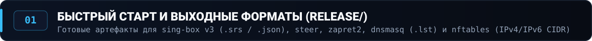
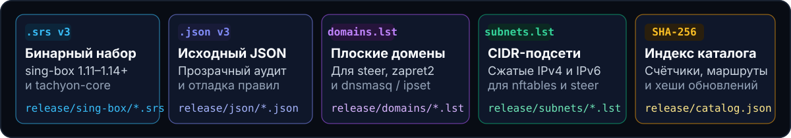
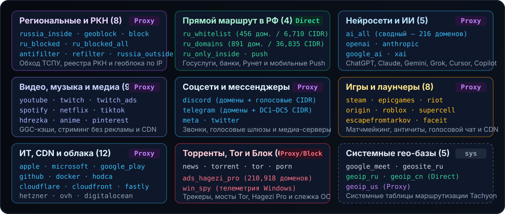

<p align="center">
  
</p>

<p align="center">
  <a href="https://github.com/Dushnilin/tachyon-lists/actions/workflows/build.yml"></a>
  <a href="https://github.com/Dushnilin/tachyon-lists/releases/tag/latest"></a>
  <a href="./release/catalog.json"></a>
  <a href="./sources.json"></a>
</p>

---

<p align="center">
  
</p>

<p align="center">
  
</p>

| Целевая система | Артефакт | Шаблон прямой ссылки (`raw` / `releases`) |
|:---|:---|:---|
| **`sing-box` / `tachyon-core`** | `release/sing-box/<id>.srs` | `https://raw.githubusercontent.com/Dushnilin/tachyon-lists/main/release/sing-box/<id>.srs`<br>`https://github.com/Dushnilin/tachyon-lists/releases/download/latest/<id>.srs` |
| **Исходник `sing-box` v3** | `release/json/<id>.json` | `https://raw.githubusercontent.com/Dushnilin/tachyon-lists/main/release/json/<id>.json` |
| **`steer` / `zapret2` / `dnsmasq`** | `release/domains/<id>.lst` | `https://raw.githubusercontent.com/Dushnilin/tachyon-lists/main/release/domains/<id>.lst` |
| **`nftables` / `steer` / `ipset`** | `release/subnets/<id>.lst` | `https://raw.githubusercontent.com/Dushnilin/tachyon-lists/main/release/subnets/<id>.lst` (также `subnets/ipv4/<id>.lst` и `ipv6/<id>.lst`) |
| **Индекс и `SHA-256` хеши** | [`release/catalog.json`](release/catalog.json) | `https://github.com/Dushnilin/tachyon-lists/releases/download/latest/catalog.json` |

<details>
<summary><b>📄 Пример подключения в <code>sing-box</code> (1.11+ / 1.14+) и команды локальной сборки (<code>build_lists.py</code>)</b></summary>

<br>

Все доменные категории (`kind: "domains"`) гарантированно **не содержат `ip_cidr`** внутри `.srs`, поэтому совместимы с `dns.rules` в `sing-box 1.14+` без ошибки `rule-set with IP CIDR rules requires match_response`:

```json
{
  "route": {
    "rule_set": [
      {
        "tag": "ru_whitelist",
        "type": "remote",
        "format": "binary",
        "url": "https://raw.githubusercontent.com/Dushnilin/tachyon-lists/main/release/sing-box/ru_whitelist.srs",
        "download_detour": "direct",
        "update_interval": "6h"
      },
      {
        "tag": "ai_all",
        "type": "remote",
        "format": "binary",
        "url": "https://raw.githubusercontent.com/Dushnilin/tachyon-lists/main/release/sing-box/ai_all.srs",
        "download_detour": "proxy",
        "update_interval": "6h"
      },
      {
        "tag": "ads_hagezi_pro",
        "type": "remote",
        "format": "binary",
        "url": "https://raw.githubusercontent.com/Dushnilin/tachyon-lists/main/release/sing-box/ads_hagezi_pro.srs",
        "download_detour": "proxy",
        "update_interval": "12h"
      }
    ],
    "rules": [
      { "rule_set": ["ads_hagezi_pro"], "action": "reject" },
      { "rule_set": ["ru_whitelist"], "outbound": "direct" },
      { "rule_set": ["ai_all"], "outbound": "proxy" }
    ]
  }
}
```

**Локальная сборка и кастомизация (`custom/`):**

```bash
python3 build_lists.py                                             # Полная сборка всех 61 категории
python3 build_lists.py --only ru_whitelist geoblock ai_all         # Выборочная пересборка
```

- `custom/domains/<id>.lst` — добавить свои домены (`domain_suffix`) в категорию `<id>`.
- `custom/subnets/<id>.lst` — добавить свои IPv4/IPv6 CIDR в категорию `<id>`.
- `custom/exclude/<id>.lst` — принудительно вырезать домены из категории `<id>` до компиляции.

</details>

---

<p align="center">
  
</p>

<p align="center">
  
</p>

---

<p align="center">
  
</p>

<p align="center">
  
</p>

<p align="center">
  <sub>Прямые ссылки на апстрим-репозитории из <a href="./sources.json"><code>sources.json</code></a>:
  <a href="https://github.com/itdoginfo/allow-domains"><b>itdoginfo/allow-domains</b></a> ·
  <a href="https://github.com/runetfreedom/russia-v2ray-rules-dat"><b>runetfreedom/russia-v2ray-rules-dat</b></a> ·
  <a href="https://github.com/runetfreedom/russia-blocked-geoip"><b>runetfreedom/russia-blocked-geoip</b></a> ·
  <a href="https://github.com/hydraponique/roscomvpn-geosite"><b>hydraponique/roscomvpn-geosite</b></a> ·
  <a href="https://github.com/hydraponique/roscomvpn-geoip"><b>hydraponique/roscomvpn-geoip</b></a> ·
  <a href="https://github.com/MetaCubeX/meta-rules-dat"><b>MetaCubeX/meta-rules-dat</b></a> ·
  <a href="https://github.com/zxc-rv/ad-filter"><b>zxc-rv/ad-filter</b></a> ·
  <a href="https://github.com/ushan0v/sing-box-supercell-ruleset"><b>ushan0v/sing-box-supercell-ruleset</b></a></sub>
</p>

<details>
<summary><b>🗺️ Развернуть точную пофайловую матрицу источников для всех 61 категории (<code>sources.json</code> → какие файлы склеиваются и <code>fallback_srs</code>)</b></summary>

<br>

| ID | Группа | `kind` | Входные источники (`sources` в `sources.json`) | Резервный `fallback_srs` |
|:---|:---:|:---:|:---|:---|
| `russia_inside` | `regional` | `domains` | `itdoginfo_srs/russia_inside.srs` + `roscomvpn_geosite_srs/category-geoblock-ru.srs` | `itdoginfo` → `russia_inside.srs` |
| `geoblock` | `regional` | `domains` | `itdoginfo_srs/geoblock.srs` + `roscomvpn_geosite_srs/category-geoblock-ru.srs` | `itdoginfo` → `geoblock.srs` |
| `block` | `regional` | `domains` | `itdoginfo_srs/block.srs` | `itdoginfo` → `block.srs` |
| `ru_blocked` | `regional` | `domains` | `runetfreedom_geosite_srs/geosite-ru-blocked.srs` + `runetfreedom_geoip_text/ru-blocked.txt` | `runetfreedom` → `geosite-ru-blocked.srs` |
| `ru_blocked_all` | `regional` | `domains` | `runetfreedom_geosite_srs/geosite-ru-blocked-all.srs` + `runetfreedom_geoip_text/ru-blocked-community.txt` | `runetfreedom` → `geosite-ru-blocked-all.srs` |
| `antifilter` | `regional` | `domains` | `runetfreedom_geosite_srs/geosite-antifilter-download-community.srs` + `runetfreedom_geoip_text/ru-blocked-community.txt` | `runetfreedom` → `geosite-antifilter-download-community.srs` |
| `refilter` | `regional` | `domains` | `runetfreedom_geosite_srs/geosite-refilter.srs` + `runetfreedom_geoip_text/re-filter.txt` | `runetfreedom` → `geosite-refilter.srs` |
| `russia_outside` | `regional` | `domains` | `itdoginfo_srs/russia_outside.srs` + `runetfreedom_geosite_srs/geosite-ru-available-only-inside.srs` | `itdoginfo` → `russia_outside.srs` |
| `ru_whitelist` | `direct` | `domains` | `roscomvpn_geosite_srs/whitelist.srs` + `roscomvpn_geoip_text/whitelist.txt` | `roscomvpn` → `whitelist.srs` |
| `ru_domains` | `direct` | `domains` | `roscomvpn_geosite_srs/category-ru.srs` + `runetfreedom_geosite_srs/geosite-category-ru.srs` + `metacubex_geosite/category-ru.json` + `roscomvpn_geoip_text/direct.txt` | `roscomvpn` → `category-ru.srs` |
| `ru_only_inside` | `direct` | `domains` | `runetfreedom_geosite_srs/geosite-ru-available-only-inside.srs` | `runetfreedom` → `geosite-ru-available-only-inside.srs` |
| `push` | `direct` | `domains` | `roscomvpn_geosite_srs/push.srs` | `roscomvpn` → `push.srs` |
| `ai_all` | `ai` | `domains` | `runetfreedom_geosite_srs/geosite-category-ai-!cn.srs` + `roscomvpn_geosite_srs/google-deepmind.srs` + `metacubex_geosite/category-ai-!cn.json` | `runetfreedom` → `geosite-category-ai-!cn.srs` |
| `openai` | `ai` | `domains` | `runetfreedom_geosite_srs/geosite-openai.srs` + `metacubex_geosite/openai.json` | `runetfreedom` → `geosite-openai.srs` |
| `anthropic` | `ai` | `domains` | `runetfreedom_geosite_srs/geosite-anthropic.srs` + `metacubex_geosite/anthropic.json` | `runetfreedom` → `geosite-anthropic.srs` |
| `google_ai` | `ai` | `domains` | `itdoginfo_srs/google_ai.srs` + `roscomvpn_geosite_srs/google-deepmind.srs` + `runetfreedom_geosite_srs/geosite-google-gemini.srs` + `metacubex_geosite/google-gemini.json` | `itdoginfo` → `google_ai.srs` |
| `xai` | `ai` | `domains` | `runetfreedom_geosite_srs/geosite-xai.srs` + `metacubex_geosite/xai.json` | `runetfreedom` → `geosite-xai.srs` |
| `youtube` | `media` | `domains` | `itdoginfo_srs/youtube.srs` + `roscomvpn_geosite_srs/youtube.srs` + `runetfreedom_geosite_srs/geosite-youtube.srs` + `metacubex_geosite/youtube.json` | `itdoginfo` → `youtube.srs` |
| `twitch` | `media` | `domains` | `roscomvpn_geosite_srs/twitch.srs` + `runetfreedom_geosite_srs/geosite-twitch.srs` + `metacubex_geosite/twitch.json` | `MetaCubeX` → `twitch.srs` |
| `twitch_ads` | `media` | `domains` | `roscomvpn_geosite_srs/twitch-ads.srs` | `roscomvpn` → `twitch-ads.srs` |
| `spotify` | `media` | `domains` | `runetfreedom_geosite_srs/geosite-spotify.srs` + `metacubex_geosite/spotify.json` | `runetfreedom` → `geosite-spotify.srs` |
| `netflix` | `media` | `domains` | `runetfreedom_geosite_srs/geosite-netflix.srs` + `metacubex_geosite/netflix.json` + `runetfreedom_geoip_text/netflix.txt` | `runetfreedom` → `geosite-netflix.srs` |
| `tiktok` | `media` | `domains` | `itdoginfo_srs/tiktok.srs` + `runetfreedom_geosite_srs/geosite-tiktok.srs` + `metacubex_geosite/tiktok.json` | `itdoginfo` → `tiktok.srs` |
| `hdrezka` | `media` | `domains` | `itdoginfo_srs/hdrezka.srs` | `itdoginfo` → `hdrezka.srs` |
| `anime` | `media` | `domains` | `itdoginfo_srs/anime.srs` | `itdoginfo` → `anime.srs` |
| `pinterest` | `media` | `domains` | `roscomvpn_geosite_srs/pinterest.srs` + `runetfreedom_geosite_srs/geosite-pinterest.srs` + `metacubex_geosite/pinterest.json` | `roscomvpn` → `pinterest.srs` |
| `discord` | `social` | `subnets` | `itdoginfo_srs/discord.srs` + `runetfreedom_geosite_srs/geosite-discord.srs` + `itdoginfo_raw/Subnets/IPv4·IPv6/discord.lst` | `itdoginfo` → `discord.srs` |
| `telegram` | `social` | `mixed` | `itdoginfo_srs/telegram.srs` + `roscomvpn_geosite_srs/telegram.srs` + `runetfreedom_geosite_srs/geosite-telegram.srs` + `runetfreedom_geoip_srs/geoip-telegram.srs` + `itdoginfo_raw/Subnets/IPv4·IPv6/telegram.lst` | `itdoginfo` → `telegram.srs` |
| `meta` | `social` | `mixed` | `itdoginfo_srs/meta.srs` + `runetfreedom_geosite_srs/geosite-meta.srs` + `runetfreedom_geoip_srs/geoip-facebook.srs` + `itdoginfo_raw/Subnets/IPv4·IPv6/meta.lst` | `itdoginfo` → `meta.srs` |
| `twitter` | `social` | `mixed` | `itdoginfo_srs/twitter.srs` + `runetfreedom_geosite_srs/geosite-twitter.srs` + `runetfreedom_geoip_srs/geoip-twitter.srs` + `itdoginfo_raw/Subnets/IPv4·IPv6/twitter.lst` | `itdoginfo` → `twitter.srs` |
| `steam` | `gaming` | `domains` | `roscomvpn_geosite_srs/steam.srs` + `runetfreedom_geosite_srs/geosite-steam.srs` + `metacubex_geosite/steam.json` | `roscomvpn` → `steam.srs` |
| `epicgames` | `gaming` | `domains` | `roscomvpn_geosite_srs/epicgames.srs` + `runetfreedom_geosite_srs/geosite-epicgames.srs` + `metacubex_geosite/epicgames.json` | `roscomvpn` → `epicgames.srs` |
| `riot` | `gaming` | `domains` | `roscomvpn_geosite_srs/riot.srs` + `runetfreedom_geosite_srs/geosite-riot.srs` + `metacubex_geosite/riot.json` | `roscomvpn` → `riot.srs` |
| `origin` | `gaming` | `domains` | `roscomvpn_geosite_srs/origin.srs` | `roscomvpn` → `origin.srs` |
| `roblox` | `gaming` | `mixed` | `itdoginfo_srs/roblox.srs` + `runetfreedom_geosite_srs/geosite-roblox.srs` + `itdoginfo_raw/Subnets/IPv4/roblox.lst` | `itdoginfo` → `roblox.srs` |
| `supercell` | `gaming` | `domains` | `ushan0v/sing-box-supercell-ruleset/main/supercell.srs` + `metacubex_geosite/supercell.json` | `ushan0v` → `supercell.srs` |
| `escapefromtarkov` | `gaming` | `domains` | `roscomvpn_geosite_srs/escapefromtarkov.srs` | `roscomvpn` → `escapefromtarkov.srs` |
| `faceit` | `gaming` | `domains` | `roscomvpn_geosite_srs/faceit.srs` | `roscomvpn` → `faceit.srs` |
| `apple` | `tech` | `domains` | `roscomvpn_geosite_srs/apple.srs` + `runetfreedom_geosite_srs/geosite-apple.srs` + `metacubex_geosite/apple.json` | `roscomvpn` → `apple.srs` |
| `microsoft` | `tech` | `domains` | `roscomvpn_geosite_srs/microsoft.srs` + `runetfreedom_geosite_srs/geosite-microsoft.srs` + `metacubex_geosite/microsoft.json` | `roscomvpn` → `microsoft.srs` |
| `google_play` | `tech` | `domains` | `itdoginfo_srs/google_play.srs` + `roscomvpn_geosite_srs/google-play.srs` + `runetfreedom_geosite_srs/geosite-google-play.srs` + `metacubex_geosite/google-play.json` | `itdoginfo` → `google_play.srs` |
| `github` | `tech` | `domains` | `roscomvpn_geosite_srs/github.srs` + `runetfreedom_geosite_srs/geosite-github.srs` + `metacubex_geosite/github.json` | `MetaCubeX` → `github.srs` |
| `docker` | `tech` | `domains` | `runetfreedom_geosite_srs/geosite-docker.srs` + `metacubex_geosite/docker.json` | `runetfreedom` → `geosite-docker.srs` |
| `hodca` | `tech` | `domains` | `itdoginfo_srs/hodca.srs` | `itdoginfo` → `hodca.srs` |
| `cloudflare` | `infra` | `subnets` | `itdoginfo_srs/cloudflare.srs` + `runetfreedom_geoip_srs/geoip-cloudflare.srs` + `itdoginfo_raw/Subnets/IPv4·IPv6/cloudflare.lst` | `itdoginfo` → `cloudflare.srs` |
| `cloudfront` | `infra` | `subnets` | `itdoginfo_srs/cloudfront.srs` + `runetfreedom_geoip_srs/geoip-cloudfront.srs` + `itdoginfo_raw/Subnets/IPv4·IPv6/cloudfront.lst` | `itdoginfo` → `cloudfront.srs` |
| `fastly` | `infra` | `domains` | `runetfreedom_geosite_srs/geosite-fastly.srs` + `metacubex_geosite/fastly.json` + `runetfreedom_geoip_srs/geoip-fastly.srs` | `runetfreedom` → `geosite-fastly.srs` |
| `hetzner` | `infra` | `subnets` | `itdoginfo_srs/hetzner.srs` + `itdoginfo_raw/Subnets/IPv4·IPv6/hetzner.lst` | `itdoginfo` → `hetzner.srs` |
| `ovh` | `infra` | `subnets` | `itdoginfo_srs/ovh.srs` + `itdoginfo_raw/Subnets/IPv4·IPv6/ovh.lst` | `itdoginfo` → `ovh.srs` |
| `digitalocean` | `infra` | `subnets` | `itdoginfo_srs/digitalocean.srs` + `itdoginfo_raw/Subnets/IPv4·IPv6/digitalocean.lst` | `itdoginfo` → `digitalocean.srs` |
| `news` | `other` | `domains` | `itdoginfo_srs/news.srs` | `itdoginfo` → `news.srs` |
| `torrent` | `other` | `domains` | `roscomvpn_geosite_srs/torrent.srs` | `roscomvpn` → `torrent.srs` |
| `tor` | `other` | `domains` | `runetfreedom_geosite_srs/geosite-tor.srs` + `metacubex_geosite/tor.json` + `runetfreedom_geoip_srs/geoip-tor.srs` | `runetfreedom` → `geosite-tor.srs` |
| `porn` | `other` | `domains` | `itdoginfo_srs/porn.srs` + `runetfreedom_geosite_srs/geosite-category-porn.srs` | `itdoginfo` → `porn.srs` |
| `ads_hagezi_pro` | `block` | `domains` | `zxc-rv/ad-filter/releases/latest/download/adlist.srs` | `zxc-rv/ad-filter` → `adlist.srs` |
| `win_spy` | `block` | `domains` | `roscomvpn_geosite_srs/win-spy.srs` + `metacubex_geosite/win-spy.json` | `roscomvpn` → `win-spy.srs` |
| `google_meet` | `internal` | `mixed` | `itdoginfo_srs/google_meet.srs` | `itdoginfo` → `google_meet.srs` |
| `geosite_ru` | `internal` | `domains` | `roscomvpn_geosite_srs/category-ru.srs` + `metacubex_geosite/category-ru.json` | `MetaCubeX` → `category-ru.srs` |
| `geoip_ru` | `internal` | `subnets` | `metacubex_geoip/ru.json` | `MetaCubeX` → `geoip/ru.srs` |
| `geoip_us` | `internal` | `subnets` | `metacubex_geoip/us.json` | `MetaCubeX` → `geoip/us.srs` |
| `geoip_cn` | `internal` | `subnets` | `metacubex_geoip/cn.json` | `MetaCubeX` → `geoip/cn.srs` |

</details>

---

<p align="center">
  
</p>

<p align="center">
  
</p>

<details>
<summary><b>📋 Развернуть полную таблицу 56 основных списков (описания, счётчики доменов/подсетей и прямые ссылки — автообновление 6ч)</b></summary>

<br>

<!-- CATALOG_TABLE_START -->
| ID | Категория и описание | Режим | Домены | Подсети (IPv4/IPv6) | Форматы |
|:---|:---|:---:|---:|---:|:---|
| `russia_inside` | **Россия (внутри) — сводный реестр заблокированных и ограниченных в РФ ресурсов**<br><sub>[Маршрут: В Прокси / VPN или Обход DPI] Главный сводный список обхода блокировок внутри России: объединяет домены из реестра РКН, списки Re:filter, Antifilter и популярные зарубежные сервисы, закрывшие доступ для российских IP.</sub> | 🟣 `Proxy` | `74,418` | `0` | [`.trs`](release/tachyon/russia_inside.trs) · [`.srs`](release/sing-box/russia_inside.srs) · [`.json`](release/json/russia_inside.json) · [`.lst`](release/domains/russia_inside.lst) |
| `geoblock` | **Геоблок — зарубежные сервисы, закрывшие доступ с российских IP**<br><sub>[Маршрут: Только в Прокси / VPN — геоблок по IP] Единая база из 150+ иностранных платформ, SaaS, банков и облаков, возвращающих ошибку 403 / Unavailable in your region из РФ: PayPal, Wise, Revolut, Notion, Canva, Trello, Jira, Atlassian, Zoom, Intel, Dell, Broadcom, VMware, Coursera, Udemy, JetBrains, GitLab, Adobe, Autodesk, Grammarly, Medium, Docker, DigiCert и др.</sub> | 🟣 `Proxy` | `946` | `0` | [`.trs`](release/tachyon/geoblock.trs) · [`.srs`](release/sing-box/geoblock.srs) · [`.json`](release/json/geoblock.json) · [`.lst`](release/domains/geoblock.lst) |
| `block` | **Реестр РКН (прямые блокировки) — домены из выгрузки Роскомнадзора**<br><sub>[Маршрут: В Прокси / VPN или Обход DPI] Сайты и сервисы, официально внесённые в единый реестр запрещённых ресурсов Роскомнадзора и блокируемые на ТСПУ провайдеров.</sub> | 🟣 `Proxy` | `331` | `0` | [`.trs`](release/tachyon/block.trs) · [`.srs`](release/sing-box/block.srs) · [`.json`](release/json/block.json) · [`.lst`](release/domains/block.lst) |
| `ru_blocked` | **Реестр РКН и Антизапрет (очищенный) — актуальные заблокированные домены**<br><sub>[Маршрут: В Прокси / VPN или Обход DPI] Очищенный и дедуплицированный список реально действующих заблокированных в РФ доменов (объединение Антизапрета и выгрузки РКН без мёртвых и мусорных доменов).</sub> | 🟣 `Proxy` | `74,739` | `88,587` | [`.trs`](release/tachyon/ru_blocked.trs) · [`.srs`](release/sing-box/ru_blocked.srs) · [`.json`](release/json/ru_blocked.json) · [`.lst`](release/domains/ru_blocked.lst) · [`subnets`](release/subnets/ru_blocked.lst) |
| `ru_blocked_all` | **Реестр РКН (полный) — все заблокированные домены, поддомены и зеркала**<br><sub>[Маршрут: В Прокси / VPN или Обход DPI] Полная нефильтрованная выгрузка всех доменов, поддоменов и зеркал из реестра блокировок РФ, включая региональные ограничения и блокировки ТСПУ.</sub> | 🟣 `Proxy` | `1,374,037` | `924` | [`.trs`](release/tachyon/ru_blocked_all.trs) · [`.srs`](release/sing-box/ru_blocked_all.srs) · [`.json`](release/json/ru_blocked_all.json) · [`.lst`](release/domains/ru_blocked_all.lst) · [`subnets`](release/subnets/ru_blocked_all.lst) |
| `antifilter` | **Antifilter Community — народный список обхода блокировок и ТСПУ**<br><sub>[Маршрут: В Прокси / VPN или Обход DPI] Курируемый сообществом Antifilter.download список доменов и сервисов, заблокированных РКН или замедляемых оборудованием ТСПУ в России.</sub> | 🟣 `Proxy` | `420` | `924` | [`.trs`](release/tachyon/antifilter.trs) · [`.srs`](release/sing-box/antifilter.srs) · [`.json`](release/json/antifilter.json) · [`.lst`](release/domains/antifilter.lst) · [`subnets`](release/subnets/antifilter.lst) |
| `refilter` | **Re:filter — выверенный список блокировок и геоблока без лишних доменов**<br><sub>[Маршрут: В Прокси / VPN] Тщательно модерируемый проект Re:filter: включает проверенные домены заблокированных ресурсов и западных сервисов с геоблоком без избыточных правил.</sub> | 🟣 `Proxy` | `74,658` | `25,266` | [`.trs`](release/tachyon/refilter.trs) · [`.srs`](release/sing-box/refilter.srs) · [`.json`](release/json/refilter.json) · [`.lst`](release/domains/refilter.lst) · [`subnets`](release/subnets/refilter.lst) |
| `russia_outside` | **Россия (снаружи) — сервисы РФ для доступа из-за рубежа**<br><sub>[Маршрут: В Прокси с IP РФ (из-за рубежа) или Direct (в РФ)] Российские банки, Госуслуги, маркетплейсы (Ozon, Wildberries), онлайн-кинотеатры (Кинопоиск, Иви, Wink, Okko) и госсайты, не открывающиеся с зарубежных IP-адресов.</sub> | 🟣 `Proxy` | `173` | `0` | [`.trs`](release/tachyon/russia_outside.trs) · [`.srs`](release/sing-box/russia_outside.srs) · [`.json`](release/json/russia_outside.json) · [`.lst`](release/domains/russia_outside.lst) |
| `ru_whitelist` | **Белый список РФ (Direct) — Госуслуги, банки, маркетплейсы, капчи и госсайты**<br><sub>[Маршрут: Напрямую (Direct)] Критически важные российские сервисы, которые нельзя пускать через VPN: Госуслуги, ФНС (nalog.ru), Честный ЗНАК, Мос.ру, Сбербанк, Т-Банк, Альфа-Банк, ВТБ, Ozon, Wildberries, Авито, Яндекс, VK, РЖД, корневые сертификаты и проверочные домены.</sub> | 🟢 `Direct` | `456` | `6,710` | [`.trs`](release/tachyon/ru_whitelist.trs) · [`.srs`](release/sing-box/ru_whitelist.srs) · [`.json`](release/json/ru_whitelist.json) · [`.lst`](release/domains/ru_whitelist.lst) · [`subnets`](release/subnets/ru_whitelist.lst) |
| `ru_domains` | **Рунет и СНГ (Direct) — доменные зоны .ru, .рф, .su, .by, .kz и компании РФ**<br><sub>[Маршрут: Напрямую (Direct)] Все национальные доменные зоны России и СНГ (.ru, .рф, .su, .рус, .москва, .дети, .татар, .by, .бел, .kz, .қаз), а также международные домены российских компаний (Яндекс, VK, Mail.ru, Kaspersky, 1С, 2ГИС, Rutube).</sub> | 🟢 `Direct` | `891` | `36,912` | [`.trs`](release/tachyon/ru_domains.trs) · [`.srs`](release/sing-box/ru_domains.srs) · [`.json`](release/json/ru_domains.json) · [`.lst`](release/domains/ru_domains.lst) · [`subnets`](release/subnets/ru_domains.lst) |
| `ru_only_inside` | **Только из РФ (Direct) — госпорталы, банки и сервисы, блокирующие VPN IP**<br><sub>[Маршрут: Строго Напрямую (Direct)] Российские государственные порталы, банки, суды, ЕМИАС, региональные сервисы ЖКХ и операторы связи, которые жёстко блокируют вход с любых зарубежных и серверных IP-адресов.</sub> | 🟢 `Direct` | `167` | `0` | [`.trs`](release/tachyon/ru_only_inside.trs) · [`.srs`](release/sing-box/ru_only_inside.srs) · [`.json`](release/json/ru_only_inside.json) · [`.lst`](release/domains/ru_only_inside.lst) |
| `push` | **Push-уведомления (Direct) — Apple APNs, Google FCM, Huawei, Xiaomi, Samsung**<br><sub>[Маршрут: Напрямую (Direct)] Серверы доставки мобильных и системных push-уведомлений: Apple APNs (push.apple.com), Google FCM (mtalk.google.com, fcm.googleapis.com), Huawei Push, Xiaomi MiPush, Samsung Push и Windows WNS.</sub> | 🟢 `Direct` | `17` | `0` | [`.trs`](release/tachyon/push.trs) · [`.srs`](release/sing-box/push.srs) · [`.json`](release/json/push.json) · [`.lst`](release/domains/push.lst) |
| `ai_all` | **Нейросети и ИИ (все) — OpenAI, Claude, Gemini, Grok, Perplexity, Cursor, Midjourney**<br><sub>[Маршрут: Только в Прокси / VPN — геоблок по IP] Единый полный список всех зарубежных ИИ-сервисов, закрывших доступ из РФ: OpenAI (ChatGPT, Sora), Anthropic (Claude), Google (Gemini, AI Studio, NotebookLM), xAI (Grok), Perplexity, Microsoft Copilot, GitHub Copilot, Cursor, Windsurf, Codeium, Midjourney, ElevenLabs, Runway, Suno, Udio, Hugging Face, Replicate, Poe, OpenRouter, DeepSeek и Groq.</sub> | 🟣 `Proxy` | `221` | `0` | [`.trs`](release/tachyon/ai_all.trs) · [`.srs`](release/sing-box/ai_all.srs) · [`.json`](release/json/ai_all.json) · [`.lst`](release/domains/ai_all.lst) |
| `openai` | **OpenAI — ChatGPT, Sora, GPT API, o1/o3 и CDN-ресурсы**<br><sub>[Маршрут: Только в Прокси / VPN — геоблок по IP] Все домены и поддомены OpenAI: chatgpt.com, chat.openai.com, sora.com, platform.openai.com, api.openai.com, oaistatic.com, oaiusercontent.com и шлюзы авторизации.</sub> | 🟣 `Proxy` | `24` | `0` | [`.trs`](release/tachyon/openai.trs) · [`.srs`](release/sing-box/openai.srs) · [`.json`](release/json/openai.json) · [`.lst`](release/domains/openai.lst) |
| `anthropic` | **Anthropic — Claude AI, Claude Code, Console и API**<br><sub>[Маршрут: Только в Прокси / VPN — геоблок по IP] Домены нейросети Claude и инструментов разработки Anthropic: claude.ai, anthropic.com, console.anthropic.com, api.anthropic.com, claudemcpclient.com и CDN.</sub> | 🟣 `Proxy` | `19` | `0` | [`.trs`](release/tachyon/anthropic.trs) · [`.srs`](release/sing-box/anthropic.srs) · [`.json`](release/json/anthropic.json) · [`.lst`](release/domains/anthropic.lst) |
| `google_ai` | **Google AI — Gemini, AI Studio, NotebookLM, DeepMind и Vertex AI**<br><sub>[Маршрут: Только в Прокси / VPN — геоблок по IP] Все домены ИИ-экосистемы Google: gemini.google.com, aistudio.google.com, notebooklm.google.com, makersuite.google.com, deepmind.google, bard.google.com и generativelanguage.googleapis.com.</sub> | 🟣 `Proxy` | `58` | `0` | [`.trs`](release/tachyon/google_ai.trs) · [`.srs`](release/sing-box/google_ai.srs) · [`.json`](release/json/google_ai.json) · [`.lst`](release/domains/google_ai.lst) |
| `xai` | **xAI — нейросеть Grok (grok.com, x.ai и API)**<br><sub>[Маршрут: Только в Прокси / VPN — геоблок по IP] Домены искусственного интеллекта xAI Илона Маска: grok.com, x.ai, console.x.ai, api.x.ai и медиа-CDN Grok.</sub> | 🟣 `Proxy` | `5` | `0` | [`.trs`](release/tachyon/xai.trs) · [`.srs`](release/sing-box/xai.srs) · [`.json`](release/json/xai.json) · [`.lst`](release/domains/xai.lst) |
| `youtube` | **YouTube — видеосервис, YouTube Music, Studio и кэш-серверы (googlevideo / ytimg)**<br><sub>[Маршрут: В Обход DPI (Desync / Zapret) или Прокси / VPN] Полный набор доменов YouTube: youtube.com, youtu.be, googlevideo.com (видеопотоки GGC), ytimg.com (превью), ggpht.com (аватарки каналов), youtubei.googleapis.com и YouTube Music.</sub> | 🟣 `Proxy` | `182` | `0` | [`.trs`](release/tachyon/youtube.trs) · [`.srs`](release/sing-box/youtube.srs) · [`.json`](release/json/youtube.json) · [`.lst`](release/domains/youtube.lst) |
| `twitch` | **Twitch — стриминговая платформа, видеопотоки (ttvnw.net) и чат**<br><sub>[Маршрут: В Прокси / VPN или Обход DPI] Все домены платформы Twitch (twitch.tv, ttvnw.net, jtvnw.net, live-video.net). Для снятия лимита 720p и отключения рекламы без проксирования самого видеопотока используйте список «Twitch (без рекламы и 1080p+)».</sub> | 🟣 `Proxy` | `43` | `0` | [`.trs`](release/tachyon/twitch.trs) · [`.srs`](release/sing-box/twitch.srs) · [`.json`](release/json/twitch.json) · [`.lst`](release/domains/twitch.lst) |
| `twitch_ads` | **Twitch (без рекламы и 1080p+) — серверы манифестов качества видео и рекламы**<br><sub>[Маршрут: Только в Прокси / VPN] Узкий список серверов выбора качества потока и рекламных вставок Twitch (usher.ttvnw.net, gql.twitch.tv, edge.ads.twitch.tv). Направьте его в Прокси (оставив остальной Twitch напрямую): видеопоток пойдёт напрямую без нагрузки на VPN, но пропадёт реклама и вернётся качество 1080p60 / 1440p!</sub> | 🟣 `Proxy` | `5` | `0` | [`.trs`](release/tachyon/twitch_ads.trs) · [`.srs`](release/sing-box/twitch_ads.srs) · [`.json`](release/json/twitch_ads.json) · [`.lst`](release/domains/twitch_ads.lst) |
| `spotify` | **Spotify — музыкальный стриминг, аудио-CDN и клиентские API**<br><sub>[Маршрут: Только в Прокси / VPN — геоблок по IP] Все домены Spotify: spotify.com, scdn.co, spotifycdn.com, audio-ak-spotify-com.akamaized.net, psavn.com и серверы авторизации приложений.</sub> | 🟣 `Proxy` | `25` | `0` | [`.trs`](release/tachyon/spotify.trs) · [`.srs`](release/sing-box/spotify.srs) · [`.json`](release/json/spotify.json) · [`.lst`](release/domains/spotify.lst) |
| `netflix` | **Netflix — онлайн-кинотеатр, видеопотоки (nflxvideo.net) и статика**<br><sub>[Маршрут: Только в Прокси / VPN — геоблок по IP] Домены видеосервиса Netflix: netflix.com, nflxvideo.net, nflximg.net, nflxso.net, nflxext.com и проверка скорости fast.com.</sub> | 🟣 `Proxy` | `24` | `122` | [`.trs`](release/tachyon/netflix.trs) · [`.srs`](release/sing-box/netflix.srs) · [`.json`](release/json/netflix.json) · [`.lst`](release/domains/netflix.lst) · [`subnets`](release/subnets/netflix.lst) |
| `tiktok` | **TikTok — приложение, веб-версия и медиа-CDN ByteDance**<br><sub>[Маршрут: Только в Прокси / VPN — региональный блок РФ] Домены TikTok и ByteDance (tiktok.com, tiktokv.com, tiktokcdn.com, byteoversea.com, musical.ly) для просмотра новых видео и стримов без региональных ограничений в РФ.</sub> | 🟣 `Proxy` | `53` | `0` | [`.trs`](release/tachyon/tiktok.trs) · [`.srs`](release/sing-box/tiktok.srs) · [`.json`](release/json/tiktok.json) · [`.lst`](release/domains/tiktok.lst) |
| `hdrezka` | **HDRezka — онлайн-кинотеатр, видео-балансеры (Voidboost) и актуальные зеркала**<br><sub>[Маршрут: В Прокси / VPN или Обход DPI] Домены, зеркала и CDN видеопотоков онлайн-кинотеатра HDRezka (rezka.ag, hdrezka.ag, voidboost.cc, stream.voidboost.cc и связанные балансеры).</sub> | 🟣 `Proxy` | `17` | `0` | [`.trs`](release/tachyon/hdrezka.trs) · [`.srs`](release/sing-box/hdrezka.srs) · [`.json`](release/json/hdrezka.json) · [`.lst`](release/domains/hdrezka.lst) |
| `anime` | **Аниме — Shikimori, AnimeGO, Jut.su, Kodik, Anilibria, Crunchyroll**<br><sub>[Маршрут: В Прокси / VPN или Обход DPI] Популярные аниме-порталы, базы данных и видеоплееры: Shikimori, AnimeGO, Jut.su, YummyAnime, Anilibria, Kodik, Sibnet, Crunchyroll и MyAnimeList.</sub> | 🟣 `Proxy` | `42` | `0` | [`.trs`](release/tachyon/anime.trs) · [`.srs`](release/sing-box/anime.srs) · [`.json`](release/json/anime.json) · [`.lst`](release/domains/anime.lst) |
| `pinterest` | **Pinterest — фотохостинг, пины и серверы изображений (pinimg.com)**<br><sub>[Маршрут: В Прокси / VPN или Обход DPI] Домены визуальной соцсети Pinterest: pinterest.com, pin.it и CDN картинок i.pinimg.com / s.pinimg.com (устраняет проблему бесконечной загрузки картинок на ТСПУ).</sub> | 🟣 `Proxy` | `52` | `0` | [`.trs`](release/tachyon/pinterest.trs) · [`.srs`](release/sing-box/pinterest.srs) · [`.json`](release/json/pinterest.json) · [`.lst`](release/domains/pinterest.lst) |
| `discord` | **Discord — мессенджер, чаты, CDN вложений и голосовые шлюзы**<br><sub>[Маршрут: В Прокси / VPN или Обход DPI] Все домены и подсети Discord: discord.com, discord.gg, discordapp.com, discordapp.net, discord.media и голосовые серверы.</sub> | 🟣 `Proxy` | `29` | `9` | [`.trs`](release/tachyon/discord.trs) · [`.srs`](release/sing-box/discord.srs) · [`.json`](release/json/discord.json) · [`.lst`](release/domains/discord.lst) · [`subnets`](release/subnets/discord.lst) |
| `telegram` | **Telegram — мессенджер, веб-клиенты, Telegraph и все датацентры (DC1–DC5)**<br><sub>[Маршрут: В Прокси / VPN] Домены (telegram.org, t.me, web.telegram.org, telegra.ph, telesco.pe) и официальные IPv4/IPv6-подсети всех датацентров Telegram для работы звонков, кружочков и быстрой загрузки медиа.</sub> | 🟣 `Proxy` | `27` | `14` | [`.trs`](release/tachyon/telegram.trs) · [`.srs`](release/sing-box/telegram.srs) · [`.json`](release/json/telegram.json) · [`.lst`](release/domains/telegram.lst) · [`subnets`](release/subnets/telegram.lst) |
| `meta` | **Meta — Instagram, Facebook, Threads, Messenger и медиа-серверы (fbcdn)**<br><sub>[Маршрут: В Прокси / VPN] Все домены и IP-подсети компании Meta: instagram.com, cdninstagram.com, facebook.com, fbcdn.net, threads.net и messenger.com (без WhatsApp).</sub> | 🟣 `Proxy` | `551` | `120` | [`.trs`](release/tachyon/meta.trs) · [`.srs`](release/sing-box/meta.srs) · [`.json`](release/json/meta.json) · [`.lst`](release/domains/meta.lst) · [`subnets`](release/subnets/meta.lst) |
| `twitter` | **X (Twitter) — соцсеть, короткие ссылки t.co и медиа-CDN (twimg.com)**<br><sub>[Маршрут: В Прокси / VPN или Обход DPI] Домены и IP-подсети соцсети X / Twitter: x.com, twitter.com, t.co, twimg.com, abs.twimg.com, pbs.twimg.com и video.twimg.com.</sub> | 🟣 `Proxy` | `24` | `19` | [`.trs`](release/tachyon/twitter.trs) · [`.srs`](release/sing-box/twitter.srs) · [`.json`](release/json/twitter.json) · [`.lst`](release/domains/twitter.lst) · [`subnets`](release/subnets/twitter.lst) |
| `steam` | **Steam — магазин, сообщество, инвентарь, чат и CDN загрузок Valve**<br><sub>[Маршрут: Напрямую (Direct) или в Прокси для смены региона магазина] Все домены экосистемы Valve и Steam: store.steampowered.com, steamcommunity.com, steamstatic.com, steamusercontent.com, steamcontent.com и steamserver.net.</sub> | 🟣 `Proxy` | `60` | `0` | [`.trs`](release/tachyon/steam.trs) · [`.srs`](release/sing-box/steam.srs) · [`.json`](release/json/steam.json) · [`.lst`](release/domains/steam.lst) |
| `epicgames` | **Epic Games — EGS, Fortnite, Unreal Engine, Rocket League и EasyAntiCheat**<br><sub>[Маршрут: В Прокси / VPN (для раздач/покупок) или Direct] Домены Epic Games Store, Fortnite, Rocket League, Fall Guys, движка Unreal Engine, Fab/Quixel и античита EasyAntiCheat (epicgames.com, unrealengine.com, fortnite.com, easy.ac).</sub> | 🟣 `Proxy` | `30` | `0` | [`.trs`](release/tachyon/epicgames.trs) · [`.srs`](release/sing-box/epicgames.srs) · [`.json`](release/json/epicgames.json) · [`.lst`](release/domains/epicgames.lst) |
| `riot` | **Riot Games — Valorant, League of Legends, TFT, Riot Client и Vanguard**<br><sub>[Маршрут: В Прокси / VPN или Direct] Сервисы авторизации, обновлений и матчей Riot Games: riotgames.com, leagueoflegends.com, playvalorant.com, pvp.net и riotcdn.net.</sub> | 🟣 `Proxy` | `54` | `0` | [`.trs`](release/tachyon/riot.trs) · [`.srs`](release/sing-box/riot.srs) · [`.json`](release/json/riot.json) · [`.lst`](release/domains/riot.lst) |
| `origin` | **EA / Origin — EA App, Apex Legends, Battlefield, EA Sports FC и Sims**<br><sub>[Маршрут: В Прокси / VPN] Домены Electronic Arts: ea.com, origin.com, tnt-ea.com, apexlegends.com и серверы авторизации и загрузки игр EA App.</sub> | 🟣 `Proxy` | `153` | `0` | [`.trs`](release/tachyon/origin.trs) · [`.srs`](release/sing-box/origin.srs) · [`.json`](release/json/origin.json) · [`.lst`](release/domains/origin.lst) |
| `roblox` | **Roblox — игровая платформа, лаунчер, Roblox Studio и игровые серверы**<br><sub>[Маршрут: В Прокси / VPN или Обход DPI] Все домены и игровые IP-подсети Roblox: roblox.com, rbxcdn.com, rbx.com, robloxlabs.com и голосовой чат.</sub> | 🟣 `Proxy` | `49` | `2` | [`.trs`](release/tachyon/roblox.trs) · [`.srs`](release/sing-box/roblox.srs) · [`.json`](release/json/roblox.json) · [`.lst`](release/domains/roblox.lst) · [`subnets`](release/subnets/roblox.lst) |
| `supercell` | **Supercell — Brawl Stars, Clash Royale, Clash of Clans, Squad Busters**<br><sub>[Маршрут: Только в Прокси / VPN — геоблок по IP] Игровые серверы, домены авторизации Supercell ID и CDN обновлений для всех мобильных игр Supercell (блокируют вход с российских и белорусских IP).</sub> | 🟣 `Proxy` | `24` | `0` | [`.trs`](release/tachyon/supercell.trs) · [`.srs`](release/sing-box/supercell.srs) · [`.json`](release/json/supercell.json) · [`.lst`](release/domains/supercell.lst) |
| `escapefromtarkov` | **Escape from Tarkov — лаунчер, сайт, API профилей и серверы Battlestate Games**<br><sub>[Маршрут: В Прокси / VPN или Direct] Домены игры Escape from Tarkov и EFT: Arena (escapefromtarkov.com, tarkov.com, battlestategames.com и CDN обновлений).</sub> | 🟣 `Proxy` | `4` | `0` | [`.trs`](release/tachyon/escapefromtarkov.trs) · [`.srs`](release/sing-box/escapefromtarkov.srs) · [`.json`](release/json/escapefromtarkov.json) · [`.lst`](release/domains/escapefromtarkov.lst) |
| `faceit` | **FACEIT — киберспортивная платформа CS2, античит и матчмейкинг**<br><sub>[Маршрут: В Прокси / VPN или Обход DPI] Домены платформы FACEIT (faceit.com, faceit-cdn.net) для открытия лобби, статистики и работы клиента без бесконечной загрузки.</sub> | 🟣 `Proxy` | `2` | `0` | [`.trs`](release/tachyon/faceit.trs) · [`.srs`](release/sing-box/faceit.srs) · [`.json`](release/json/faceit.json) · [`.lst`](release/domains/faceit.lst) |
| `apple` | **Apple — App Store, iCloud, обновления iOS/macOS, Apple Music, TV+ и Intelligence**<br><sub>[Маршрут: Напрямую (Direct) или в Прокси для Apple Intelligence] Все домены экосистемы Apple: apple.com, icloud.com, mzstatic.com, aaplimg.com, cdn-apple.com, itunes.apple.com и серверы Apple Intelligence / Siri.</sub> | 🟣 `Proxy` | `1,591` | `0` | [`.trs`](release/tachyon/apple.trs) · [`.srs`](release/sing-box/apple.srs) · [`.json`](release/json/apple.json) · [`.lst`](release/domains/apple.lst) |
| `microsoft` | **Microsoft — Windows Update, Office 365, OneDrive, Xbox Live, Teams и Azure**<br><sub>[Маршрут: В Прокси / VPN (для Copilot, Xbox и ISO Windows) или Direct] Все сервисы Microsoft: microsoft.com, live.com, office.com, sharepoint.com, onedrive.com, xbox.com, microsoftonline.com, visualstudio.com и серверы обновлений Windows.</sub> | 🟣 `Proxy` | `648` | `0` | [`.trs`](release/tachyon/microsoft.trs) · [`.srs`](release/sing-box/microsoft.srs) · [`.json`](release/json/microsoft.json) · [`.lst`](release/domains/microsoft.lst) |
| `google_play` | **Google Play — магазин приложений Android, обновления и APK-серверы (gvt1/gvt2)**<br><sub>[Маршрут: В Прокси / VPN (для платных приложений и смены региона) или Direct] Домены магазина Google Play и скачивания приложений Android: play.google.com, play.googleapis.com, android.clients.google.com, gvt1.com, gvt2.com и xn--ngstr-lra8j.com.</sub> | 🟣 `Proxy` | `32` | `0` | [`.trs`](release/tachyon/google_play.trs) · [`.srs`](release/sing-box/google_play.srs) · [`.json`](release/json/google_play.json) · [`.lst`](release/domains/google_play.lst) |
| `github` | **GitHub — репозитории, GitHub Actions, Packages, Pages, Raw и Gist**<br><sub>[Маршрут: В Прокси / VPN (для Copilot и при сбоях ТСПУ) или Direct] Все домены GitHub: github.com, githubusercontent.com, githubassets.com, ghcr.io, github.io, gist.github.com и api.github.com.</sub> | 🟣 `Proxy` | `59` | `0` | [`.trs`](release/tachyon/github.trs) · [`.srs`](release/sing-box/github.srs) · [`.json`](release/json/github.json) · [`.lst`](release/domains/github.lst) |
| `docker` | **Docker — Docker Hub, реестр образов (registry-1.docker.io) и пакеты**<br><sub>[Маршрут: Только в Прокси / VPN — геоблок по IP] Домены Docker, закрывшие скачивание контейнеров с российских IP: docker.com, hub.docker.com, docker.io, registry-1.docker.io, production.cloudflare.docker.com и download.docker.com.</sub> | 🟣 `Proxy` | `6` | `0` | [`.trs`](release/tachyon/docker.trs) · [`.srs`](release/sing-box/docker.srs) · [`.json`](release/json/docker.json) · [`.lst`](release/domains/docker.lst) |
| `hodca` | **Центры сертификации (CA) — проверка SSL/TLS (OCSP / CRL): DigiCert, Sectigo, Let's Encrypt**<br><sub>[Маршрут: В Прокси / VPN] Серверы проверки отзыва SSL-сертификатов (OCSP и CRL) мировых удостоверяющих центров: DigiCert, Sectigo, Comodo, GlobalSign, Entrust, Let's Encrypt и Amazon Trust (устраняет зависания при открытии HTTPS-сайтов из-за геоблока OCSP).</sub> | 🟣 `Proxy` | `249` | `0` | [`.trs`](release/tachyon/hodca.trs) · [`.srs`](release/sing-box/hodca.srs) · [`.json`](release/json/hodca.json) · [`.lst`](release/domains/hodca.lst) |
| `cloudflare` | **Cloudflare — IPv4/IPv6-подсети CDN и защиты от DDoS (обход блокировки ECH)**<br><sub>[Маршрут: В Прокси / VPN или Обход DPI] Официальные IP-подсети Cloudflare для обхода блокировки TLS ECH (Encrypted Client Hello) и сайтов за Cloudflare на ТСПУ.</sub> | 🟣 `Proxy` | `4` | `788` | [`.trs`](release/tachyon/cloudflare.trs) · [`.srs`](release/sing-box/cloudflare.srs) · [`.json`](release/json/cloudflare.json) · [`.lst`](release/domains/cloudflare.lst) · [`subnets`](release/subnets/cloudflare.lst) |
| `cloudfront` | **Amazon CloudFront — IP-подсети глобальной CDN-сети AWS**<br><sub>[Маршрут: В Прокси / VPN] Диапазоны IP-адресов CDN Amazon CloudFront, на которых работают тысячи зарубежных сайтов, игр и API, часто попадающих под веерные блокировки подсетей.</sub> | 🟣 `Proxy` | `1` | `246` | [`.trs`](release/tachyon/cloudfront.trs) · [`.srs`](release/sing-box/cloudfront.srs) · [`.json`](release/json/cloudfront.json) · [`.lst`](release/domains/cloudfront.lst) · [`subnets`](release/subnets/cloudfront.lst) |
| `fastly` | **Fastly CDN — домены и инфраструктура сети доставки контента Fastly**<br><sub>[Маршрут: В Прокси / VPN] Домены и подсети CDN-провайдера Fastly (fastly.net, fastlylb.net, fsdn.com), используемого Reddit, GitHub, StackOverflow, PyPI и многими западными сервисами.</sub> | 🟣 `Proxy` | `7` | `96` | [`.trs`](release/tachyon/fastly.trs) · [`.srs`](release/sing-box/fastly.srs) · [`.json`](release/json/fastly.json) · [`.lst`](release/domains/fastly.lst) · [`subnets`](release/subnets/fastly.lst) |
| `hetzner` | **Hetzner — IP-подсети европейских датацентров Hetzner (Германия и Финляндия)**<br><sub>[Маршрут: В Прокси / VPN] Подсети популярного европейского хостинга Hetzner Online, часто блокируемые ТСПУ целыми диапазонами.</sub> | 🟣 `Proxy` | `1` | `86` | [`.trs`](release/tachyon/hetzner.trs) · [`.srs`](release/sing-box/hetzner.srs) · [`.json`](release/json/hetzner.json) · [`.lst`](release/domains/hetzner.lst) · [`subnets`](release/subnets/hetzner.lst) |
| `ovh` | **OVHcloud — IP-подсети европейских датацентров OVH**<br><sub>[Маршрут: В Прокси / VPN] Подсети облачного провайдера OVHcloud, на которых размещено множество игровых серверов, веб-проектов и API.</sub> | 🟣 `Proxy` | `1` | `655` | [`.trs`](release/tachyon/ovh.trs) · [`.srs`](release/sing-box/ovh.srs) · [`.json`](release/json/ovh.json) · [`.lst`](release/domains/ovh.lst) · [`subnets`](release/subnets/ovh.lst) |
| `digitalocean` | **DigitalOcean — IP-подсети облачного хостинга DigitalOcean**<br><sub>[Маршрут: В Прокси / VPN] Подсети облачного хостинга DigitalOcean, большая часть которых заблокирована или ограничена на ТСПУ в РФ.</sub> | 🟣 `Proxy` | `1` | `183` | [`.trs`](release/tachyon/digitalocean.trs) · [`.srs`](release/sing-box/digitalocean.srs) · [`.json`](release/json/digitalocean.json) · [`.lst`](release/domains/digitalocean.lst) · [`subnets`](release/subnets/digitalocean.lst) |
| `news` | **СМИ и новости — заблокированные независимые информационные издания и медиа**<br><sub>[Маршрут: В Прокси / VPN или Обход DPI] Независимые российские и мировые новостные агентства, издания и аналитические порталы, заблокированные в РФ (Meduza, BBC, DW, Euronews, Радио Свобода и др.).</sub> | 🟣 `Proxy` | `184` | `0` | [`.trs`](release/tachyon/news.trs) · [`.srs`](release/sing-box/news.srs) · [`.json`](release/json/news.json) · [`.lst`](release/domains/news.lst) |
| `torrent` | **Торренты и трекеры — RuTracker, Rutor, NNM-Club, Kinozal, LostFilm, Nyaa**<br><sub>[Маршрут: В Обход DPI (Desync / Zapret) или Прокси] Торрент-трекеры, индексаторы и публичные анонсеры: RuTracker, Rutor, NNM-Club, Kinozal, Rustorka, Tapochek, LostFilm, The Pirate Bay, 1337x, YTS и Nyaa.</sub> | 🟣 `Proxy` | `418` | `0` | [`.trs`](release/tachyon/torrent.trs) · [`.srs`](release/sing-box/torrent.srs) · [`.json`](release/json/torrent.json) · [`.lst`](release/domains/torrent.lst) |
| `tor` | **Tor и анонимайзеры — проект Tor, мосты, I2P, Freenet и Psiphon**<br><sub>[Маршрут: В Прокси / VPN] Домены и узлы Tor Project (torproject.org), каталогов мостов, I2P, Tails, Whonix и инструментов обхода цензуры.</sub> | 🟣 `Proxy` | `3` | `659` | [`.trs`](release/tachyon/tor.trs) · [`.srs`](release/sing-box/tor.srs) · [`.json`](release/json/tor.json) · [`.lst`](release/domains/tor.lst) · [`subnets`](release/subnets/tor.lst) |
| `porn` | **Сайты 18+ (Adult) — Pornhub, XVideos, xHamster, OnlyFans, Fansly, Chaturbate**<br><sub>[Маршрут: В Прокси / VPN или Обход DPI] Крупнейшие сайты для взрослых, видео-CDN и платформы подписок 18+, заблокированные в РФ или требующие авторизацию через ВК.</sub> | 🟣 `Proxy` | `6,527` | `0` | [`.trs`](release/tachyon/porn.trs) · [`.srs`](release/sing-box/porn.srs) · [`.json`](release/json/porn.json) · [`.lst`](release/domains/porn.lst) |
| `ads_hagezi_pro` | **Реклама и трекеры (Hagezi Pro) — блокировка рекламы, аналитики и фишинга**<br><sub>[Маршрут: Блокировать (Block)] Сбалансированный список блокировки рекламных сетей, счётчиков аналитики, мобильных баннеров и фишинга (Hagezi Multi PRO).</sub> | 🔴 `Block` | `214,078` | `0` | [`.trs`](release/tachyon/ads_hagezi_pro.trs) · [`.srs`](release/sing-box/ads_hagezi_pro.srs) · [`.json`](release/json/ads_hagezi_pro.json) · [`.lst`](release/domains/ads_hagezi_pro.lst) |
| `win_spy` | **Телеметрия Windows (Block) — домены слежки, диагностики и рекламы Microsoft**<br><sub>[Маршрут: Блокировать (Block)] Серверы сбора телеметрии, отчётов об ошибках и рекламных идентификаторов Windows 10/11 (vortex.data.microsoft.com, telecommand.telemetry.microsoft.com, settings-win.data.microsoft.com).</sub> | 🔴 `Block` | `328` | `0` | [`.trs`](release/tachyon/win_spy.trs) · [`.srs`](release/sing-box/win_spy.srs) · [`.json`](release/json/win_spy.json) · [`.lst`](release/domains/win_spy.lst) |
<!-- CATALOG_TABLE_END -->

</details>

<details>
<summary><b>⚙️ Развернуть системные и гео-базы ядра (5 категорий — <code>group: internal</code>)</b></summary>

<br>

| ID | Категория и назначение | Режим | Источники (`sources.json`) | Форматы |
|:---|:---|:---:|:---|:---|
| `google_meet` | **Google Meet** — видеоконференции и медиа-серверы | 🟣 `Proxy` | `itdoginfo_srs/google_meet.srs` | [`.srs`](release/sing-box/google_meet.srs) · [`.json`](release/json/google_meet.json) · [`.lst`](release/domains/google_meet.lst) · [`subnets`](release/subnets/google_meet.lst) |
| `geosite_ru` | **GeoSite RU** — все домены российского сегмента | 🟢 `Direct` | `roscomvpn_geosite_srs/category-ru.srs` + `metacubex_geosite/category-ru.json` | [`.srs`](release/sing-box/geosite_ru.srs) · [`.json`](release/json/geosite_ru.json) · [`.lst`](release/domains/geosite_ru.lst) |
| `geoip_ru` | **GeoIP RU** — IPv4/IPv6 подсети Российской Федерации | 🟢 `Direct` | `metacubex_geoip/ru.json` | [`.srs`](release/sing-box/geoip_ru.srs) · [`.json`](release/json/geoip_ru.json) · [`subnets`](release/subnets/geoip_ru.lst) |
| `geoip_us` | **GeoIP US** — IPv4/IPv6 подсети США | 🟣 `Proxy` | `metacubex_geoip/us.json` | [`.srs`](release/sing-box/geoip_us.srs) · [`.json`](release/json/geoip_us.json) · [`subnets`](release/subnets/geoip_us.lst) |
| `geoip_cn` | **GeoIP CN** — IPv4/IPv6 подсети Китая | 🟢 `Direct` | `metacubex_geoip/cn.json` | [`.srs`](release/sing-box/geoip_cn.srs) · [`.json`](release/json/geoip_cn.json) · [`subnets`](release/subnets/geoip_cn.lst) |

</details>
